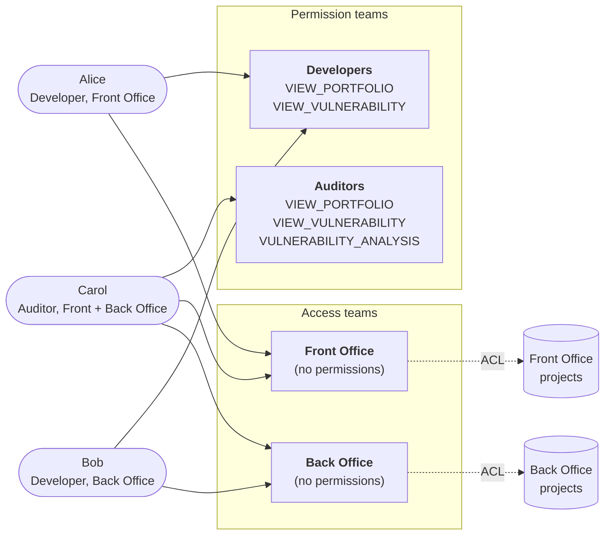

# アクセス制御について

Dependency-Track は、**権限**、**チーム**、**ユーザー**を中心に構成されたロールベースのアクセス制御モデルを使います。権限は、チームに割り当てることも、ユーザーに直接割り当てることもできます。

!!! note "実効権限"

    ユーザーの実効権限は、そのユーザーに直接割り当てられた権限と、そのユーザーが所属するすべてのチームの権限の**和集合**です。チームへの所属によって権限が積集合になったり、格下げされたりすることはありません。

## ユーザー {#users}

ユーザーには 4 つの種類があります。

| 種類            | 説明                                                                                       |
|:----------------|:--------------------------------------------------------------------------------------------------|
| 管理対象ユーザー    | Dependency-Track の中で作成・管理されるローカルアカウントです。                                      |
| LDAP ユーザー       | 外部の LDAP ディレクトリを介して認証されます。[LDAP を設定する](../guides/administration/configuring-ldap.md)を参照してください。 |
| OIDC ユーザー       | OpenID Connect の ID プロバイダーを介して認証されます。[OpenID Connect を設定する](../guides/administration/configuring-oidc.md)を参照してください。 |
| サービスアカウント | 自動化のための、人間以外のアカウントです。自身の API キー、またはワークロード ID フェデレーションで認証します。5.2.0 以降で利用できます。[サービスアカウント](#service-accounts)を参照してください。 |

すべての種類のユーザーが同じ権限モデルを共有します。認証の仕組みが決めるのは、システムがユーザーの身元をどのように検証するかであり、ユーザーが何にアクセスできるかではありません。

### サービスアカウント {#service-accounts}

!!! note "5.2.0 以降で利用可能"

    それより前のバージョンでは、自動化にはチーム API キーしか使えません。

サービスアカウントは、CI パイプライン、スキャナー、スクリプト、その他の自動化ツールのアイデンティティです。ほかのユーザーと同様に、権限を直接、またはチームへの所属を通じて保持し、チームのメンバー一覧に表示されます。

サービスアカウントはログインできません。次の 2 つのいずれかの方法で認証します。

* **ワークロード ID フェデレーション。** ワークロードは、GitHub Actions、GitLab CI、Kubernetes、SPIFFE など、自身のプラットフォームが発行した有効期間の短いトークンを、サービスアカウントのセッションと交換します。[ワークロード ID フェデレーションについて](workload-identity-federation.md)を参照してください。
* サービスアカウントが所有する **API キー**。そのキーを使って行われた各リクエストは、サービスアカウントとして動作します。

どちらの場合も、監査記録にはサービスアカウントのユーザー名が表示されます。サービスアカウントを停止すると、停止を解除するまで、そのすべての API キーが使えなくなり、新たなトークン交換もブロックされます。フェデレーションを通じて作成されたセッションも、ただちに終了します。アカウントを削除すると、その API キーとワークロード ID のバインディングも削除されます。

サービスアカウントのユーザー名は、`svc:ci-pipeline` のように、必ず `svc:` で始まります。ほかのユーザーがこの接頭辞を持つユーザー名を使うことはできません。これにより、LDAP や OIDC のユーザーが初回ログイン時に受け取るはずのユーザー名を、サービスアカウントが先に使ってしまうことを防ぎます。

サービスアカウントを管理するには、`ACCESS_MANAGEMENT` 権限が必要です。

チーム API キーと比べて、サービスアカウントには次の特徴があります。

* ツール同士がチームを共有している場合でも、自動化ツールごとに個別のアイデンティティを与えます。
* 権限を直接受け取るため、あるツールの権限を絞り込むために専用のチームを用意する必要がありません。
* 停止に対応しており、API キーを削除せずにアクセスをブロックできます。
* ワークロード ID フェデレーションを通じて、保存された認証情報なしで認証できます。

!!! tip "自動化に推奨される方法"

    サービスアカウントと[ワークロード ID フェデレーション](workload-identity-federation.md)の組み合わせは、有効期間の長い API キーを保持するためだけに存在するチームを置き換える、戦略的な代替手段です。チーム API キーは引き続きサポートされます。新しい連携はサービスアカウントで始めてください。

## チーム {#teams}

チームは、ユーザーと API キーの名前付きのコレクションです。チームは権限を保持するため、人のグループ(たとえば *Security Engineers*、*Developers*、*CI/CD Pipelines*)や自動化システムのアクセスを簡単に管理できます。

ユーザーは複数のチームに所属でき、所属するすべてのチームの権限の和集合を継承します。権限はユーザーに直接割り当てることもできます。それらの権限は、ユーザーがチームから継承した権限に追加されます。

基本的には、チーム単位での割り当てを優先してください。ユーザーへの直接の権限付与は、専用のチームを作るほどではない例外の場合に限って控えめに使ってください。

チーム API キーはチームに属し、そのチームと同じ権限を持ちます。チーム API キーは、リクエストを特定のアイデンティティに結び付けずに、自動化されたアクセス(CI/CD パイプライン、連携)を認証します。5.2.0 以降では、[サービスアカウント](#service-accounts)がチーム API キーに取って代わります。サービスアカウントは独自のアイデンティティと権限を持ち、保存された認証情報をまったく使わずに認証することもできます。

チームを削除すると、そのチームの API キーと、そのチームを通じて行われたプロジェクトへのアクセスの割り当ても削除されます。プロジェクト、ユーザーアカウント、サービスアカウントが所有する API キーは残りますが、ユーザーは削除されたチームから継承していた権限を失います。

## ポートフォリオのアクセス制御 {#portfolio-access-control}

デフォルトでは、`VIEW_PORTFOLIO` を持つすべてのプリンシパルがすべてのプロジェクトを参照できます。ポートフォリオのアクセス制御(PAC)は、この可視性を制限し、チームが明示的に割り当てられたプロジェクトに対してのみ操作できるようにします。プロジェクトごとの割り当て済みチームの一覧が、そのプロジェクトのアクセス制御リスト(ACL)です。

PAC を有効にすると、ACL への所属が、プロジェクトに対するすべての操作(参照、BOM のアップロード、編集、削除、脆弱性のトリアージ)の可否を決めます。ポートフォリオの権限(`VIEW_PORTFOLIO`、`PORTFOLIO_MANAGEMENT_UPDATE` など)は、*必要条件ではあっても十分条件ではなく*なります。プリンシパルは、該当する権限を持ち、**かつ**プロジェクトの ACL に含まれるチームに所属している必要があります。

PAC は **Administration > Access Management > Portfolio Access Control** で有効にします。

!!! warning "PAC を有効にすると既存のプロジェクトに影響する"

    既存のプロジェクトのデータは保持されますが、チームの割り当てがない状態から始まります。管理者(または `PORTFOLIO_ACCESS_CONTROL_BYPASS` を持つプリンシパル)が各プロジェクトに少なくとも 1 つのチームを割り当てるまで、それらのプロジェクトは管理者以外のすべてのユーザーから見えなくなります。本番環境のインスタンスで PAC を有効にする前に、割り当ての展開を計画してください。

PAC が最も役立つのは、異なるチームが互いのプロジェクトを見るべきでないマルチテナントのシナリオです。単一チームやオープンな環境では、PAC はセキュリティ上の利点がないまま管理の負担を増やします。

### PAC と権限の関係 {#how-pac-interacts-with-permissions}

権限と ACL は互いに独立しています。

* **権限**は、BOM のアップロード、プロジェクトの編集、脆弱性のトリアージなど、*プリンシパルが何をできるか*を定義します。権限はプリンシパルに対してグローバルです。このモデルにはプロジェクトごとの権限はありません。
* **ACL** は、*プリンシパルがどのプロジェクトに対してそれを行えるか*を定義します。ACL は読み取りと書き込みの両方の可否を決めますが、プリンシパルが持つ機能は変えません。

プロジェクトに対して操作するには、プリンシパルは該当する権限*と*、そのプロジェクトへの ACL によるアクセスの両方を必要とします。`PORTFOLIO_MANAGEMENT_UPDATE` を持つユーザーは、ACL によるアクセス権を持つすべてのプロジェクトを編集でき、アクセス権を持たないプロジェクトは 1 つも編集できません。プロジェクトの ACL からチームを外すと、そのチームのそのプロジェクトへのアクセスは取り消されますが、ほかの場所でのそのチームの権限は変わりません。

### パターン: 権限チームとアクセスチームを分ける {#pattern-separating-permission-teams-from-access-teams}

権限と ACL は独立して組み合わさるため、役割によってチームを分けるのが便利なパターンです。

* **権限チーム**は機能(`VIEW_PORTFOLIO`、`VULNERABILITY_ANALYSIS` など)を持ちますが、どのプロジェクトにも割り当てられません。
* **アクセスチーム**は権限を持ちませんが、一部のプロジェクトに割り当てられます。

ユーザーは、それぞれの種類のチームに 1 つずつ参加します。ユーザーの実効的な権利は、所属するすべてのチームの権限の和集合を、所属するすべてのチームの ACL による付与の和集合の範囲に限定したものになります。これにより、モデルが直接サポートしていなくても、プロジェクトごとの権限を再現できます。

*Front Office* と *Back Office* のポートフォリオを持つ組織の場合は次のようになります。

その結果、実効的なアクセスは次のようになります。

| ユーザー  | 参照できるもの                              | 脆弱性をトリアージできる対象 |
|:------|:--------------------------------------|:------------------------------|
| Alice | Front Office のプロジェクト                 | なし                          |
| Bob   | Back Office のプロジェクト                  | なし                          |
| Carol | Front Office と Back Office のプロジェクト | 両方のポートフォリオ               |

新しいドメインを追加する場合は、新しいアクセスチームを 1 つ作成し、その ACL を割り当てるだけで済みます。既存のユーザーにそのドメインのアナリストの権利を与えるのは、プロジェクトごとの編集ではなく、チームの所属の変更です。

### プロジェクト階層による継承 {#inheritance-through-the-project-hierarchy}

ACL による付与は、プロジェクト階層を下へ継承されます。親プロジェクトへのアクセスをチームに付与すると、現在および将来のすべての子孫へのアクセスが付与されます。通常は、すべての末端のプロジェクトにチームを割り当てるよりも、プロジェクトツリーの最上位で割り当てるほうが適しています。

### PAC をバイパスする {#bypassing-pac}

`PORTFOLIO_ACCESS_CONTROL_BYPASS` 権限を持つプリンシパルは、PAC の対象から完全に除外され、PAC が無効であるかのようにすべてのプロジェクトを参照できます。この権限は、管理者と、ポートフォリオ全体にわたって正当に操作する必要がある信頼できる自動化だけに与えてください。

### PAC のもとでのプロジェクトの作成 {#project-creation-under-pac}

チーム API キーまたはサービスアカウントがプロジェクトを作成する場合(たとえば、`PROJECT_CREATION_UPLOAD` を使った BOM のアップロード)、Dependency-Track は、そのキーまたはアカウントが所属するチームのうちアルファベット順で最初のチームを新しいプロジェクトの ACL に追加します。どのチームにも所属していないサービスアカウントの場合、ACL にはチームが追加されません。

ユーザーがプロジェクトを作成する場合は、自分が所属するチームの中から所有チームを指定する必要があります。選択したチームが新しいプロジェクトの ACL に追加されます。チームの割り当てなしで作成されたプロジェクトは、チームが割り当てられるまで、管理者と `PORTFOLIO_ACCESS_CONTROL_BYPASS` の保持者以外の誰からも見えません。

## 関連項目 {#further-reading}

* 権限の一覧とデフォルトのチームについては、[権限リファレンス](../reference/permissions.md)を参照してください。
* サービスアカウントが保存された認証情報なしで認証する方法については、[ワークロード ID フェデレーションについて](workload-identity-federation.md)を参照してください。
* Dependency-Track がプロジェクト、階層、コレクションプロジェクトをどのようにモデル化しているかについては、[プロジェクトについて](projects.md)を参照してください。
