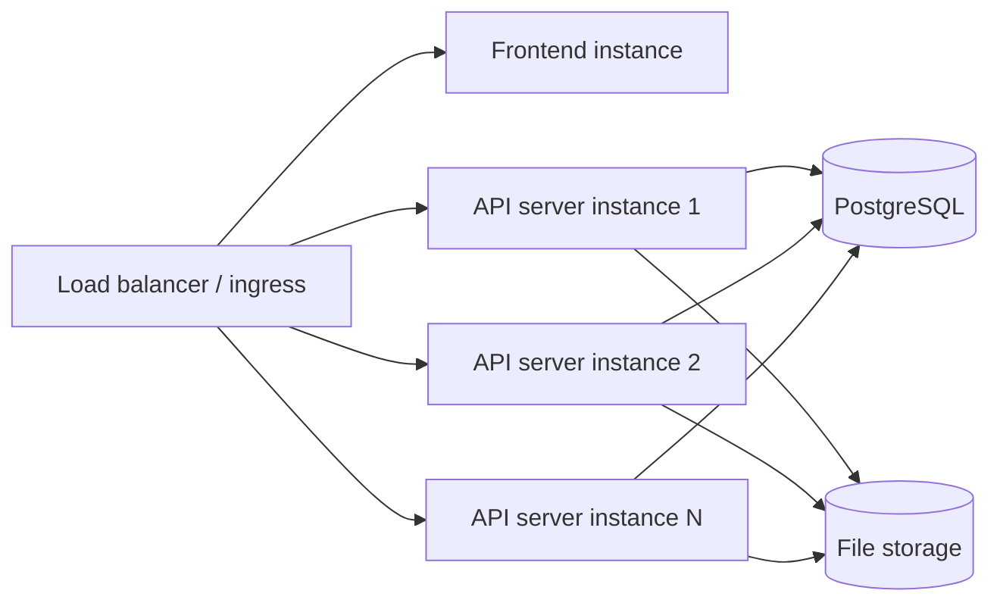

# デプロイのトポロジー

このページでは、Dependency-Track クラスターがどのように組み合わさっているか、つまり、どのコンポーネントが必要か、それらがどのように通信するか、個々のインスタンスに障害が起きたときに何が起こるかを説明します。運用の手順を説明している[本番環境にデプロイする](../../guides/administration/deploying-to-production.md)を補完するページです。

## コンポーネント {#components}

本番環境のデプロイは 4 つのコンポーネントで構成され、通常は同じイングレスの背後に置かれます。

- **API サーバー。** ポート `8080` で REST API を公開し、バックグラウンドワーカーを実行する Java サービスです。PostgreSQL とファイルストレージにコミットした内容以外の状態を持ちません。1 つ以上のインスタンスを並べて実行します([協調](#coordination)を参照)。各インスタンスは、ヘルスチェックとメトリクス用に、ポート `9000` で別の管理サーバーも公開します。
- **PostgreSQL。** プロダクトのデータ、永続実行エンジンのワークフローの記録、ノード間の協調に関する唯一の信頼できる情報源です。
- **ファイルストレージ。** 短期間だけ使う中間ファイル(アップロードされた BOM、分析の成果物)を保存する共有ストアです。共有の永続ボリューム(`local` プロバイダー)か、S3 互換のバケット(`s3` プロバイダー)のいずれかを使います。[ファイルストレージ](../../reference/configuration/file-storage.md)を参照してください。
- **フロントエンド。** 静的アセットを Nginx で配信するコンテナーイメージとして配布される、Vue.js のシングルページアプリケーションです。状態を持ちません。1 つ以上のインスタンスを、API サーバーと並べてイングレスの背後で実行します。ブラウザーは API サーバーの REST API を直接呼び出すため、フロントエンドのコンテナーが API トラフィックをプロキシしたり集約したりすることはありません。

## 協調 {#coordination}

API サーバーのインスタンスは、PostgreSQL を介してのみ協調します。インスタンス同士がネットワークで接続できる必要はなく、PostgreSQL とファイルストレージに接続できれば十分です。クラスターは、ピアツーピアのプロトコルも、ゴシップも、`LISTEN` / `NOTIFY` も使いません。

これは運用に直接影響します。

- すべてのインスタンスがデータベースとファイルストアに到達できる限り、クラスターはアベイラビリティーゾーン、ネットワーク名前空間、仮想プライベートクラウドをまたいで動作します。
- インスタンスを追加または削除しても、ほかのインスタンスの設定を変更する必要はありません。
- インスタンス間のネットワーク分断は表面化しません。それぞれの側が、データベースから読み取れる内容を独立して参照します。

### リーダー選出 {#leader-election}

一部の処理は、常にちょうど 1 つのインスタンスで実行する必要があります。永続実行エンジンのタスクスケジューラーとメンテナンスワーカーです。エンジンはリースに基づくリーダー選出を使います。正常なシャットダウンではリーダーがリースを解放し、クラッシュした場合はリースが期限切れになってほかのインスタンスが引き継ぎます。仕組みについては、[リーダー選出](design/durable-execution.md#leader-election)を参照してください。

### タスクの分散 {#task-distribution}

エンジンは、バックグラウンド処理をすべてのインスタンス(web と worker を分離している場合は、worker プロファイルのすべてのインスタンス)に分散します。タスクの取得は、クラスター全体で並行処理に対して安全で、ロックを使いません。

## インスタンスの障害からの復旧 {#recovery-from-instance-failure}

永続実行エンジンは、インスタンスの喪失を日常的なイベントとして扱います。

- **インスタンスが停止した場合。** そのインスタンスがリーダーのリースを保持していた場合も、アクティビティを実行していた場合も、ほかのインスタンスが引き継ぎます。ほかのインスタンスがリースを取り直し、未完了のワークフロー実行は、実行履歴に最後に記録されたイベントから再開します。再生のモデルについては、[永続実行](design/durable-execution.md#execution-model)を参照してください。
- **すべてのインスタンスが停止した場合。** 少なくとも 1 つのインスタンスが復帰すると、PostgreSQL が保持している状態からスケジューリングと実行が再開します。データベースが失われない限り、処理が失われることはありません。

ファイルストレージの障害は、データベースの障害と同じようには扱われません。中間ファイルはベストエフォートです。ストアが利用できない場合やファイルが失われた場合、処理中のワークフローは失敗し、クライアントがアップロードを再試行します。

## 単一インスタンスのデプロイ {#single-instance-deployments}

単一インスタンスのデプロイは、運用上は複数インスタンスのデプロイと同じです。同じコード、同じリーダー選出の仕組み、同じ復旧経路を使います。唯一の違いは、インスタンスの再起動中にフェイルオーバーする先がないことです。そのため、デプロイやクラッシュの間はクラスターを利用できません。
