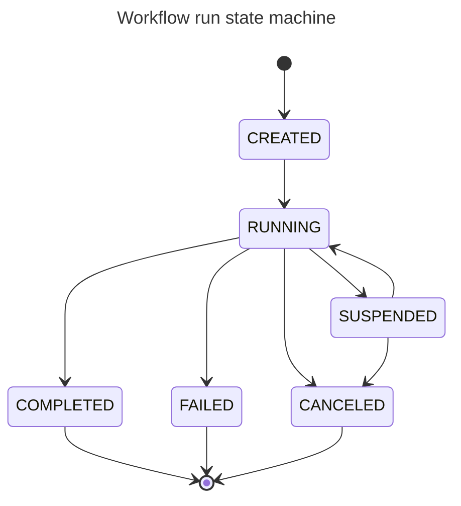
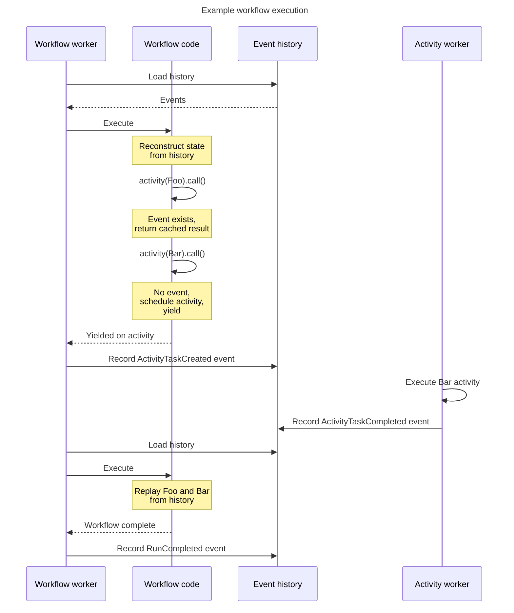
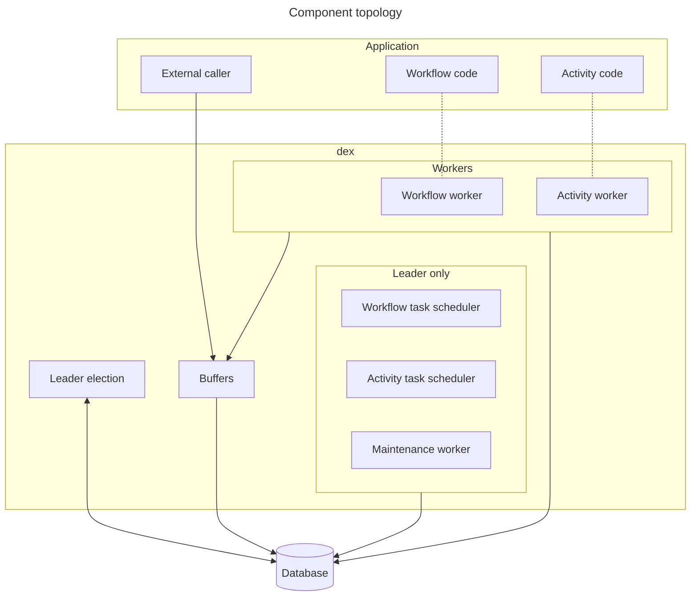
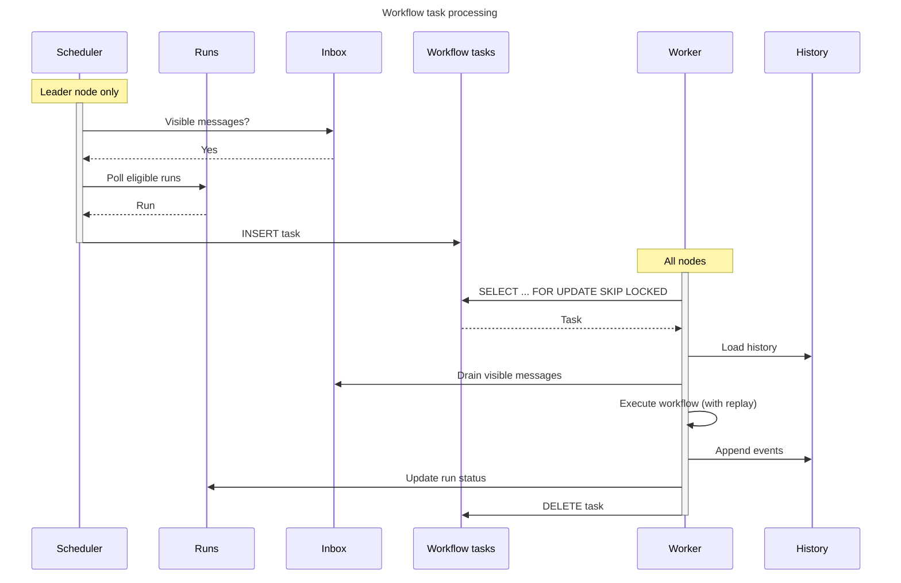
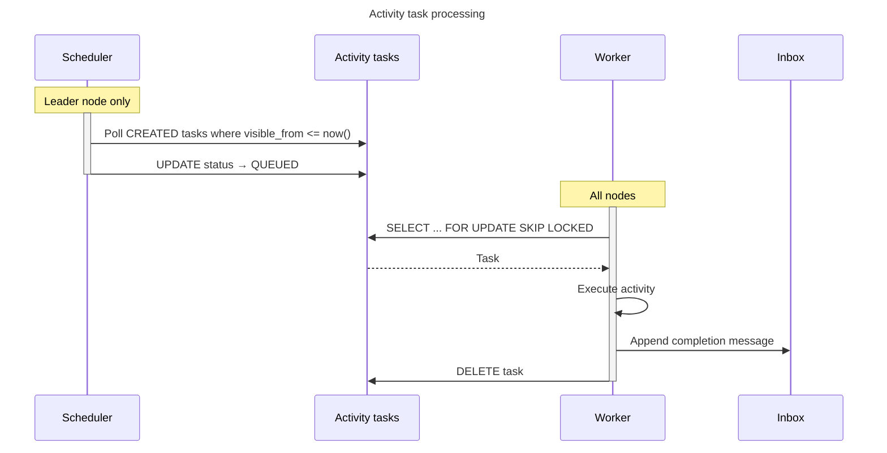
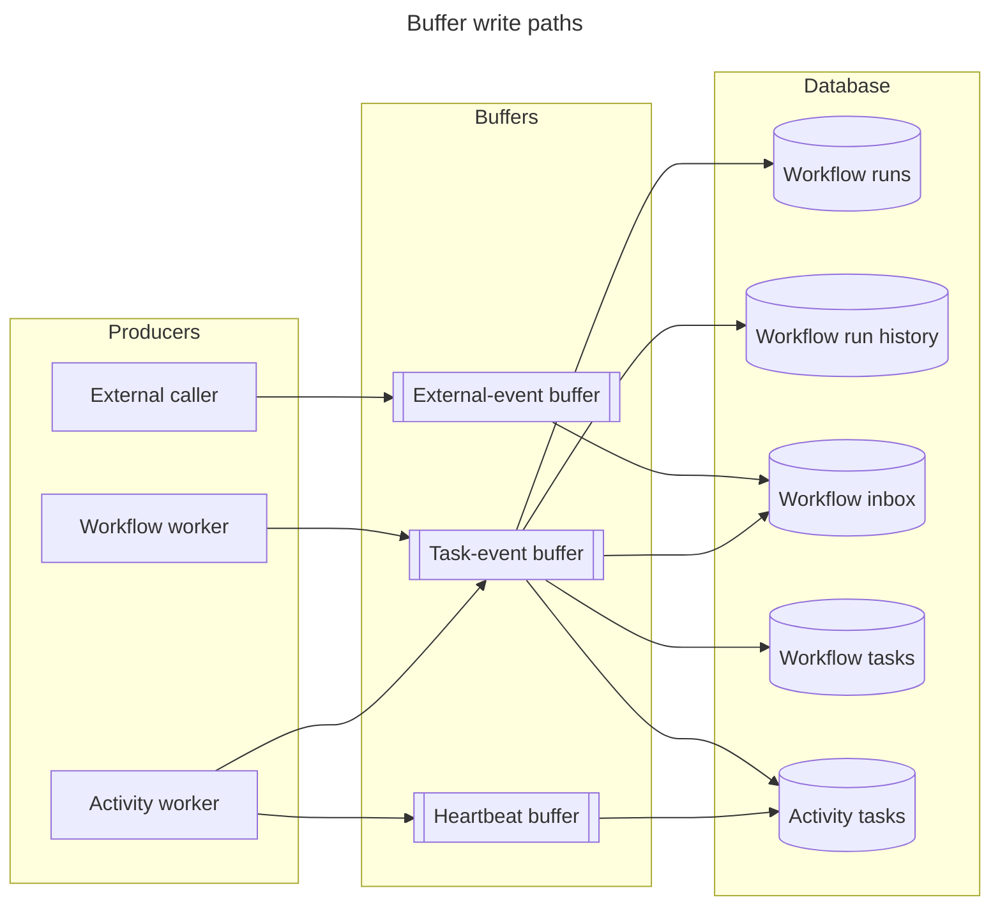

# 永続実行

## 概要 {#overview}

永続実行エンジン(コードと設定では `dex` と略します)は、長時間かかる可能性のあるプロセスを、高い信頼性とスケーラビリティで実行する組み込みのエンジンです。

このエンジンは [Temporal] と Microsoft の [Durable Task Framework] を参考にしています。Dependency-Track の要件に合わせて専用に構築され、PostgreSQL 向けに最適化されています。

## 中核となる概念 {#core-concepts}

### 永続実行 {#durable-execution_1}

永続実行とは、(長時間かかる可能性のある)プロセスの状態と進捗を自動的に永続化し、障害や再起動を乗り越えられるようにするプログラミングモデルです。

!!! note
    このエンジンは [Temporal] を大いに参考にしているため、その概念と用語の大半を採用しています。ほかのエンジンでは名前が異なる概念もあります。たとえば、Durable Task では *workflow* の代わりに *orchestration* という用語を使います。

[Temporal] と同様に、エンジンは[ワークフロー](#workflow)の完了したステップをすべてイベントとしてデータベースに記録します。プロセスがクラッシュしたり再起動したりした場合、ワークフローはイベント履歴をリプレイすることで、中断した場所から自動的に再開します。これにより、状態管理や再試行のロジックを手作業で実装しなくても、ワークフローは障害に強くなります。

永続実行では、ワークフローがいったん開始されると、一時的な障害が繰り返し発生しても完了まで実行されることが保証されます。

### ワークフロー {#workflow}

ワークフローとは、実行する一連のステップを形式的に記述したものです。ワークフローは通常の Java コードとして記述しますが、履歴を確実にリプレイできるように、*決定的で副作用がない*ものでなければなりません。ワークフローの唯一の目的はオーケストレーション、つまり作業を直接行うことではなく、作業の順序を決めて調整することです。

ワークフローは[アクティビティ](#activity)の呼び出し、[タイマー](#timer)の作成、子ワークフローの生成、[外部イベント](#external-event)の待機を行えます。

### ワークフローインスタンス {#workflow-instance}

ワークフローインスタンスとは、[ワークフロー](#workflow)を具体的にインスタンス化したものです。

インスタンスは複数回実行できますが、非終了状態にある実行は、どの時点でも 1 つしか存在できません。

エンジンでは、各インスタンスに*インスタンス ID* があり、クライアントはワークフローの開始時にこれを指定します。

インスタンス ID の一意性制約は、非終了状態にある実行にのみ適用されます。前の実行が終了した直後に、2 つの呼び出し元が同じインスタンス ID でワークフローを同時に開始しようとすると、両方とも成功することがあります。インスタンス ID の一意性は非終了状態の実行を対象とした緩い保証であり、すべての世代にまたがるグローバルなロックではありません。

### アクティビティ {#activity}

アクティビティとは、非決定的な操作を形式的に記述したものです。外部システムとのやり取り、より一般的には I/O はここで行われます。

アクティビティは、それを「所有する」ワークフローの実行とは非同期に実行されるため、ワークフローをブロックしません。

実際には、アクティビティの呼び出しは従来のバックグラウンドジョブのように動作します。

アクティビティは失敗することがあり、その場合エンジンが透過的に再試行します。再試行の動作は、呼び出しごとに再試行ポリシーでカスタマイズできます。アクティビティは**少なくとも 1 回**実行されます。実行中にクラッシュしたワーカーのロックは期限切れによって解放され、別のワーカーが同じタスクを取得します。アクティビティは[べき等][idempotent]でなければなりません。

### ワークフロー実行 {#workflow-run}

ワークフロー実行とは、ワークフローの 1 回の実行です。各実行は一意の識別子を持ち、完全なイベント履歴を保持します。この履歴によって、復旧のためのリプレイが可能になり、決定的な動作が保証されます。

実行には次のメタデータを持たせることができます。

* **同時実行キー**: 同じキーを持つ実行を直列化します。順序と飢餓状態のセマンティクスについては[同時実行制御](#concurrency-control)を参照してください。
* **優先度**: 実行順序に影響します。優先度の高い実行が先に実行されます。
* **ラベル**: 任意のキーと値のメタデータです。

実行は次の状態を遷移します。

`CREATED`、`RUNNING`、`SUSPENDED` は*非終了*状態です。`COMPLETED`、`FAILED`、`CANCELED` は*終了*状態で、実行がいったん終了状態になると、そこから遷移することはありません。

### タイマー {#timer}

タイマーは、ワークフローの実行の中で永続的な遅延を提供します。

通常のスリープとは異なり、エンジンはタイマーをワークフロー実行のイベント履歴に記録するため、タイマーは決定的でリプレイしても安全です。

### 外部イベント {#external-event}

外部イベントとは、エンジンの外部からワークフロー実行に送られるメッセージです。

外部イベントを使うと、ワークフローは一時停止して、承認の通知、Webhook のコールバック、ステータスの更新など、外部システムやユーザーからのシグナルを待機できます。各イベントは一意の識別子を持ち、任意でペイロードデータを含めることができます。

### タスク {#task}

タスクとは、[ワークフロー実行](#workflow-run)または[アクティビティ](#activity)を進めるためにエンジンが生成する作業の単位です。

エンジンはタスクを[タスクキュー](#task-queue)にスケジュールし、[タスクワーカー](#task-worker)がそこからタスクを取得します。

### タスクキュー {#task-queue}

タスクキューとは、エンジンが[タスク](#task)を実行のためにスケジュールする、名前付きのキューです。

タスクキューは作業を整理して[ワーカー](#task-worker)に分配します。各キューには種類(*workflow* または *activity*)があり、容量と現在の深さ(保留中のタスクの数)を追跡します。ワークフローとアクティビティは、自身のタスクをどのキューに振り分けるかを指定します。

キューによって関心を分離できます。異なるワーカーがそれぞれ異なる種類の作業に特化でき、ワークロード間でリソースを分離できます。

!!! note
    エンジンでは、キューはスケーリングの手段にもなります。各タスクキューは物理的に別のテーブル[パーティション](https://www.postgresql.org/docs/current/ddl-partitioning.html#DDL-PARTITIONING-OVERVIEW)に格納されます。

キューの容量は実行時に変更でき、クラスター全体に対するグローバルなスロットルとして機能します。キューを完全に*一時停止*することもできます。

### タスクワーカー {#task-worker}

タスクワーカーは、キューからタスクをポーリングして実行します。ワーカーはワークフロータスクとアクティビティタスクのどちらか一方を処理し、両方を処理することはありません。各ワーカーは*ちょうど 1 つ*のキューからポーリングします。

## データモデル {#data-model}

エンジンの状態は、少数の PostgreSQL テーブルに格納されます。テーブル名にはすべて `dex_` というプレフィックスが付きます。

| テーブル | 目的 | 備考 |
|:---|:---|:---|
| `dex_lease` | [リーダー選出](#leader-election)で使うリーダーシップのリースを保持します。 | `UNLOGGED`。設計上、一時的なデータです。 |
| `dex_workflow_run` | 実行の状態: ステータス、同時実行キー、優先度、ラベル、スティッキネス、ライフサイクルのタイムスタンプ。 | 実行の状態の信頼できる情報源です。 |
| `dex_workflow_history` | 実行ごとの追記専用のイベントログ。ペイロードは Protobuf でシリアライズされた `WorkflowEvent` です。 | 連続する UUIDv7 の挿入を分散させるため、`workflow_run_id` で 8 つのパーティションにハッシュパーティション分割されます。 |
| `dex_workflow_inbox` | 実行宛ての保留中のメッセージ(外部イベント、アクティビティの完了、タイマーの発火)。 | `visible_from` によって配信を遅延でき、タイマーやアクティビティの再試行のスケジューリングに使われます。 |
| `dex_workflow_task_queue` | ワークフローキューのメタデータ: 容量、ステータス(`ACTIVE` / `PAUSED`)。 | [ワークフロータスクスケジューラー](#workflow-task-scheduler)が容量を強制します。 |
| `dex_workflow_task` | 実行待ちのワークフロータスク。主キーは `(queue_name, workflow_run_id)` です。 | `UNLOGGED`、キューごとにリストパーティション分割されます。クラッシュ後、次のスケジューラーのポーリングで再構築されます。 |
| `dex_activity_task_queue` | アクティビティキューのメタデータ: 容量、ステータス。 | ワークフローキューのメタデータテーブルと同じ役割です。 |
| `dex_activity_task` | 実行待ちのアクティビティ呼び出し。引数、再試行ポリシー、試行回数を保持します。 | キューごとにリストパーティション分割されます(引数と再試行の状態は履歴から再構築できないため、ログ記録されます)。 |

`dex_workflow_task` の主キー `(queue_name, workflow_run_id)` によって、**実行ごとにキューに入るワークフロータスクは最大 1 つ**であることが保証されます。タスクがすでにキューに入っている間に届いた作業をまとめる処理は必要ありません。同時に行われた挿入は主キーで衝突します。

`dex_workflow_inbox` は、エンジンのメッセージルーティングの基盤です。実行がスケジューリングの対象になるのは、`visible_from <= now()` を満たすインボックスの行が少なくとも 1 つある場合**に限ります**。アクティビティの完了、タイマーの発火、子の実行の完了、外部イベント、実行制御のシグナル(キャンセル / 一時停止 / 再開)は、すべてインボックスを経由します。

## 実行モデル {#execution-model}

エンジンは、イベントソーシングによって永続性を実現します。ワークフローが実行されると、エンジンは完了したステップごとにイベントを記録します。実行が予期せず停止した場合、ワークフローは記録された履歴をリプレイして再開します。

リプレイ中、ワークフローのコードは再実行されますが、エンジンは副作用をスキップします。代わりに、完了したステップの結果を履歴から返します。そのため、ワークフローのコードは決定的でなければなりません。同じ履歴が与えられたら、同じ判断を下す必要があります。記録された履歴と一致しないアクティビティをコードが要求した場合、エンジンは決定性エラーで実行を失敗させます。

!!! note "関連項目"
    リプレイ中に決定的な*制御フロー*が保たれなければならない一方で、副作用そのものはべき等でありさえすればよい理由を第一原理から論じたものとして、Jack Vanlightly の [Demystifying determinism in durable execution][jvl-determinism] を参照してください。

### リプレイ時のブロッキング {#replay-time-blocking}

完了イベントがまだ履歴にないアクティビティ、タイマー、または子の実行の結果をワークフローのコードが待機すると、エンジンは*イールド*します。つまり、ワークフローがこのターンで生成したイベント(たとえば `ActivityTaskCreated`)を永続化し、ワークフロータスクのロックを解除して、別の作業に移ります。対応する完了メッセージが `dex_workflow_inbox` に届いた時点で、実行は再びスケジューリングの対象になります。

このモデルにより、ワークフローごとにスレッドを専有することなく、高い並行性を実現できます。また、実行がマシンをまたいだり、プロセスの再起動を挟んだりして一時停止と再開を繰り返す場合でも、ワークフロー本体の制御フローを通常の同期コードのように読めるようになります。

### イベントの種類 {#event-types}

`WorkflowEvent` のサブジェクトの一覧は次のとおりです。

| カテゴリ | イベント |
|:---|:---|
| 実行 | `RunCreated`、`RunStarted`、`RunSuspended`、`RunResumed`、`RunCanceled`、`RunCompleted` |
| タスク | `WorkflowTaskStarted`、`WorkflowTaskCompleted` |
| アクティビティ | `ActivityTaskCreated`、`ActivityTaskCompleted`、`ActivityTaskFailed` |
| 子の実行 | `ChildRunCreated`、`ChildRunCompleted`、`ChildRunFailed` |
| タイマー | `TimerCreated`、`TimerElapsed` |
| その他 | `SideEffectExecuted`、`ExternalEventReceived` |

### 副作用と `continueAsNew` {#side-effects-and-continueasnew}

次の 2 つのプリミティブは、永続性を犠牲にすることなく、厳格な決定性の契約から制御された形で逃れる手段を提供します。

* **副作用。** 副作用は任意のコードブロックを 1 回だけ実行し、その結果を `SideEffectExecuted` イベントとして記録して、以降のリプレイでは毎回記録された値を返します。生成された識別子やタイムスタンプなどの非決定的な値は、このしくみによってリプレイを壊さずにワークフローに取り込まれます。
* **Continue-as-new。** Continue-as-new は実行のイベント履歴を切り詰め、実行の `continued_as_new_generation` カウンターをインクリメントし、同じ実行メタデータ(ワークフロー名、バージョン、キュー、同時実行キー、インスタンス ID、優先度、ラベル)と新しい引数で新たな実行を開始します。リプレイのコストは履歴の長さに比例して増えるため、定期的なスケジューラーのような長期間存続するワークフローは、continue-as-new によって履歴を一定の範囲に抑えます。

## エンジンのアーキテクチャ {#engine-architecture}

### 概要 {#overview_1}

エンジンは次のコンポーネントで構成されています。

* **ワークフロータスクスケジューラー**: 対象となるワークフロー実行からワークフロータスクを作成します([ワークフロータスクスケジューラー](#workflow-task-scheduler)を参照)。
* **アクティビティタスクスケジューラー**: アクティビティタスクをキューに入った状態に遷移させます([アクティビティタスクスケジューラー](#activity-task-scheduler)を参照)。
* **ワークフロータスクワーカー**: 履歴をリプレイしながらワークフローのコードを実行します([実行モデル](#execution-model)を参照)。
* **アクティビティタスクワーカー**: アクティビティのコードを実行します。
* **メンテナンスワーカー**: 古い終了済みの実行を削除して保持期間を適用します([メンテナンス](#maintenance)を参照)。
* **リーダー選出**: クラスター内で単一インスタンスによる操作を調整します([リーダー選出](#leader-election)を参照)。
* **バッファー**: 頻繁に発生する小さな書き込みをバッチにまとめます([バッファリング](#buffering)を参照)。

スケジューラーとメンテナンスワーカーはリーダーでのみ動作します。ワーカーはすべてのノードで動作し、アプリケーションが登録したワークフローとアクティビティのコードをホストします(点線)。読み取り(タスクのポーリング、履歴の読み込み、インボックスの取り出し)はデータベースに直接行われます。書き込みはバッファーを経由し、これがエンジンの[バックプレッシャー](#buffering)の動作を生み出しています。どのプロデューサーがどのバッファーに書き込み、どのバッファーがどのテーブルに書き込むかについては、[バッファリングのセクション](#buffering)で詳しく説明します。

デフォルトでは、シンプルにするため、エンジンは Dependency-Track のメインアプリケーションと同じデータベースを使います。大規模なデプロイでは、[`dt.dex-engine.datasource.name`](../../../reference/configuration/properties.md#dtdex-enginedatasourcename) で別のデータベースインスタンスを使うように設定し、エンジンの負荷をアプリケーションから分離できます。

### リーダー選出 {#leader-election}

一部の操作は、クラスター内の単一のノードで実行されます。たとえば次のものです。

* メンテナンス
* タスクのスケジューリング

エンジンは Kubernetes のコントローラーを参考にした、`dex_lease` テーブルを使うシンプルなリースベースのしくみを使います。テーブルの各行は名前付きのリース 1 つ(現在は `leadership` リースのみ)を表し、現在の保持者の ID と有効期限のタイムスタンプを持ちます。

クラスター内のすべてのノードは定期的に([`dt.dex-engine.leader-election.lease-check-interval-ms`](../../../reference/configuration/properties.md#dtdex-engineleader-electionlease-check-interval-ms))、一定期間([`dt.dex-engine.leader-election.lease-duration-ms`](../../../reference/configuration/properties.md#dtdex-engineleader-electionlease-duration-ms))のリーダーシップのリースの取得を試みます。次の 3 つのケースはすべて、1 つのアトミックなステートメントで処理されます。

* リースが存在しない場合、行を作成したノードがリーダーになります。
* このノードがすでにリースを保持している場合、ノードは有効期限を延長します(更新)。
* 別のノードがリースを保持しているが、リースの有効期限が切れている場合、新しいノードがリースを引き継ぎます。

それ以外のすべてのケースでは、取得の試みは何も行わず、そのノードはリーダーになりません。

データベースのタイムアウトなどにより取得の試みを完了できなかったノードは、自分のリースが*失われた*とみなします。これにより[スプリットブレイン](https://en.wikipedia.org/wiki/Split-brain_(computing))の可能性は低くなりますが、なくなるわけではありません。グレースフルシャットダウンの際、リーダーはリースを明示的に解放するため、別のノードは有効期限を待たずに引き継げます。

`dex_lease` テーブルは [`unlogged`][unlogged] であり、[WAL] への書き込みを発生させません。リースは設計上一時的なものです。すべてのノードが次の試行でリースを再取得するため、データベースの再起動でリースが失われても問題ありません。

!!! warning "フェンシングトークンはありません"
    リースはリーダーシップを付与しますが、データベースがすべての書き込みで検証するフェンシングトークンは生成しません。リースを失うほど長く停止したリーダーは、すでに処理中の作業を取り消せないため、新しいリーダーとの短い重複が発生する可能性があります。

    代わりに、エンジンは `dex_workflow_run` の一意な[部分インデックス](https://www.postgresql.org/docs/current/indexes-partial.html)を事実上のフェンシング層として利用します。重複したスケジューラーが、同時実行キーを共有する 2 つの実行を同時に実行させることはありません。データベースが 2 つ目の `RUNNING` への遷移を拒否するためです。

    スプリットブレインの期間中に観測される症状は、競合に負けたノードでの制約違反エラー、キュー容量の一時的な超過(各リーダーがそれぞれキューの深さの独自のスナップショットを見るため)、メンテナンスのバッチでの作業の重複(べき等で無害)です。実行の正しさは保たれます。スロットリングとオブザーバビリティは結果整合性です。

### タスクのスケジューリング {#task-scheduling}

エンジンには 2 つの独立したスケジューラーがあり、どちらもリーダーノードで動作します。

#### ワークフロータスクスケジューラー {#workflow-task-scheduler}

ワークフロー実行からタスクを作成します。既知のキューごとに、次の条件を満たすワークフロー実行を選び、`dex_workflow_task` に最大 `capacity - depth` 行を挿入します。

* 非終了状態(`CREATED`、`RUNNING`、`SUSPENDED`)である。
* `visible_from <= now()` を満たす行が `dex_workflow_inbox` に少なくとも 1 つある。
* このキューについて、`dex_workflow_task` にまだ行がない。
* 同時実行キーによる直列化を守る。実行が `CREATED` 状態で `concurrency_key` を持つ場合、そのキーで最も優先度の高い `CREATED` の実行であり、そのキーを持つほかの実行が `RUNNING` または `SUSPENDED` ではなく、そのキーのタスクがまだキューに入っていない必要があります。
* キューを `capacity` を超えて埋めない。

対象となる実行が見つからない場合、スケジューラーは指数バックオフでポーリングの間隔を空けてスリープします。ワーカーはタスクを完了するとすぐにスケジューラーを起こすため、`LISTEN`/`NOTIFY` を使わなくてもアイドル時のレイテンシーは低く保たれます。この起動はノード内に限られます。ノード B のワーカーがノード A のスケジューラーを起こすことはできません。

#### アクティビティタスクスケジューラー {#activity-task-scheduler}

アクティビティタスクを作成するのはスケジューラーではなく、ワークフローの実行です(ワークフローがアクティビティを呼び出したとき)。スケジューラーはタスクを `CREATED` から `QUEUED` ステータスに遷移させ、ワーカーから見えるようにします。

この 2 段階の設計が存在するのは、アクティビティタスクが再試行の遅延に使う `visible_from` タイムスタンプを持つためです。`visible_from` が未来の時刻になっている `CREATED` ステータスのタスクは、まだ実行の対象になりません。スケジューラーは `visible_from <= now()` を満たすタスクをポーリングし、`QUEUED` に遷移させます。

スケジューラーの呼び出しとワーカーの呼び出しはいずれも `dex_activity_task` に同時にアクセスする可能性があるため、スケジューラーは [`FOR NO KEY UPDATE SKIP LOCKED`][skip-locked] を使って、キューをまたいだロックの競合とデッドロックを回避します。

#### キュー {#queue}

エンジンは、各タスクキューを PostgreSQL の別々のテーブルパーティションに格納します。パーティションは新しいキューが登録されたときに動的に作成されます。これにより、ワークロード間が分離され、データベースは各キューのデータを独立して管理できます。

キューには、実行時に変更できる 2 つのプロパティがあります。

* **容量**: 保留中のタスクの上限です。キューが容量に達するとスケジューラーはタスクの作成を停止し、バックプレッシャーをかけます。
* **ステータス**: キューを一時停止して、スケジューラーが新しいタスクを追加しないようにできます。

スケジューラーは各タスクに、ワークフロー実行から継承した優先度(0-100)を割り当てます。ワーカーは優先度の高いタスクから取得します。優先度が同じ場合は、作成順に取得します。

### タスクの処理 {#task-processing}

#### ワークフロータスク {#workflow-tasks}

スケジューラーは対象となるワークフロー実行をポーリングし、`dex_workflow_task` テーブルにタスクを挿入します。ワーカーはこのテーブルからポーリングしてワークフローを実行し、実行の状態と履歴を更新します。

各ワークフロータスクには、ワーカーが一定時間保持するロックがあり、その時間はワークフローごとに登録時に設定します。ワーカーはタスクを取得するときに `locked_until = now() + lockTimeout` を設定します。ワーカーがクラッシュした場合、`locked_until` を過ぎるとタスクはほかのワーカーから取得できるようになります。ワークフロータスクはハートビートをサポートしないため、ロックのタイムアウトはワークフロー本体の実時間の予算をカバーできる長さにする必要があります。短すぎると不要な再実行が発生します。長すぎると、クラッシュした作業が滞留したままになります。

クラッシュ後、`dex_workflow_task` のパーティションのデータは失われます(`UNLOGGED` であるため)。明示的な復旧処理は実行されません。スケジューラーの次のポーリングサイクルで、可視のインボックスメッセージが残っているすべての実行についてタスクの行が作り直されます。

#### アクティビティタスク {#activity-tasks}

アクティビティタスクを作成するのはスケジューラーではなく、ワークフローの実行です。スケジューラーは、`visible_from` タイムスタンプを過ぎたタスクを `CREATED` から `QUEUED` に遷移させ、ワーカーから見えるようにします。

長時間実行されるアクティビティは、ハートビートを送ってロックを延長できます。ハートビートは[ハートビートバッファー](#buffering)を経由し、`locked_until` をバッチで更新します。ワーカーがクラッシュするかハートビートを停止すると、ロックが期限切れになり、別のワーカーがタスクを再取得します。これが「少なくとも 1 回」の契約です。1 回のワークフローの呼び出しに対してアクティビティが複数回実行される可能性があるため、アクティビティはべき等でなければなりません。

### 同時実行制御 {#concurrency-control}

エンジンは、いくつかのしくみによってタスク実行の並行性を制御します。

#### ローカル {#local}

各ワーカーは、同時に実行するタスクの数に上限を設けます。ワーカーは空き容量の分だけタスクをポーリングし、処理しきれない量の作業を取得しないようにします。

これは、単一ノードでのタスク実行の並列度を制御します。値を小さくするとリソースの消費は減りますが、レイテンシーが増える場合があります。値を大きくするとスループットは上がりますが、メモリーと CPU の使用量が増えます。

#### グローバル {#global}

タスクキューの容量は、クラスター全体で保留できるタスクの数を制限します。キューが容量に達すると、スケジューラーはそのキューに新しいタスクを作成しなくなり、システムにバックプレッシャーがかかります。

これにより、負荷の急増時にキューが際限なく大きくなることを防ぎます。ワークフロー実行は容量が空くまで現在の状態のまま待機し、容量が空いた時点でスケジューラーがそれらのタスクの作成を再開します。

#### 同時実行キーごと {#per-concurrency-key}

スケジューラーは、`concurrency_key` を共有する実行を直列化します。あるキーの実行がすでに処理中の場合、そのキーについて 2 つ目の `RUNNING`/`SUSPENDED` の実行を開始しません。一意な部分インデックスが、データベース層でこの不変条件を強制します。

同じキーを持つ `CREATED` の実行の間では、スケジューラーは `(priority DESC, id ASC)` の順にディスパッチします。同じキーで優先度の高い実行が絶え間なく続くと、優先度の低い実行がいつまでも飢餓状態になる可能性があります。同時実行キーは実行を直列化しますが、公平性は提供しません。

#### ワークフローインスタンスごと {#per-workflow-instance}

同時実行キーが実行を直列化するのに対し、[ワークフローインスタンス ID](#workflow-instance)は実行の*重複を排除*します。`workflow_instance_id` の一意な部分インデックスにより、クラスター全体で同じインスタンス ID を共有する非終了状態の実行が 2 つ存在しないことが、データベース層で強制されます。エンジンは、非終了状態の実行がすでにあるインスタンス ID で 2 つ目の実行を開始しようとする試みを、タスクをスケジュールする前に拒否します。

そのため、実行を作成する側(UI の操作、API クライアント、内部のスケジューラー)は、べき等性のための自然なプリミティブを利用できます。意味のあるインスタンス ID(たとえばプロジェクトの識別子)を選ぶと、繰り返されたトリガーが 1 つの処理中の実行にまとめられます。これにより、ユーザーが同じボタンを繰り返しクリックしたり、HTTP クライアントが応答を受け取れなかったリクエストを再試行したりといった、作業の重複のよくある原因に対してエンジンが強くなります。

#### スティッキネス {#stickiness}

エンジンは、タスクごとに `sticky_to` / `sticky_until` というヒントも追跡します。ワーカーがタスクを完了した後、同じ実行の次のタスクを同じノードで処理することを優先し、[履歴キャッシュ](#history-cache)などのプロセス内キャッシュを活かします。スティッキネスはベストエフォートで、期限切れになります(アフィニティの保証ではなく、ヒントです)。

### バッファリング {#buffering}

ほかの多くの永続実行エンジンやワークフローエンジンとは異なり、このエンジンは特定の書き込み操作をバッファリングし、バッチでデータベースにフラッシュします。これにより、エンジンとデータベースの間のネットワークのラウンドトリップが減り、トランザクションのオーバーヘッドが分散されます。

すべての永続実行エンジンに共通する性質として、アクションが*実行*されてから(たとえば HTTP リクエストを発行する)、その結果が*記録*される(たとえばデータベースに書き込む)までには、必ず時間の隔たりがあります。結果の記録に失敗した場合、エンジンはアクション自体が起こらなかったものとみなすしかありません。これをアトミックにするしくみは存在しません。これが、アクションを複数回実行しても安全なように[べき等][idempotent]にすべき理由の 1 つです。エンジンはこの本質的なリスクを逆手に取り、まさにその時間の隔たりの中でバッファリングを行います。

バッファーをフラッシュするとき、エンジンは [PostgreSQL 固有の最適化](https://www.tigerdata.com/blog/boosting-postgres-insert-performance)を適用し、*データベース内*で費やす時間をさらに短縮します。

!!! note
    これは、レイテンシーよりもスループットを、正確さよりも効率を重視するトレードオフです。

      * スループットは向上しますが、エンドツーエンドのレイテンシーは最大でフラッシュ間隔 1 回分だけ増加します。
      * 書き込みをバッチでフラッシュすると、障害時の影響範囲が大きくなるリスクがあります。

Dependency-Track はレイテンシーに敏感なシステムではありません。ワークフローの完了を数秒待つことは許容できます。それよりも、データベースの CPU と I/O を急上昇させる小さなトランザクションを大量に発生させないことのほうが重要です。

PostgreSQL は無限にスケールするわけではありませんが、スループットと効率に最適化したシステムを設計することで、スケーリングの上限を高く保てます。

エンジンは、次の 3 つの操作をそれぞれ独立してバッファリングします。

* **アクティビティタスクのハートビート**: 長時間実行されるアクティビティタスクからのハートビートです。
* **外部イベント**: エンジンの外部からワークフロー実行に送られるメッセージです。
* **タスクイベント**: ワークフロータスクとアクティビティタスクの実行結果です。

タスクイベントバッファーは、エンジンの主要なコミット経路です。ワークフロータスクの完了(履歴の追記、実行ステータスの更新、タスクの削除、送信するインボックスメッセージ、アクティビティタスクの作成)と、アクティビティタスクの完了(インボックスメッセージ、タスクの削除または再試行のための更新)を運びます。ハートビートバッファーが運ぶのは、ロックを延長する更新のみです。外部イベントバッファーは、エンジンの外部の呼び出し元からのインボックスへの挿入を運びます。

各バッファーはサーキットブレーカーで保護されています。バッファーのフラッシュが設定されたしきい値を超えて失敗したり遅くなったりし始めると、ブレーカーが開きます。その結果、次の 2 つのことが起こります。

* 新たに送信された項目は、いつまでもキューで待機するのではなく、すぐに失敗します。ブレーカーが開いている間、配信はベストエフォートになります。エンジンは失敗を黙って吸収するのではなく、表面化させます。
* 完了やハートビートが影響を受けたバッファーを経由するタスクワーカーは、データベースへの新しい作業のポーリングを停止します。ワークフローワーカーはタスクイベントバッファーの状態に応じて停止します。アクティビティワーカーは、タスクイベントバッファーとハートビートバッファーの両方の状態に応じて停止します。これにより、バックプレッシャーがタスクテーブルまで伝わります。ブレーカーが回復するまで、不健全なデータベースはそれ以上の作業を払い出さなくなります。

!!! tip
    バッファーのフラッシュ間隔とバッチサイズは設定できます。

      * [`dt.dex-engine.activity-task-heartbeat-buffer.flush-interval-ms`](../../../reference/configuration/properties.md#dtdex-engineactivity-task-heartbeat-bufferflush-interval-ms)
      * [`dt.dex-engine.activity-task-heartbeat-buffer.max-batch-size`](../../../reference/configuration/properties.md#dtdex-engineactivity-task-heartbeat-buffermax-batch-size)
      * [`dt.dex-engine.external-event-buffer.flush-interval-ms`](../../../reference/configuration/properties.md#dtdex-engineexternal-event-bufferflush-interval-ms)
      * [`dt.dex-engine.external-event-buffer.max-batch-size`](../../../reference/configuration/properties.md#dtdex-engineexternal-event-buffermax-batch-size)
      * [`dt.dex-engine.task-event-buffer.flush-interval-ms`](../../../reference/configuration/properties.md#dtdex-enginetask-event-bufferflush-interval-ms)
      * [`dt.dex-engine.task-event-buffer.max-batch-size`](../../../reference/configuration/properties.md#dtdex-enginetask-event-buffermax-batch-size)
    
    間隔を短くすると、データベースの使用率が上がる代わりに、エンドツーエンドのレイテンシーが短くなります。

### 履歴キャッシュ {#history-cache}

ワークフロータスクのたびに履歴を読み直さずに済むよう、各ノードは `(workflow_run_id, continued_as_new_generation)` をキーとするプロセス内キャッシュを保持します。ノードは、実行を完了したときに自身のローカルキャッシュのエントリーを無効化します。ノード間の一貫性は維持されません。タスクを取得したノードは、必ずタスクの楽観的ロックのもとで履歴を読み込み直します。正しさを保証するのはキャッシュの鮮度ではなく、ロックのバージョンチェックです。キャッシュはレイテンシーの最適化であり、一貫性のためのしくみではありません。

### メンテナンス {#maintenance}

リーダーでのみ動作するメンテナンスワーカーが、[`dt.dex-engine.maintenance.run-retention-ms`](../../../reference/configuration/properties.md#dtdex-enginemaintenancerun-retention-ms) より古い終了済みのワークフロー実行を定期的に削除します。削除は、アクティブなワークロードと共存できるよう `FOR NO KEY UPDATE SKIP LOCKED` を使い、[`dt.dex-engine.maintenance.run-deletion-batch-size`](../../../reference/configuration/properties.md#dtdex-enginemaintenancerun-deletion-batch-size) 行ずつのバッチで行われます。カスケードする外部キーにより、関連する履歴、インボックス、タスクの行が同じトランザクションで削除されます。

保持期間を設けないと、履歴は単調に増え続けます。長期間存続するワークフローでは、[`continueAsNew`](#side-effects-and-continueasnew) も使って実行内の履歴を切り詰めてください。

## 再試行と障害の処理 {#retry-and-failure-handling}

エンジンは `dex` の障害を、アクティビティごとの再試行と、実行ごとの終了時の結果という 2 つの層に分けて扱います。

### アクティビティの再試行 {#activity-retries}

エンジンは、失敗したアクティビティを自動的に再試行します。再試行の動作は、呼び出しごとの再試行ポリシーによって決まります。

| パラメーター | 説明 |
|:---|:---|
| Initial delay | 最初の再試行までの遅延 |
| Delay multiplier | 指数バックオフの係数 |
| Randomization factor | サンダリングハード問題を防ぐためのジッター |
| Max delay | 再試行の遅延の上限 |
| Max attempts | 試行回数の上限 |

スケジューラーは、タスクの `visible_from` タイムスタンプを更新することで再試行をキューに入れます。タスクは再試行の遅延が経過するまでワーカーから見えず、経過した時点でアクティビティタスクスケジューラーがタスクを `QUEUED` に戻します。

エンジンは障害を次の 2 つのカテゴリに分類します。

* **終了障害**は、再試行をただちに停止します。
* **再試行可能な障害**は、試行回数が上限に達するまで再試行のしくみを起動します。上限に達した時点で、エンジンは `ActivityTaskFailed` イベントをワークフローのインボックスに送ります。ワークフローは、アクティビティの結果を待機していた箇所でその失敗を観測します。

### ワークフローの障害 {#workflow-failures}

ワークフローのコードが未処理の例外を発生させると、実行は `FAILED` に遷移し、`RunCompleted` イベントがその失敗を記録します。親の実行は、子のハンドルを待機している箇所で子の失敗を観測します。

ワークフローのコードが決定性に違反した場合(たとえば、リプレイ時に履歴にあるものとは異なるアクティビティ呼び出しを発行した場合)、エンジンは決定性エラーで実行を失敗させます。

### キャンセル、一時停止、再開 {#cancellation-suspension-and-resumption}

キャンセル、一時停止、再開の操作は、`dex_workflow_inbox` に制御メッセージを入れます。実行の次のワークフロータスクが、対応する効果(`RunCanceled`、`RunSuspended`、`RunResumed`)を適用します。これらの操作は**結果整合性**です。処理中のタスクは、キャンセルが有効になる前に完了する場合があります。

## 注目すべき設計上の判断 {#noteworthy-design-decisions}

このエンジンは、今日の永続実行エンジンに共通する PostgreSQL に適した手法と、Dependency-Track に特有のいくつかの選択を組み合わせています。

### 特徴的な選択 {#distinguishing-choices}

次の表の各行は、このエンジンを同等の永続実行エンジンと差別化する意図的な設計上の選択と、その選択がもたらす具体的なトレードオフを示しています。

| 判断 | 利点 | トレードオフ |
|:---|:---|:---|
| アプリケーションの JVM に組み込む | デプロイ、管理、アップグレードが必要な 2 つ目のサービスがありません。ワーカーはデータベースを直接ポーリングするため、ネットワークやシリアライズを経由する余分なホップがありません。 | JVM と PostgreSQL に依存します。言語に依存しない SDK はありません。 |
| 決定的なリプレイを伴う、コードとしてのワークフロー | 同期的な Java と見分けがつかない、フォールトトレラントな制御フロー。DSL も、メッセージの形の設計も、オーケストレーションサービスも不要です。 | ワークフローの作成者は決定性を理解している必要があります。後方互換性を保ったワークフローの進化は容易ではありません。 |
| PostgreSQL 内の単一のトランザクション境界 | 履歴の追記、実行状態の遷移、インボックスの取り出し、送信メッセージの発行がすべてまとめてコミットされます。アウトボックスは不要です。 | PostgreSQL に依存します。データベースをまたぐトランザクションは使えません。 |
| サーキットブレーカーで保護された、バッファリングされる書き込み経路 | 小さな書き込みをまとめ、コミットのコストを分散し、データベースに負荷がかかったときにバックプレッシャーをかけます。 | バッファーのフラッシュに失敗すると、多数の future が一度に失敗します。レイテンシーは最大でフラッシュ間隔 1 回分だけ増加します。 |
| ファーストクラスのプリミティブとしてのクラスター全体のキュー容量 | スケジューラーの挿入によって強制される、キューごとの保留中タスクの厳格な上限。ワーカーの数にかかわらず予測可能なバックプレッシャーがかかります。 | キューがいっぱいになると、プロデューサーが停滞する可能性があります。`CREATED` 状態の実行は、進行するまで待たされることがあります。 |
| ファーストクラスのプリミティブとしての同時実行キーによる直列化 | キーごとの順序どおりの実行をエンジンのプリミティブとして提供し、一意な部分インデックスによってデータベースで強制します。アプリケーションのコードで作り直す必要はありません。 | キー間の公平性はありません。優先度に偏りがあると、キーを共有する優先度の低い実行が飢餓状態になる可能性があります。 |

### 実装の手法 {#implementation-techniques}

次の手法は、PostgreSQL をバックエンドとする最近の永続実行エンジンに共通するものですが、スケーリングを検討するうえで知っておく価値があります。

* `dex_workflow_task` と `dex_lease` の [`UNLOGGED`][unlogged] パーティション。最も更新頻度の高いオブジェクトの [WAL] コストを削減します。スケジューラーは、クラッシュ後に永続的な状態からワークフロータスクを再構築します。
* ハッシュパーティション分割された `dex_workflow_history`(8 パーティション)。連続する UUIDv7 の挿入を分散させ、[B-tree] の右端のページでの競合を回避します。
* キューごとにリストパーティション分割されたタスクテーブル。ワーカーは小さなパーティションをスキャンします。キューの容量と一時停止は、パーティション単位の関心事になります。
* スケジューラーやワーカーが取得する行を選択するすべての箇所での `FOR NO KEY UPDATE SKIP LOCKED`。
* `LISTEN`/`NOTIFY` の代わりの `Polling + intra-node nudge`。コネクションプーラーと互換性があり、コミットがグローバルに直列化されることもありません。
* [仮想スレッド][virtual threads]上でのタスク実行。ワーカーは、リソースのフットプリントを小さく保ちながら、多数の処理中のタスクを同時に保持できます。
* イベント、引数、結果の Protobuf によるシリアライズ。コンパクトで、スキーマを進化させられます。トレードオフとして、テーブルを調べるときにイベントを人間が読める形では確認できません。

### `LISTEN`/`NOTIFY` を使わない理由 {#why-not-listennotify}

エンジンは次の理由から、[`LISTEN`][pg-listen] / [`NOTIFY`][pg-notify] を検討したうえで採用しませんでした。

* `LISTEN` にはデータベースへの永続的な直接接続が必要であり、コネクションプーラーとの相性がよくありません。
<!-- vale write-good.Passive = NO -->
* > トランザクション中に NOTIFY クエリーが発行されると、トランザクションのコミットフェーズ中にデータベース全体に対するグローバルロックを取得し […]、実質的にすべてのコミットを直列化します。([出典](https://www.recall.ai/blog/postgres-listen-notify-does-not-scale))
<!-- vale write-good.Passive = YES -->

代わりに、エンジンはポーリングを行い、スケジューラーとワーカーの間でプロセス内の通知を使ってアイドル時のレイテンシーを低く保ちます。

## 参考文献 {#references}

* ADR-002: Workflow Orchestration
* [Temporal]
* [Durable Task Framework]

### 関連項目 {#further-reading}

ベンダーによる永続実行モデルの紹介:

* [What is durable execution?][temporal-de](Temporal)
* [What is durable execution?][restate-de](Restate)

Jack Vanlightly の「Theory of Durable Execution」シリーズは、このモデルを第一原理から論じており、このページで説明した設計上の選択を理解するための背景知識として役立ちます。

* [Demystifying determinism in durable execution][jvl-determinism]: リプレイ中に決定的な制御フローが保たれなければならない一方で、副作用はべき等でありさえすればよい理由。
* [The durable function tree, part 1][jvl-tree-1] と [part 2][jvl-tree-2]: リモート操作に中断点を持つ永続関数の階層による、関数の合成。

[B-tree]: https://www.postgresql.org/docs/current/btree.html
[Durable Task Framework]: https://github.com/Azure/durabletask
[Temporal]: https://temporal.io/
[WAL]: https://www.postgresql.org/docs/current/wal-intro.html
[idempotent]: https://en.wikipedia.org/wiki/Idempotence#Computer_science_meaning
[jvl-determinism]: https://jack-vanlightly.com/blog/2025/11/24/demystifying-determinism-in-durable-execution
[jvl-tree-1]: https://jack-vanlightly.com/blog/2025/12/4/the-durable-function-tree-part-1
[jvl-tree-2]: https://jack-vanlightly.com/blog/2025/12/4/the-durable-function-tree-part-2
[pg-listen]: https://www.postgresql.org/docs/current/sql-listen.html
[pg-notify]: https://www.postgresql.org/docs/current/sql-notify.html
[restate-de]: https://www.restate.dev/what-is-durable-execution
[skip-locked]: https://www.postgresql.org/docs/current/sql-select.html#SQL-FOR-UPDATE-SHARE
[temporal-de]: https://temporal.io/blog/what-is-durable-execution
[unlogged]: https://www.postgresql.org/docs/current/sql-createtable.html#SQL-CREATETABLE-UNLOGGED
[virtual threads]: https://docs.oracle.com/en/java/javase/25/core/virtual-threads.html
