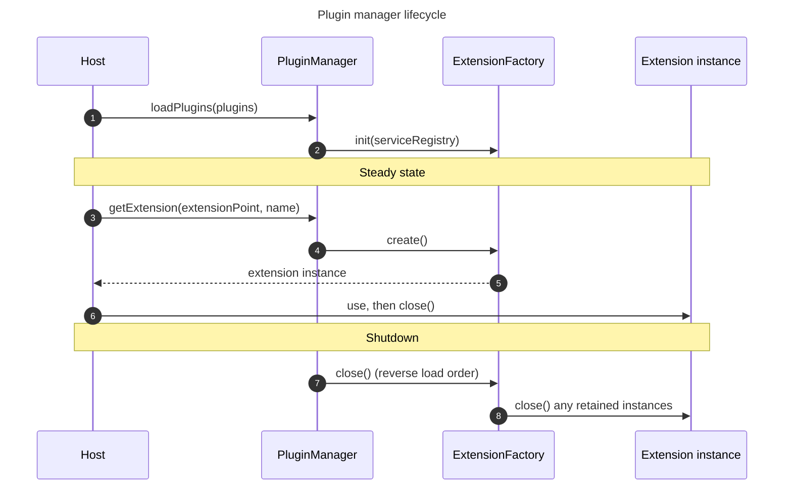

# 拡張性

!!! warning "現時点では内部 API"
    このページで説明するプラグインシステムは、プラットフォームの**内部**向けです。プラットフォーム自身のモジュールだけが使用しており、API はリリース間でいつでも変更される可能性があります。コミュニティ拡張向けの公開 API はロードマップにありますが、チームはまだ時期を決めていません。先に準備が必要な事項については、[サードパーティプラグインに向けて](#toward-third-party-plugins)を参照してください。このページは現在の設計を説明するものであり、安定した契約ではありません。

## 概要 {#overview}

プラットフォームにはプラグインシステムがあります。これにより、プラットフォームの一部でプラグインのコードを受け入れられます。どの部分を開放するかはプラットフォームが決めます。拡張を受け入れるのは、プラットフォームが*拡張ポイント*として指定したコンポーネントだけです。拡張のコードは、公式の API を通じてそれ以外の部分にアクセスできません。

この設計は、[Trino plugins](https://trino.io/docs/current/installation/plugins.html) と [Keycloak SPIs](https://www.keycloak.org/docs/latest/server_development/index.html#_providers) のアイデアを取り入れています。構造は同じで、プラットフォームが定義する少数の拡張ポイントを `ServiceLoader` で読み込み、拡張が使用できるプラットフォームサービスを固定のセットとして提供します。

プラグインシステムは、[Java のモジュールシステム](https://dev.java/learn/modules/intro/)や [OSGi](https://www.osgi.org/) を使用しません。どちらもプラットフォームに不要なライフサイクル、リゾルバー、記述子の機能を追加するうえ、プラグインごとのクラスローダー([クラスローダーの分離](#classloader-isolation)を参照)を使えば、フレームワークの残りの部分なしで同じ分離が得られるためです。

プラグインシステムは、プラットフォームと同じプロセス内で動作します。[hashicorp/go-plugin](https://github.com/hashicorp/go-plugin) のように HTTP や gRPC は使用しません。プロセス外の呼び出しでは、シリアライズのコスト、ネットワークのレイテンシー、タイムアウトに加え、コネクション管理、オブザーバビリティ、通信路の保護(TLS、認証)の手間が増えるためです。

## 中核となる概念 {#core-concepts}

### プラグイン {#plugin}

プラグインはパッケージングの単位です。`Plugin` インターフェースを実装し、1 つ以上の拡張ファクトリーを提供します。プラットフォームは起動時に Java の [`ServiceLoader`](https://docs.oracle.com/en/java/javase/21/docs/api/java.base/java/util/ServiceLoader.html) でプラグインを検出します。

このページで参照する API の型はすべて、`org.dependencytrack.plugin.api` とその子パッケージである `config` と `storage` にあります。`ExtensionPoint` と `ExtensionFactory` はどちらも `java.io.Closeable` を継承しているため、拡張のインスタンスはデフォルトで try-with-resources で使用できます。

### 拡張ポイント {#extension-point}

拡張ポイントは、プラットフォームがプラグイン可能にした機能です。`ExtensionPoint` を継承し、`@ExtensionPointSpec` アノテーションを付けた Java インターフェースです。このアノテーションによって拡張ポイントに安定した名前が付きます。1 つの拡張ポイントが持つ拡張は、0 個、1 個、または複数個です。

### 拡張 {#extension}

拡張は、拡張ポイントを実装したクラスです。ファクトリーが拡張を作成して設定します。ホストのコードが直接作成することはありません。

### 拡張ファクトリー {#extension-factory}

ファクトリーは `ExtensionFactory` を実装します。1 つの拡張ポイントに対する拡張を作成して設定します。ファクトリーは次を宣言します。

- 拡張の名前(ケバブケース)。
- 作成する拡張のクラス。
- 優先度。数値が小さいほど優先されます。拡張ポイントのすべてのファクトリーを順に処理する呼び出し元には、この順序でファクトリーが渡されます。

`create()` が何を返すかはファクトリーが決めます。毎回新しいインスタンスを返すことも、常に同じインスタンスを返すこともできます。呼び出しごとに新しいインスタンスを返す方法は、1 回の呼び出しの間だけリソースを保持し、最後に解放する拡張に適しています。共有インスタンスを返すファクトリーは、そのインスタンスの `close()` をべき等かつ安全にする必要があります。呼び出し元は `create()` が返したものを常にクローズするためです。

ファクトリーは、ほかの機能を有効にすることもできます。[オプション機能](#optional-capabilities)を参照してください。

### 拡張の識別子 {#extension-identity}

すべての拡張には識別子があります。識別子は、拡張ポイントのクラスと拡張の名前の組み合わせです。プラットフォームはこれを文字列のペア `(extension-point-name, extension-name)` に変換します。プラットフォームはこのペアを、拡張ごとのすべてのストア(設定キー、キーバリューストレージ、キャッシュエントリー、メトリクスのタグ)の名前空間キーとして使用します。2 つの拡張が同じ拡張名を使えるのは、異なる拡張ポイントに属する場合だけです。

## コンポーネントモデル {#component-model}

```mermaid
---
title: Plugin, factory, extension
---
graph LR
    SL["ServiceLoader<br/>(META-INF/services)"] --> P["Plugin"]
    P -->|provides| F1["ExtensionFactory&lt;T&gt;"]
    P -->|provides| F2["ExtensionFactory&lt;U&gt;"]
    F1 -->|create&#40;&#41;| E1["Extension : T"]
    F2 -->|create&#40;&#41;| E2["Extension : U"]
    EPS1["@ExtensionPointSpec"] -.declares.-> T["ExtensionPoint T"]
    EPS2["@ExtensionPointSpec"] -.declares.-> U["ExtensionPoint U"]
    T -.implemented by.-> E1
    U -.implemented by.-> E2
```



## 最小限の例 {#minimal-example}

完全なプラグインは、3 つの Java の型と 1 つの `ServiceLoader` 登録ファイルで構成されます。次の例では、架空の `Greeter` 拡張ポイント、1 つの拡張、そのファクトリー、ファクトリーを公開するプラグインを定義します。

```java linenums="1"
@ExtensionPointSpec(name = "greeter")
public interface Greeter extends ExtensionPoint {
    
    String greet(String name);
    
}
```

```java linenums="1"
class FriendlyGreeter implements Greeter {
    
    @Override
    public String greet(String name) {
        return "Hello, %s!".formatted(name);
    }
    
}
```

```java linenums="1"
class FriendlyGreeterFactory implements ExtensionFactory<Greeter> {
    
    @Override
    public String extensionName() { 
        return "friendly"; 
    }
    
    @Override
    public Class<? extends Greeter> extensionClass() {
        return FriendlyGreeter.class; 
    }
    
    @Override
    public int priority() { 
        return PRIORITY_HIGHEST; 
    }

    @Override
    public void init(ServiceRegistry serviceRegistry) {
        // Resolve platform services once at startup. Nothing to do here.
    }

    @Override
    public Greeter create() {
        return new FriendlyGreeter();
    }
    
}
```

```java linenums="1"
public class GreeterPlugin implements Plugin {
    
    @Override
    public Collection<? extends ExtensionFactory<? extends ExtensionPoint>> extensionFactories() {
        return List.of(new FriendlyGreeterFactory());
    }
    
}
```

`ServiceLoader` への登録は、`META-INF/services/org.dependencytrack.plugin.api.Plugin` の 1 行です。

```text linenums="1"
com.example.greeter.GreeterPlugin
```

## 読み込みとライフサイクル {#loading-and-lifecycle}

ホストは `PluginManager` を作成し、サポートする拡張ポイントのクラスの一覧を渡します。次に、`ServiceLoader` でプラグインを読み込み、マネージャーに渡します。マネージャーは各ファクトリーを検査し(名前のパターン、クラスが具象クラスであること、対象の拡張ポイントをマネージャーが認識していること、識別子が一意であること)、拡張用の `ServiceRegistry` を構築して、ファクトリーの `init` を呼び出します。`init` は起動時に**ファクトリーごとに 1 回**実行されます。例外がスローされた場合、プラットフォームはその拡張をスキップせずに、プラグインの読み込みを停止します。`create()` は、ホストがインスタンスを要求するたびに実行されます。



ホストは `PluginManager` から名前で拡張を取得し、try-with-resources ブロック内で使用します。`create()` が返したインスタンスは呼び出し元が所有し、使い終わったらクローズします。ファクトリーが保持しているインスタンスは、シャットダウン時にファクトリー自身の `close()` が実行されるまで開いたままです。

```java linenums="1"
try (var greeter = pluginManager.getExtension(Greeter.class, "friendly")) {
    String message = greeter.greet("world");
    System.out.println(message);
}
```

シャットダウン時、プラットフォームは読み込みと逆の順序で各ファクトリーの `close()` を呼び出します。その後、ファクトリーは保持している拡張のインスタンスをクローズします。

プラットフォームは、拡張のインスタンスがステートフルで**スレッドセーフではない**ことを前提とします。拡張ポイントが別の前提を明示することもできます。呼び出しごとに新しいインスタンスを返すファクトリーは、すでにこの前提を満たしています。長期間存続する 1 つのインスタンスを再利用するファクトリーは、そのインスタンス自体をスレッドセーフにする必要があります。

拡張で発生したエラーは呼び出し元に渡されます。`PluginManager` はエラーをキャッチせず、1 つの拡張が失敗してもホストが停止することはありません。

## 拡張から参照できるもの {#what-extensions-can-see}

拡張は、少数の固定されたサービスを通じてのみプラットフォームとやり取りします。`init` の間、ファクトリーは読み取り専用の `ServiceRegistry` を受け取ります。レジストリーが保持するのは固定されたプラットフォームサービスのセットだけです。拡張が独自のサービスを追加することはできません。また、プラットフォームのフレームワークのコンテキスト、データベース接続、ドメインのリポジトリにもアクセスできません。

| サービス         | スコープ                    | 目的                                                                                      |
|------------------|-----------------------------|-------------------------------------------------------------------------------------------|
| `ConfigRegistry` | 拡張ごと                    | デプロイ設定とランタイム設定へのアクセス                                                  |
| `KeyValueStore`  | 拡張ごと                    | 楽観的同時実行制御を備えた永続的な状態                                                    |
| `CacheManager`   | 拡張ごと(名前空間で分離)  | 設定された `CacheProvider` が提供するキャッシュ(デフォルト: データベース、`CACHE_ENTRY` テーブル) |
| `HttpClient`     | 共有                        | プラットフォームのデフォルト設定を適用した外向きの HTTP                                   |

### 設定 {#configuration}

拡張の設定には 2 種類あります。どちらも拡張ごとの `ConfigRegistry` から取得します。

**デプロイ設定**は、プロセスの実行中には変わりません。プロセスは起動時にこれを読み込みます。デプロイ設定には、プラットフォームのプロセスレベルの設定を使用します(設定元、形式、プロパティの一覧については[設定リファレンス](../../../reference/configuration/application.md)を参照してください)。キーは拡張の識別子に基づく名前空間の下に置かれ、`dt.<extension-point>.<extension>.<key>` という形式になります。`greeter` 拡張ポイントの `friendly` 拡張の場合、`endpoint` という名前のプロパティは `dt.greeter.friendly.endpoint` に対応します。拡張ごとの `DeploymentConfig` は、その名前空間の外にあるキーへのアクセスをブロックするため、公式の API を通じてある拡張が別の拡張の設定を読み取ることはできません。

**ランタイム設定**はデータベースに保存されます。プロセスの実行中に変更でき、プラットフォームは読み取りのたびにこれを検証します。ファクトリーは、`RuntimeConfigurable` を実装して `RuntimeConfigSpec` を返すことで、これを有効にします。この仕様には、デフォルトの設定インスタンス、設定クラスの [JSON Schema](https://json-schema.org/) ドキュメント([2020-12 ドラフト](https://json-schema.org/specification-links#2020-12)に準拠)、スキーマでは表現できないチェックのための任意のバリデーターが含まれます。読み込み時にデータベースにまだ値がない場合、プラットフォームはデフォルト値をデータベースに書き込みます。

#### スキーマの拡張 {#schema-extensions}

プラットフォームは、独自の JSON Schema キーワードを予約しています。これらは検証には影響しませんが、フロントエンドと設定マッパーにとって意味を持ちます。

- `x-secret-ref`(Boolean)。値がシークレットの値そのものではなく、管理対象シークレットの**名前**であるフィールドであることを示します。設定に生のシークレットが保存されることはありません。読み取り時に、`ConfigRegistry` はプラットフォームのシークレットリゾルバーを使って、名前を平文の値に変換します。`ConfigRegistry` は、設定を拡張に渡す前にこれを行います。シークレットの命名と保存のルールは、[シークレット管理サブシステム](../../../guides/administration/configuring-secret-management.md)が定めます。
- `x-ui-hint`(オブジェクト)。設定フォームの表示方法についてのヒントです。たとえば、1 行の入力欄ではなく複数行の入力欄を要求できます。

フロントエンドは、これらのスキーマを使って実行時に設定フォームを構築します。`title` と `description` はラベルとヘルプテキストになり、`x-secret-ref` はシークレットの入力欄を表示し、`x-ui-hint` は入力欄の種類を選びます。スキーマは、入力をチェックする手段であるだけでなく、拡張の UI の契約の一部でもあります。

## オプション機能 {#optional-capabilities}

### 実行時に設定可能 {#runtime-configurable}

`RuntimeConfigurable` を実装したファクトリーは、`RuntimeConfigSpec` を宣言します。そのうえで、型付きの `RuntimeConfig` を `ConfigRegistry` から取得します。これにより、管理者はプラットフォームを再起動せずに拡張の動作を変更できます。

### テスト可能 {#testable}

`Testable` を実装したファクトリーは、`test` メソッドを持ちます。プラットフォームはこのメソッドを呼び出し、運用者が拡張を有効にする前にその設定が機能することを確認できるようにします。結果には、`PASSED`、`FAILED`、`SKIPPED` のいずれかのステータスを持つ 1 つ以上の名前付きチェックが含まれます。たとえば、メールのパブリッシャーには、SMTP セッションを開く `connection` チェックが 1 つあります。

## 例 {#examples}

現在プラットフォームで使用されている拡張ポイントは次のとおりです。

- `NotificationPublisher`: メール、Jira、Slack、Webhook などのチャネルに通知を送信します。
- `PackageMetadataResolver`: エコシステムのパッケージメタデータ(最新バージョン、公開日、ハッシュ)を検索します。
- `VulnAnalyzer`: CycloneDX BOM を分析し、脆弱性開示レポートを返します。
- `VulnDataSource`: OSV、NVD、GitHub Advisories などのデータソースから脆弱性データをミラーリングします。

## 境界と設計の根拠 {#boundaries-and-rationale}

拡張性には、設計上明確な制限があります。何を開放し、何を閉じたままにするかはプラットフォームが選びます。サービスのセットを小さく保つことで、チームはそれを安定させ、その挙動を把握し続けられます。拡張は、プラットフォームのほかの部分へのアクセスを得ることなく、必要なサービスを利用できます。[拡張から参照できるもの](#what-extensions-can-see)のサービスに加えて、さらに 2 つの特性が重要です。

- **拡張ごとの名前空間。** 設定キー、キーバリューストレージ、キャッシュはすべて、拡張の識別子によってスコープが区切られます。拡張は、公式の API を通じて別の拡張のデータを読み取ることはできません。
- **シークレットは設定に保存されない。** 機密性の高いフィールドが保持するのはシークレットの名前だけです。プラットフォームのシークレットリゾルバーが、**読み取り時にそれを値に変換します。**

これらの制限は**API レベル**のものであり、実行レベルのものではありません。プラグインは、プラットフォームのクラスローダーと Java 仮想マシン(JVM)を共有します。プラットフォームはサンドボックスを実行せず、リフレクションによって名前空間のルールが破られることを防ぐものはありません。現時点でこれが問題にならないのは、プラットフォームが読み込むプラグインがすべてプラットフォームと同じリポジトリで提供されているためです。サードパーティプラグインに対してシステムを開放するには、さらに多くのことが必要です。[サードパーティプラグインに向けて](#toward-third-party-plugins)を参照してください。

## サードパーティプラグインに向けて {#toward-third-party-plugins}

チームはコミュニティ拡張を念頭に置いてプラグインシステムを設計しましたが、現在プラットフォームはコミュニティ拡張を読み込んでおらず、公開 API もまだ契約にはなっていません。プラットフォームには、まず次の事項が必要です。いずれも時期は決まっていません。

### API の安定性 {#api-stability}

現在の内部 API は、公開された契約になります。それに伴い、非推奨化のポリシー、セマンティックバージョニング、プラットフォームのリリース間での後方互換性といった通常のルールが適用されます。それまでは、このページの内容はすべてリリース間で変更される可能性があります。

### API アーティファクトの公開 {#api-artifact-publication}

プラグイン API のモジュールを [Maven Central](https://central.sonatype.com/) で配布する必要があります。そうすれば、作成者はソースをコピーしたりプラットフォームのリポジトリ全体を取得したりせずに、通常のビルドツールでモジュールに依存できます。

### クラスローダーの分離 {#classloader-isolation}

現在、プラグインはプラットフォームのクラスローダーを共有しています。これはファーストパーティのプラグインであれば問題ありません。ファーストパーティのプラグインはプラットフォームと同じリポジトリで提供され、同じバージョンに対して依存関係を選ぶため、分離すべきサードパーティのコードがなく、依存関係の競合はビルドが解決します。

サードパーティプラグインでは、これらの前提が崩れます。その場合、1 つのクラスローダーを共有すると 3 つの問題が生じます。プラグインの推移的な依存関係がプラットフォームの依存関係と衝突する可能性があること、プラグインがほかのプラグインのクラスを読み込めること、そしてリフレクションによってプラットフォームの任意の内部にアクセスできることです。そのため、各プラグインには、プラットフォームやほかのプラグインのクラスローダーとは別の、独自のクラスローダーが必要になります。

プラグインごとの [`URLClassLoader`](https://docs.oracle.com/en/java/javase/21/docs/api/java.base/java/net/URLClassLoader.html) を使い、API モジュールだけを公開するようにフィルタリングしたプラットフォームのクラスローダーを親にすれば、完全なモジュールフレームワークやバンドルフレームワークなしでこの分離が得られます。その結果、プラグインが参照できるのは API モジュールと自身の依存関係だけになり、依存関係の衝突がなくなり、API が唯一の入り口になります。

### 完全性検証 {#integrity-verification}

プラグインのアーティファクトには、その出所を検証する手段が必要です。運用者は、プラグインが作成者の公開したものであることを信頼できなければなりません。プラットフォームは、まだ特定の仕組みを採用していません。選択肢には次のものがあります。

- [`jarsigner`](https://docs.oracle.com/en/java/javase/21/docs/specs/man/jarsigner.html)。JDK に組み込まれた JAR 署名ツールです。安定しており単独で動作しますが、運用者が X.509 トラストストアを管理する必要があります。
- [Sigstore](https://www.sigstore.dev/)(`cosign`)。OIDC の ID に結び付いた短期間有効な鍵でアーティファクトに署名し、署名を公開の透明性ログに記録します。運用者の手間は少なくなりますが、Sigstore のインフラストラクチャ(またはセルフホスト版)への実行時の依存が加わります。

どの仕組みを選ぶにしても、プラットフォームはプラグインを読み込む前に署名をチェックする必要があり、運用者にはどの署名者を信頼するかを指定する手段が必要です。

### その他の未解決の課題 {#other-open-questions}

- **配布と検出。** 運用者がプラグインを見つけ、インストールし、更新する方法です。現在の `ServiceLoader` の仕組みは、起動時に JAR がすでにクラスパス上にあることを前提としています。
