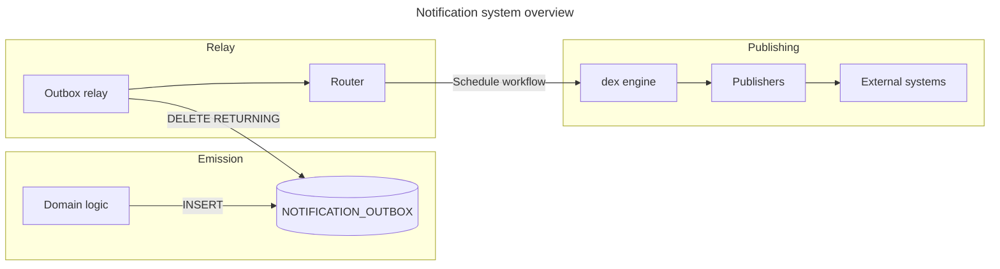
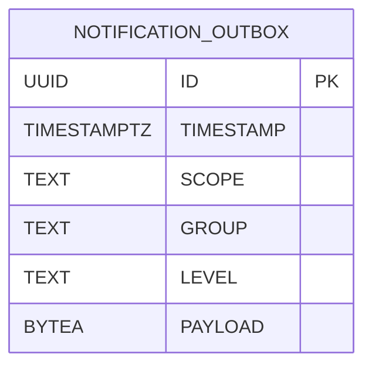
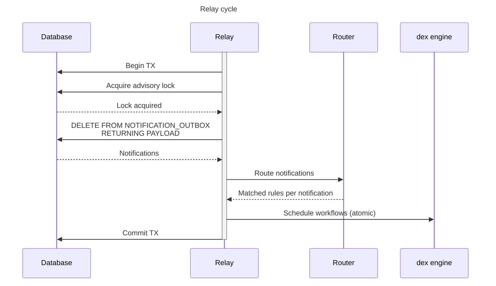
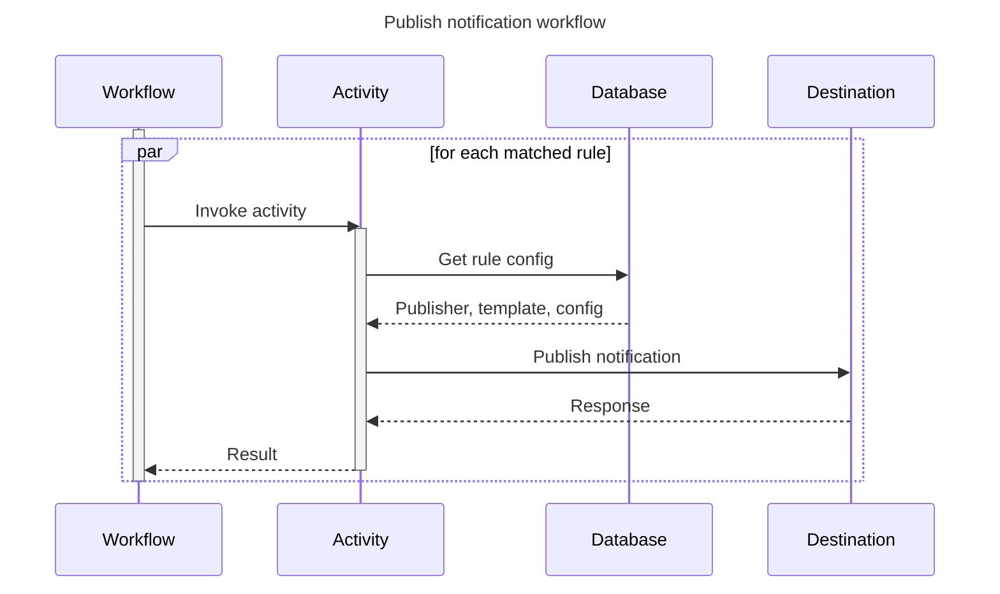

# 通知

## 概要 {#overview}

通知システムは、プラットフォームで発生したイベントをユーザーと外部システムに知らせます。通知システムは 3 つのフェーズで構成されます。

1. **発行**: 通知をアウトボックステーブルに書き込みます
2. **リレー**: アウトボックスをポーリングし、通知を一致するルールにルーティングして、ワークフローをスケジュールします
3. **パブリッシュ**: 永続ワークフローを使って、通知を送信先のシステムに配信します

この設計は、ADR-011 で説明しているとおり、[トランザクショナルアウトボックス][transactional outbox]パターンに従っています。これにより通知をアトミックに発行でき、クリティカルパスに外部のメッセージブローカーを置く必要がなくなります。

## 発行 {#emission}

ドメインロジックは、`NOTIFICATION_OUTBOX` テーブルにレコードを挿入することで通知を発行します。この挿入は、通知のきっかけとなるビジネスロジックを実行するのと同じデータベーストランザクションの中で行えるため、[二重書き込みの問題][dual write problem]を回避できます。

`ID` 列には、グローバルな一意性とソート可能性を兼ね備えた [UUIDv7] を使います。`PAYLOAD` 列には、[Protobuf] 形式でシリアライズされた通知が格納されます。スキーマについては、[通知スキーマのリファレンス](../../../reference/notifications/schema.md)で説明しています。

### 事前フィルタリング {#preliminary-filtering}

アウトボックステーブルの負荷を減らすため、システムは、有効なアラートのうち*少なくとも 1 つ*が通知に一致する*可能性がある*場合にだけ通知を挿入します。`INSERT` 操作は、`NOTIFICATIONRULE` テーブルに対する `EXISTS` サブクエリーを使ってこのチェックを実行します。

一致するルールがない通知は、その場で破棄されます。

## リレー {#relay}

アウトボックスリレーは、`NOTIFICATION_OUTBOX` テーブルを継続的にポーリングし、通知を一致するルールにルーティングして、パブリッシュのワークフローをスケジュールするバックグラウンドプロセスです。ポーリング間隔は [`dt.notification.outbox-relay.poll-interval-ms`](../../../reference/configuration/properties.md#dtnotificationoutbox-relaypoll-interval-ms) で設定でき、デフォルトは 1 秒です。

### 並行性の制御 {#concurrency-control}

トランザクションレベルの[アドバイザリーロック][advisory locks]により、API サーバーのインスタンスをまたいでリレーのサイクルが並行して実行されることを防ぎます。これにより、リレーはシステムが通知を発行したおおよその順序で通知を処理します。並行性がないことは、バッチ処理で補います。オペレーターは [`dt.notification.outbox-relay.batch-size`](../../../reference/configuration/properties.md#dtnotificationoutbox-relaybatch-size) でバッチサイズを設定します。デフォルトは 100 です。

### ルーティング {#routing}

ルーターは、各通知を有効なすべての[アラート](../../notifications.md#alerts)と照らし合わせて評価します。ルールは次の場合に一致します。

* ルールのスコープが通知のスコープと一致する
* ルールのレベルが通知のレベルと同じか、それより詳細度が低い
* 通知のグループが、ルールに設定されたグループに含まれている
* ルールが配信先を特定のプロジェクトやタグに限定している場合は、通知のサブジェクトがそれに一致する

ルーターは、`UNNEST` を使った 1 つの SQL クエリーでバッチ単位で実行され、データベースとのやり取りの回数を減らします。

### 大きな通知の扱い {#large-notification-handling}

設定可能なサイズの閾値(デフォルト: 64KiB)を超える通知は、永続実行エンジンに直接渡されるのではなく、ファイルストレージに移されます。これにより、大きなペイロード(たとえば `PROJECT_VULN_ANALYSIS_COMPLETED`)によってワークフローの履歴が肥大化することを防ぎます。パブリッシュのワークフローはファイルストレージから通知を取得し、完了時にファイルを削除します。

## パブリッシュ {#publishing}

一致したルールが*少なくとも 1 つ*ある通知ごとに、リレーは *Publish Notification* ワークフローをスケジュールします。このワークフローは、一致したすべてのルールへの配信を調整します。

ルールごとに別々のアクティビティが並行してパブリッシュするため、ルールごとに独立して再試行できます。ある送信先への配信が失敗しても、ほかの送信先への配信には影響しません。

*少なくとも 1 つ*のルールのパブリッシュが成功すれば、ワークフローは成功します。逆に、*すべて*のルールのパブリッシュが失敗した場合は、ワークフロー全体が失敗します。

### パブリッシャー {#publishers}

パブリッシャーは、特定の種類の送信先に通知を配信する実装です。組み込みのパブリッシャーには、メール、Kafka、Slack、Microsoft Teams、Jira、Webhook などがあります。詳しくは、[パブリッシャー](../../../reference/notifications/publishers.md)のドキュメントを参照してください。

パブリッシャーは次のものを受け取ります。

* 通知のペイロード
* ルール固有の設定(たとえば、送信先の URL や認証情報)
* 通知を整形するためのテンプレートレンダラー

### 再試行 {#retries}

アクティビティは、再試行可能な失敗(たとえば、レート制限や一時的な利用不能)を通知できます。永続実行エンジンは、バックオフを伴う再試行を透過的に処理します。再試行できない失敗は、そのルールについては最終的な失敗となりますが、ほかのルールには影響しません。

[advisory locks]: https://www.postgresql.org/docs/current/explicit-locking.html#ADVISORY-LOCKS
[dual write problem]: https://www.confluent.io/blog/dual-write-problem/
[Protobuf]: https://protobuf.dev/
[transactional outbox]: https://microservices.io/patterns/data/transactional-outbox.html
[UUIDv7]: https://en.wikipedia.org/wiki/Universally_unique_identifier#Version_7_(timestamp_and_random)
