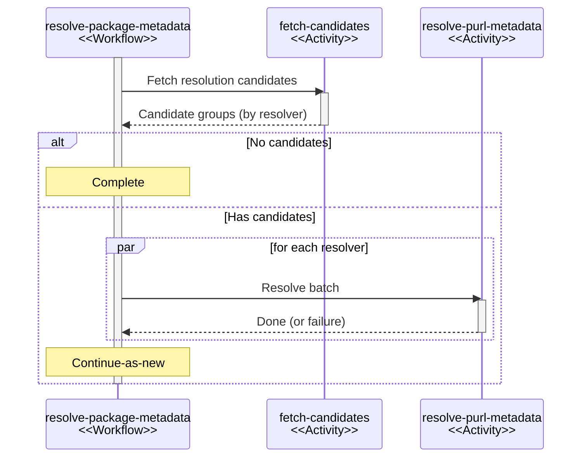

# パッケージメタデータの解決

## 概要 {#overview}

パッケージメタデータの解決システムは、上流のパッケージリポジトリからパッケージのメタデータを取得します。これには、利用可能な最新バージョン、アーティファクトのハッシュ、公開日時が含まれます。Dependency-Track は、このデータを最新バージョンのチェック、コンポーネントの経過期間に関するポリシー、完全性検証に使います。

シングルトンの[永続ワークフロー](durable-execution.md)が解決をオーケストレーションし、制御されたバッチ単位でパッケージを処理します。データモデルについては [ADR-015] で説明しています。

## 公共インフラストラクチャーの責任ある利用 {#responsible-consumption-of-public-infrastructure}

Maven Central、npm、PyPI などの公開レジストリは、限られた帯域をすべての利用者で共有しています。Sonatype は、[IP アドレスの 1% が Maven Central の総帯域の 83% を占めている][maven-overconsumption]こと、そしてこれを受けてレジストリが[組織単位のスロットリング][maven-tragedy]を適用し始め、過剰な利用者に HTTP 429 エラーを返すようになったことを報告しています。

多数のプロジェクトにわたって数十万のコンポーネントを追跡することもある Dependency-Track のようなシステムにとって、これはアーキテクチャに直接影響します。BOM のアップロードやスケジュールされた分析サイクルのたびに、コンポーネントごとに HTTP リクエストを送るのは現実的ではありません。上流のレジストリに対して数百もの並行リクエストを発生させることも同様です。どちらのパターンも、特に多数の API サーバーのインスタンスが並行して実行される大規模なデプロイでは、すぐにレート制限を使い果たしてしまいます。

そのため、解決システムは、その場限りの検索よりも、スケジュールされた制御された処理を優先します。システムは、メタデータの解決が必要なコンポーネントをバッチ単位で特定し、リゾルバーごとに順番に解決して、上流への重複したリクエストを避けられるだけの来歴情報とともに結果を永続化します。

リゾルバーは、データを更新する際に[条件付き HTTP リクエスト][rfc-conditional]も発行します。小さな共有キャッシュが、上流の各レスポンスボディを、その `ETag` と `Last-Modified` のバリデーターとともに保存します。プロセス内の鮮度の期間を過ぎた後の更新では `If-None-Match`(または `If-Modified-Since`)を送信し、ほとんどの場合、完全なメタデータドキュメントではなく小さな `304 Not Modified` のやり取りで済みます。これにより、システムがレジストリに問い合わせる頻度を変えずに上流の帯域を削減でき、`304` レスポンスをレート制限の対象外とするレジストリ(特に GitHub API)ではクォータの節約にもなります。その動機については、Sonatype のブログ記事 [*Open is not costless: reclaiming sustainable infrastructure*][open-not-costless] で説明されています。

## データモデル {#data-model}

2 つのテーブルが 2 段階の階層を構成し、どちらも PURL をキーとします。

* `PACKAGE_METADATA`: *バージョン、修飾子、サブパスを含まない* PURL(たとえば `pkg:maven/com.acme/acme-lib`)をキーとします。利用可能な最新バージョンと解決の来歴情報を保存します。パッケージごとに 1 つのレコードです。
* `PACKAGE_ARTIFACT_METADATA`: *修飾子とサブパスを含む*完全な PURL(たとえば `pkg:maven/com.acme/acme-lib@1.2.3?type=jar`)をキーとします。アーティファクトのハッシュ、公開日時、解決の来歴情報を保存します。個別のアーティファクトごとに 1 つのレコードです。`PACKAGE_METADATA` への外部キーを持ちます。

これにより、パッケージレベルの情報(最新バージョン)とアーティファクトレベルの情報(ハッシュ、公開日時)が分離されます。外部キー制約により、対応するパッケージのメタデータなしにアーティファクトのメタデータが存在できないことが保証され、オーケストレーションのロジックは、その結果生じる書き込み順序の依存関係に従います。

完全な根拠については、[ADR-015] を参照してください。

### 永続化 {#persistence}

どちらのテーブルも、既存の null でない値を保持する `COALESCE` ベースのアップサートを使います。時間的なガード(`WHERE "RESOLVED_AT" < EXCLUDED."RESOLVED_AT"`)により、古い結果が新しい結果を上書きすることを防ぎます。書き込みでは PostgreSQL の `UNNEST` を使って 1 つのステートメントで多数の行をまとめて処理し、データベースとのやり取りの回数を減らします。

## PURL の正規化 {#purl-normalization}

コンポーネントの生の PURL が、上流のメタデータを取得するためのキーとしてそのまま適切であることはほとんどありません。PURL には同一性に影響しない情報(パッケージリポジトリの URL、チェックサム、BOM 固有の修飾子など)が含まれる一方で、エコシステムが特定のアーティファクトを取得するのに必要な情報が省かれていることもよくあります。各リゾルバーファクトリーは `normalize` を実装して PURL を期待する形に変換し、リゾルバーがその種類をサポートしない場合は `null` を返します。

PURL の正規化には 2 つの目的があります。

1. 特定の PURL をどのリゾルバーが処理するかを選択します。`normalize` が null 以外の結果を返した最初のファクトリーが採用されます。
2. `PACKAGE_ARTIFACT_METADATA` に永続化される正確なキーの形に PURL を整えます。

つまり、アーティファクトの粒度を決めるのは入力の PURL ではなく、リゾルバーです。

### Maven {#maven}

Maven の座標は、グループ、アーティファクト、バージョンだけでは完全に特定されません。同じ GAV から複数のアーティファクトが生成されることがあり、それらは [`type` と `classifier` の修飾子][purl-maven-qualifiers]で区別されます。`type` はパッケージング(`jar`、`war`、`pom`、`aar`)を選択し、`classifier` はバリアント(`sources`、`javadoc`、`linux-x86_64`)を選択します。それぞれがディスク上に独自のファイルと独自のハッシュを持ちます。Maven のリゾルバーは、`type`(Maven の慣例に合わせてデフォルトは `jar`)と、存在する場合は `classifier` を残し、それ以外をすべて取り除いて正規化します。その結果、`pkg:maven/com.acme/acme-lib@1.2.3` と `pkg:maven/com.acme/acme-lib@1.2.3?classifier=sources` は、異なるハッシュを持つ別々の `PACKAGE_ARTIFACT_METADATA` の行に解決されます。

### PyPI {#pypi}

PyPI のリリースは単一のファイルではありません。1 つのバージョンには通常、1 つのソース配布物(`.tar.gz`)と、サポートする Python のバージョン、ABI、プラットフォームごとに 1 つずつの、ビルド済みの wheel 群(`cp311-cp311-manylinux_2_17_x86_64.whl`、`cp312-cp312-macosx_11_0_arm64.whl` など)が含まれます。各ファイルは独自のハッシュを持ち、PyPI の JSON API はリリース単位ではなくファイル単位でハッシュを返します。1 つを選ぶ方法がなければ、リゾルバーはどのハッシュを記録すべきかを決められません。

これに対処するため、PyPI のリゾルバーは入力の PURL に [`file_name` 修飾子][purl-pypi-qualifiers]を必須とし、正規化の際にそれを保持します。PyPI のコンポーネントを出力する SBOM ツールは、リゾルバーがハッシュを記録できるように `file_name` を含める必要があります。`file_name` を含まない PURL がただちに拒否されるわけではありませんが、リゾルバーはどのファイルが該当するかを特定できません。

### その他のエコシステム {#other-ecosystems}

ほかのほとんどのエコシステムは、バージョンごとに 1 つのアーティファクト(npm の tarball、RubyGems の gem、crate)を公開します。そのため、それらのリゾルバーは正規化の際にすべての修飾子を取り除き、`type/namespace/name@version` だけをキーとします。

## ワークフロー {#workflow}

パッケージメタデータの解決は、シングルトンの[永続ワークフロー](durable-execution.md)です。

### シングルトンの制約 {#singleton-constraint}

ワークフローは固定のインスタンス ID(`resolve-package-metadata`)を使います。永続実行エンジンは、特定のワークフローインスタンスについて、終了状態でない実行が常に 1 つしか存在できないように強制します。すでに実行がアクティブなときに実行を作成しようとすると、通知なしに重複排除されます。

これにより、実行されている API サーバーのインスタンスの数にかかわらず、クラスター全体でアクティブな解決ワークフローは最大 1 つであることが保証されます。解決が並行して試みられることは構造的にありえないため、上流への重複したリクエストや、永続化の際のデータ競合を防げます。

### トリガー {#triggers}

次の 3 つの状況でワークフローがトリガーされます。

| トリガー         | タイミング                                                               |
|:----------------|:-------------------------------------------------------------------|
| スケジュール       | 設定可能な cron スケジュール                                         |
| BOM のアップロード      | コンポーネントを含む BOM をインポートした後                     |
| 手動の分析 | ユーザーがプロジェクトの脆弱性分析を手動でトリガーしたとき |

すべてのトリガーは、同じシングルトンのインスタンス ID で実行を作成します。実行がすでにアクティブな場合、作成のリクエストは何もしません。重複排除はシングルトンの制約が処理するため、トリガーを低コストで呼び出せます。

### 構造 {#structure}

### 候補の取得 {#candidate-fetching}

| アクティビティ                                        | タスクキュー |
|:------------------------------------------------|:-----------|
| `fetch-package-metadata-resolution-candidates`  | `default`  |

PURL は、次のいずれかに当てはまる場合に解決の対象になります。

* その PURL の `PACKAGE_ARTIFACT_METADATA` レコードが存在しない
* その PURL の `PACKAGE_METADATA` レコードが存在しない
* 対応する `PACKAGE_METADATA` が最後に解決されてから 24 時間以上経過している

アクティビティは、250 件ずつのバッチで候補を取得し、リゾルバーごとにグループ化します。各 PURL は、`normalize` メソッドが null 以外の結果を返した最初のリゾルバーに対応付けられます。一致するリゾルバーがない PURL は、空のリゾルバー名のもとにグループ化されます。解決のアクティビティは、それらの PURL について空の結果を永続化し、以降のバッチで再び候補として現れないようにします。

### 解決 {#resolution}

| アクティビティ                 | タスクキュー                     |
|:-------------------------|:-------------------------------|
| `resolve-purl-metadata`  | `package-metadata-resolutions` |

リゾルバーごとに 1 つのアクティビティが、割り当てられた PURL を順番に処理します。異なるリゾルバーのアクティビティは並行して実行されます。

処理の前に、アクティビティはバッチの既存の `PACKAGE_ARTIFACT_METADATA` の行を読み込み、各 PURL の以前の結果をヒントとしてリゾルバーに渡します。このヒントで処理を省略できるリゾルバー(たとえば、安定版のバージョンに対する Maven)は、対応する上流からの取得をスキップします。

各 PURL について、アクティビティは次の処理を行います。

1. リゾルバーファクトリーを使って PURL を正規化します。
2. PURL の種類に対して設定されたパッケージリポジトリを、解決の優先順位の順に検索します。
3. 内部/外部の分類に従ってパッケージリポジトリを順に処理し、いずれかが成功するか候補がなくなるまでリゾルバーを呼び出します。
4. 結果をバッファーに格納し、25 件ずつのバッチでデータベースにフラッシュします。

リゾルバーが再試行可能なエラー(たとえば HTTP 429)を通知した場合、アクティビティはバッファー内の結果をフラッシュし、エラーを伝播します。その後、永続実行エンジンがバックオフを伴ってアクティビティを再試行します。個々の PURL に対する再試行できないエラーはアクティビティが捕捉して空の結果を永続化し、その PURL がすぐにまた候補になることを防ぎます。

#### 再試行ポリシー {#retry-policy}

| パラメーター            | 値 |
|:---------------------|:------|
| 初回の遅延        | 5&nbsp;s  |
| 遅延の乗数     | 2x    |
| ランダム化係数 | 0.3   |
| 最大遅延            | 1&nbsp;m  |
| 最大試行回数         | 3     |

### Continue-as-new {#continue-as-new}

バッチを処理した後、ワークフローは `continueAsNew` を使って、次のバッチを引き継ぐ新しい実行を開始します。これにより、履歴が際限なく増えることを防ぎます。各実行のイベント履歴は 1 つのバッチだけを対象とします。これがなければ、数千のパッケージを解決する 1 つの実行に大きな履歴が蓄積され、再生のパフォーマンスが低下します。

これは自然なチェックポイントにもなります。バッチの間でプロセスが停止した場合、次の実行は新たな候補のクエリから始まり、データベースの `RESOLVED_AT` タイムスタンプに基づいて、解決済みの PURL をスキップします。

このサイクルは候補がなくなるまで続き、その時点でワークフローは正常に完了します。

## 並行性の制御 {#concurrency-control}

並行性の制御は 4 つのレベルで行われます。

| レベル    | 仕組み                                     | 効果                                             |
|:---------|:----------------------------------------------|:---------------------------------------------------|
| クラスター  | シングルトンのインスタンス ID                         | クラスター全体で解決ワークフローは最大 1 つ |
| エンジン   | `package-metadata-resolutions` キューの容量 | 保留中の解決アクティビティの数を制限(デフォルト: 25)    |
| ノード     | アクティビティワーカーの最大並行数               | ノードごとのアクティビティの並列実行を制限        |
| リゾルバー | 各アクティビティ内での順次処理    | 各リゾルバーは一度に 1 つの PURL を処理         |

キューの容量とワーカーの並行性がどのように相互作用するかについては、[永続実行](durable-execution.md)を参照してください。

## リゾルバーの拡張ポイント {#resolver-extension-point}

リゾルバーは、[拡張性](extensibility.md)の仕組みを通じてプラグインとして追加できます。API は 2 つのインターフェースで構成されます。

* **`PackageMetadataResolverFactory`**: リゾルバーのインスタンスを作成します。リゾルバーがパッケージリポジトリを必要とするかどうかを宣言し、PURL を正規化し(サポートしない場合は `null` を返します)、拡張機能の名前を公開します。
* **`PackageMetadataResolver`**: 正規化された PURL と任意のパッケージリポジトリを受け取り、`PackageMetadata` または `null` を返します。

特定の PURL を処理するのは 1 つのリゾルバーです(ファクトリーの順序に基づき、最初に一致したものが採用されます)。そのリゾルバーの中では、1 つのパッケージリポジトリが結果を提供します(設定された解決の順序に基づき、最初に成功したものが採用されます)。

リゾルバーは、上流からの取得を、ETag と Last-Modified による再検証を透過的に処理する共有の HTTP リソースキャッシュを経由して行います。エントリーが新鮮な間は、キャッシュは上流に問い合わせずにボディを返します。古くなってもキャッシュに残っている場合、キャッシュはバリデーターを送信し、`304 Not Modified` が返ればボディを再利用し、`200 OK` が返ればエントリーを置き換えます。キャッシュは `404` と `410` のレスポンスをネガティブキャッシュするため、存在しないパッケージについて鮮度の期間内にリクエストが再発行されることはありません。キャッシュはリゾルバーごとに別の名前空間を使い、既存のキャッシュプロバイダーの仕組みを通じて、インメモリとデータベースのプロバイダーを切り替えられます。

候補のクエリは 24 時間後に PURL を対象としてマークしますが、リゾルバー側のキャッシュにより、通常はそれが上流からの完全な転送にはつながりません。

## メンテナンス {#maintenance}

スケジュールされたタスクが、孤立したメタデータをクリーンアップします。

1. PURL が一致する `COMPONENT` が存在しない `PACKAGE_ARTIFACT_METADATA` の行を削除します。
2. どの `PACKAGE_ARTIFACT_METADATA` からも参照されていない `PACKAGE_METADATA` の行を削除します。

この 2 段階のカスケードにより、コンポーネントがポートフォリオから外れていってもテーブルが際限なく大きくなることを防ぎます。分散ロックにより、クリーンアップを実行するノードは常に 1 つだけになります。

## 回復性 {#resiliency}

[永続実行](durable-execution.md)エンジンが、クラッシュからの復旧と再試行を透過的に処理します。

* 解決の途中でノードがクラッシュした場合、再起動時にワークフローは最後に完了したステップから再開します。クラッシュ前に以前の実行がフラッシュした PURL は、`RESOLVED_AT` タイムスタンプが 24 時間の鮮度の期間内にあるため、候補のクエリに一致しなくなります。
* 特定のリゾルバーで再試行を使い果たしても解決が失敗した場合、ワークフローは `ActivityFailureException` を捕捉し、失敗をログに記録して処理を続けます。ほかのリゾルバーの結果は、ワークフローが通常どおり永続化します。
* 正常なシャットダウンの際、アクティビティは各 PURL の処理前にスレッドの割り込みを確認し、バッファー内の結果をフラッシュして、割り込みを伝播します。

[ADR-015]: https://github.com/DependencyTrack/dependency-track/blob/main/docs/adr/015-package-metadata.md
[maven-overconsumption]: https://www.sonatype.com/blog/beyond-ips-addressing-organizational-overconsumption-in-maven-central
[maven-tragedy]: https://www.sonatype.com/blog/maven-central-and-the-tragedy-of-the-commons
[open-not-costless]: https://www.sonatype.com/blog/open-is-not-costless-reclaiming-sustainable-infrastructure
[purl-maven-qualifiers]: https://github.com/package-url/purl-spec/blob/main/types-doc/maven-definition.md#qualifiers-definition
[purl-pypi-qualifiers]: https://github.com/package-url/purl-spec/blob/main/types-doc/pypi-definition.md#qualifiers-definition
[rfc-conditional]: https://www.rfc-editor.org/rfc/rfc7232
