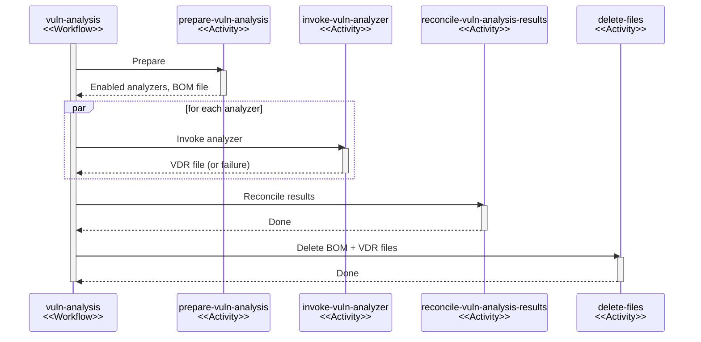

# 脆弱性分析

## 概要 {#overview}

脆弱性分析システムは、[永続ワークフロー](durable-execution.md)を介して複数の脆弱性アナライザーを連携させ、プロジェクトのコンポーネントに含まれる既知の脆弱性を特定します。

## 粒度 {#granularity}

脆弱性分析はプロジェクト単位で行われます。個々のコンポーネントの分析はサポートしていません。

この設計を選んだ理由は、分析が文脈に依存する場合があるためです。[Trivy] などの一部のスキャナーは、特定のほかのコンポーネントも存在する場合にのみ、あるコンポーネントの特定の脆弱性を報告することがあります。個々のコンポーネントを分析するだけでは、この文脈を提供できません。

作業単位をプロジェクトにすることには、さらに次のような非機能面の利点があります。

* 送信・処理する非同期タスクやイベントが少なくなります。
* バッチ処理の機会が増えます。
* オーケストレーションが単純になります。

## トリガー {#triggers}

脆弱性分析を開始するトリガーは 3 つあります。各トリガーは外側の `analyze-project` ワークフローの実行を作成し、このワークフローがこのドキュメントで説明する `vuln-analysis` ワークフローを呼び出した後、プロジェクトのポリシー評価とメトリクスの更新を行います。

| トリガー             | ワークフローインスタンス ID                   | 同時実行キー                    | 優先度         |
|:---------------------|:----------------------------------------------|:--------------------------------|:---------------|
| スケジュール         | `analyze-project-scheduled:<projectUuid>`     | `analyze-project:<projectUuid>` | 0(デフォルト) |
| BOM のアップロード   | `analyze-project:bom-upload:<bomUploadToken>` | `analyze-project:<projectUuid>` | 50             |
| 手動                 | `analyze-project-manual:<projectUuid>`        | `analyze-project:<projectUuid>` | 75             |

すべてのトリガーは同じ同時実行キーのパターンを共有するため、トリガーに関係なく、分析の実行はプロジェクトごとに直列化されます。1 つのプロジェクトで同時にアクティブにできる実行は 1 つだけです。これにより、データ競合や過剰なリソース使用を防ぎます。

BOM のアップロードのインスタンス ID にはアップロードごとのトークンが含まれるため、同じプロジェクトに対して短い間隔でアップロードが続いた場合でも、アップロードごとに別の実行になります。スケジュールと手動のトリガーは、プロジェクト単位のインスタンス ID を使い、同じプロジェクトに対する同時のリクエストを重複排除します。

エンジンは優先度の値が大きいものから処理するため、手動のトリガー(75)は BOM のアップロード(50)より優先され、BOM のアップロードはスケジュールによる実行(0)より優先されます。優先度が制御するのは受け入れの順序であり、プリエンプションではありません。プロジェクトの同時実行キーをすでに保持している実行は、完了するまでそのキーを保持し続けるため、同じプロジェクトに対する優先度の高い実行は待機します。[スケジュールトリガーのペース配分](#scheduled-trigger-pacing)により、この待機時間には上限があります。

`analyze-project` が `vuln-analysis` を呼び出すとき、ネストされたワークフローの同時実行キーを `vuln-analysis:<projectUuid>` に設定します。これにより、脆弱性分析のステージが、その前後にあるポリシーとメトリクスのステージから分離されます。

エンジンが同時実行キー、インスタンス ID、優先度をどのように適用するかについては、[永続実行](durable-execution.md)のドキュメントを参照してください。

### スケジュールトリガーのペース配分 {#scheduled-trigger-pacing}

スケジュールトリガーは、ポートフォリオ全体を決まった時刻に一斉に開始するわけではありません。代わりに、各プロジェクトが最後に分析された時刻を保持します。タスクは 60 秒ごとに、最後の分析の開始から [`dt.task.portfolio-analysis.max-analysis-age-ms`](../../../reference/configuration/properties.md#dttaskportfolio-analysismax-analysis-age-ms)(デフォルトは 24 時間)以上経過したプロジェクトを探し、最後の試行が最も古いものから開始します。自身が開始した実行のうちアクティブなものが [`dt.task.portfolio-analysis.max-in-flight-analyses`](../../../reference/configuration/properties.md#dttaskportfolio-analysismax-in-flight-analyses)(デフォルトは 50)に達すると、開始を停止します。

3 つのトリガーはすべてこのタイムスタンプを更新するため、クライアントが頻繁に分析するプロジェクトは、スケジュールによる分析の対象になりません。これにより、スケジュールトリガーは、2 つ目の負荷の発生源ではなく、分析頻度の下限として機能します。

## ワークフローの実行 {#workflow-execution}

`vuln-analysis` ワークフローは、分析のライフサイクル全体を統括します。

### 準備 {#preparation}

| アクティビティ          | タスクキュー |
|:------------------------|:-------------|
| `prepare-vuln-analysis` | `default`    |

1. アクティブなすべてのアナライザーインスタンスに要件を問い合わせて、プロジェクトに適用できるアナライザーを判断します。
2. すべてのアナライザーの要件を集約し、必要なデータ(CPE、PURL など)を含むプロジェクトのコンポーネントで構成される CycloneDX BOM を組み立てます。
3. BOM をファイルストレージに保存します。

アクティブなアナライザーがない場合や、プロジェクトに分析可能なコンポーネントがない場合、ワークフローは早期に終了します。

### アナライザーの呼び出し {#analyzer-invocation}

| アクティビティ         | タスクキュー    |
|:-----------------------|:----------------|
| `invoke-vuln-analyzer` | `vuln-analyses` |

1. ファイルストレージから BOM を取得します。
2. アナライザーを呼び出し、VDR を得ます。
3. 得られた VDR をファイルストレージに保存します。
4. 専用の `vuln-analyses` タスクキューで実行し、アナライザーのワークロードをほかのアクティビティの処理から分離します。

アナライザーの呼び出しはそれぞれ別のアクティビティであるため、アナライザーごとに独立して再試行でき、並行して実行できます。

### アナライザーの結果の照合 {#analyzer-result-reconciliation}

| アクティビティ                    | タスクキュー                    |
|:----------------------------------|:--------------------------------|
| `reconcile-vuln-analysis-results` | `vuln-analysis-reconciliations` |

* 成功したすべてのアナライザーの VDR ファイルをファイルストレージから読み込みます。
* 報告された脆弱性と検出結果をデータベースと照合します。

照合では、次の操作を順に実行します。

1. VDR 間で重複する脆弱性の報告をマージします。
2. 脆弱性をデータベースに同期します(つまり、作成または更新します)。
3. 脆弱性のエイリアスのアサーションを同期します([エイリアスの同期](#alias-synchronization)を参照)。
4. 検出結果の帰属を作成し、論理削除します([ADR-013][adr-013] を参照)。
5. アクティブな検出結果に対して脆弱性ポリシーを評価します。
6. 通知を発行します([通知](#notifications)を参照)。

アクティビティは、データベースへの変更をすべてバッチにまとめ、1 つのトランザクションでコミットします。これにより、変更はアトミックになり、アクティビティはべき等になります。

### ファイルの削除 {#file-deletion}

| アクティビティ | タスクキュー |
|:---------------|:-------------|
| `delete-files` | `default`    |

BOM ファイル、すべての VDR ファイル、コンテキストファイル(存在する場合)をファイルストレージから削除します。

## アナライザーの拡張ポイント {#analyzer-extension-point}

アナライザーは、[拡張性](extensibility.md)のシステムによってプラグイン可能です。API は 2 つのインターフェースで構成されます。

* **`VulnAnalyzerFactory`**: アナライザーのインスタンスを作成します。アナライザーがアクティブかどうかを報告し、アナライザーが必要とするコンポーネントのデータを `VulnAnalyzerRequirement` のセット(たとえば `COMPONENT_CPE`、`COMPONENT_PURL`)で宣言します。
* **`VulnAnalyzer`**: プロジェクトのコンポーネントを表す CycloneDX BOM を受け取り、見つかった脆弱性を記述した CycloneDX VDR を返します。

準備のステップではアクティブなすべてのアナライザーの要件を集約するため、各アナライザーが受け取る BOM には、そのアナライザーが要求した以上のデータが含まれる場合があります。要件はベストエフォートであり、コンポーネントに要求したフィールドがない場合もあります。グループ、名前、バージョンは常に存在します。各アナライザーは、どのコンポーネントを扱えるかを自分で判断し、それ以外は無視します。

返される VDR では、`vulnerabilities[].affects[].ref` のエントリーが、影響を受けるコンポーネントをその `bomRef` で参照します。アナライザーは `bomRef` の値を不透明な文字列として扱う必要があります。

### 内部コンポーネント {#internal-components}

コンポーネントは `dependencytrack:internal:is-internal-component` プロパティを持つ場合があります。このプロパティがある場合、そのコンポーネントは内部コンポーネントであり、アナライザーはそのデータを外部サービスに送信してはいけません。プロパティが存在するだけで十分であり、その値は関係ありません。

### アドバイザリーの参照 URL {#advisory-reference-urls}

VDR 内の脆弱性には、その脆弱性に関するアナライザー固有のアドバイザリーページや Issue ページを指す `dependency-track:vuln:reference-url` プロパティが含まれる場合があります。

## ファイルストレージ {#file-storage}

分析中に生成される BOM ファイルと VDR ファイルは、基盤となるストレージバックエンドを抽象化する `FileStorage` の仕組みを通じて扱われます。

システムがファイルストレージを使う理由は次のとおりです。

* ワークフローの実行が複数のノードにまたがる場合があるため、インメモリーのストレージは選択肢になりません。
* 各アーティファクトのサイズに上限がありません。
* ワークフローやアクティビティの引数として直接渡すと、ワークフローの履歴が肥大化します。
* データベースに BLOB として保存すると、過剰な I/O によってデータベースに負荷がかかります。

ストレージプロバイダーが返す `FileMetadata` がアクティビティ間で受け渡されるため、ワークフローはストレージの詳細から切り離されます。

### ファイルの命名 {#file-naming}

ファイルは、ワークフローの実行単位でスコープが区切られた決定的な命名規則に従います。

| ファイル     | 名前のパターン                                           |
|:-------------|:---------------------------------------------------------|
| BOM          | `vuln-analysis/<workflowRunId>/bom.proto`                |
| VDR          | `vuln-analysis/<workflowRunId>/vdr_<analyzerName>.proto` |
| コンテキスト | `vuln-analysis/context/<bomUploadToken>.proto`           |

## 回復性 {#resiliency}

### アクティビティの再試行 {#activity-retries}

アナライザーの呼び出しには、次の再試行ポリシーを使用します。

| パラメーター         | 値         |
|:---------------------|:-----------|
| 初期遅延             | 5&nbsp;s   |
| 遅延の倍率           | 2x         |
| ランダム化係数       | 0.3        |
| 最大遅延             | 1&nbsp;min |
| 最大試行回数         | 5          |

これにより、アナライザーの呼び出しが恒久的に失敗したとみなされるまでの再試行期間は、約 2〜3 分になります。

### 失敗時の適切な処理 {#graceful-failure-handling}

アナライザーが失敗すると(再試行を使い果たした後も含む)、ワークフローは `ActivityFailureException` をキャッチし、そのアナライザーを失敗として記録します。ワークフローは、成功したアナライザーの結果で処理を続行します。照合の際、アクティビティは失敗したアナライザーに帰属する検出結果を保持し、その帰属を削除しません。結果がないことは、脆弱性がないことを意味しないためです。

ワークフローは、失敗したアナライザーごとに `ANALYZER_ERROR` 通知を発行します。

### ファイルのクリーンアップ {#file-cleanup}

`deleteFiles` ステップは、成功時とエラー時(キャッチして再スローすることによる)の両方の経路で実行されるため、結果に関係なく BOM ファイルと VDR ファイルがクリーンアップされます。

## 照合 {#reconciliation}

照合の間、アクティビティは成功したすべてのアナライザーの VDR を処理し、検出結果をデータベースと同期します。

### 脆弱性のマージ {#vulnerability-merge}

複数のアナライザーが同じ脆弱性(ソースと脆弱性 ID で識別)を報告した場合、アクティビティは同期に 1 つの報告だけを使用します。アクティビティは VDR をアナライザー名のアルファベット順に処理し、最初の報告が採用されます。例外は、後の報告にあらかじめ設定されたデータベース ID(内部アナライザーだけが設定する)が含まれる場合で、その報告が優先されます。この ID があれば、同期の際にデータベースの検索を省略できるためです。

### 脆弱性の同期 {#vulnerability-synchronization}

アクティビティは、3 段階の戦略で、報告された脆弱性をデータベースに同期します。

1. 事前設定された ID: データベース ID がすでに分かっている脆弱性(内部アナライザーによるもの)は、データベースへのクエリーなしで直接返されます。
2. 読み取り専用の解決: アナライザーが更新できない脆弱性([脆弱性の更新](#vulnerability-updates)を参照)は、`SELECT` クエリーで解決されます。これにより、アップサートで取得される排他的な行ロックを回避します。
3. アップサート: 残りの脆弱性は `INSERT ... ON CONFLICT DO UPDATE` で処理されます。

アクティビティは、脆弱性を 100 件ずつのバッチで処理します。

### 脆弱性の更新 {#vulnerability-updates}

アナライザーが脆弱性のデータを更新できるのは、次のいずれかの場合です。

* その種類の脆弱性について、正式なデータソースである場合(たとえば、`OSSINDEX` に対する `oss-index`、`SNYK` に対する `snyk`)。
* 脆弱性のデータソースがミラーリングをサポートしており(たとえば `NVD`、`GITHUB`、`OSV`)、運用者がそのデータソースのミラーリングをオフにしている場合。

アナライザーが `INTERNAL` ソースの脆弱性を変更することはありません。

データソースレベルのチェックに加えて、アップサートでは 2 つの行レベルのガードを適用します。

* 時間: 受信した `UPDATED` タイムスタンプが、既存のタイムスタンプより厳密に新しくなければなりません。これにより、古いデータで新しいデータが上書きされることを防ぎます。
* べき等性: アップサートは、変更可能なすべてのフィールドを `IS DISTINCT FROM` で比較します。受信したデータが保存済みのデータと一致する場合、その行は書き込まれません。

### エイリアスの同期 {#alias-synchronization}

脆弱性の同期の後、アクティビティは各アナライザーが報告したエイリアスのアサーションをデータベースに同期します。

エイリアスのスキーマと同期アルゴリズムの詳細については、[ADR-014][adr-014] を参照してください。

### 検出結果の帰属 {#finding-attributions}

各検出結果(コンポーネントと脆弱性のペア)は、帰属によって、どのアナライザーがそれを報告したかを追跡します。照合の間は次のように処理されます。

1. アクティビティは、新たに報告された検出結果に対して新しい帰属を作成します。
2. 以前に検出結果を報告したアナライザーがそれを報告しなくなった場合、アクティビティは古くなった帰属を論理削除します。*失敗した*アナライザーの帰属はそのまま残ります。
3. 検出結果は、削除されていない帰属が少なくとも 1 つある限り、アクティブとみなされます。

帰属の仕組みの詳細については、[ADR-013][adr-013] を参照してください。

### ポリシー評価 {#policy-evaluation}

アクティビティは、検出結果を照合した後、アクティブなすべての検出結果に対して脆弱性ポリシーを評価します。ポリシーの結果によって分析状態(たとえば抑制)が自動的に設定されることがあり、それによって生じた監査の変更は通知を発行します。

以前に検出結果に一致していたポリシーが一致しなくなると、自動的に適用された分析状態はデフォルトにリセットされます。

!!! tip
    アクティビティは、ポリシーによる分析を検出結果の照合とアトミックに適用します。そのため、新たに特定された検出結果は、時系列メトリクスに表示されたり、`NEW_VULNERABILITY` 通知を発火させたりすることなく、即座に抑制される場合があります。

### 通知 {#notifications}

照合では、次の通知が発行される場合があります。

* `NEW_VULNERABILITY`: 新たに作成された各検出結果と、非アクティブになった後に再びアクティブになった検出結果([検出結果の帰属](#finding-attributions)を参照)に対して発行されます。
* `VULNERABILITY_RETRACTED`: 検出結果が非アクティブになったとき、つまり、そのすべての帰属が論理削除され、どのアナライザーもそれを報告しなくなったときに発行されます。
* `NEW_VULNERABLE_DEPENDENCY`: BOM のアップロードによって、既存の脆弱性を持つ新しいコンポーネントが追加されたときに発行されます。BOM のアップロードのトリガーは、新たに追加されたコンポーネントの ID を含むコンテキストファイルを保存します。照合の際にコンテキストファイルが存在する場合、そのリストに含まれるコンポーネントのうち検出結果を持つことになったものがこの通知を発生させます。
* `PROJECT_AUDIT_CHANGE`: ポリシー評価によって、既存の検出結果の分析状態または抑制が変わったときに発行されます。
* `ANALYZER_ERROR`: 呼び出し中に失敗したアナライザーごとに発行されます。

アクティビティは、[トランザクショナルアウトボックス](notifications.md)パターンに従い、検出結果を永続化するのと同じトランザクション内ですべての通知を発行します。

## ワークフロー完了後のイベントリスナー {#post-workflow-event-listeners}

後方互換性のためのイベントリスナーが、完了したワークフローの実行に反応します。チームはこれを削除する予定です。

* **BOM 処理完了通知の遅延**: [`dt.tmp.delay-bom-processed-notification`](../../../reference/configuration/properties.md#dttmpdelay-bom-processed-notification) がオンの場合、`BOM_PROCESSED` 通知を脆弱性分析の完了後まで遅らせます。BOM のアップロードによって開始された分析にのみ適用されます。

[Trivy]: https://trivy.dev/
[adr-013]: https://github.com/DependencyTrack/dependency-track/tree/main/docs/adr/013-finding-status.md
[adr-014]: https://github.com/DependencyTrack/dependency-track/tree/main/docs/adr/014-new-alias-schema.md
