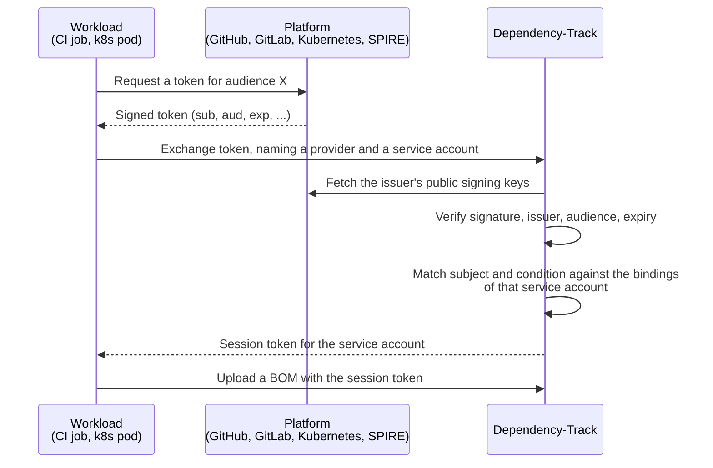

# ワークロード ID フェデレーションについて

!!! note "5.2.0 以降で利用可能"

    それより前のバージョンでは、自動化処理の認証にはチーム API キーしか使えません。

ワークロード ID フェデレーションを使うと、ワークロードは、誰かが作成して保存した API キーの代わりに、自身のプラットフォームが発行したトークンで Dependency-Track に認証できます。GitHub Actions のジョブ、GitLab CI のジョブ、Kubernetes の Pod、SPIFFE のワークロードは、自身の ID を示す有効期間の短い署名付きトークンをすでに保持しています。Dependency-Track はそのトークンを検証し、管理者が設定したルールに一致すれば、[サービスアカウント](access-control.md#service-accounts)のセッションを返します。

ワークロードは Dependency-Track の認証情報を一切保存しません。

## 存在する理由 {#why-it-exists}

API キーは有効期間の長い静的なシークレットです。誰かがそれを作成して CI システムにコピーし、漏洩したときには削除し、期限切れになる前にはローテーションすることを忘れずに行う必要があります。キー自体からは、どのパイプラインがそれを使っているかがわかりません。また、パイプラインの外に漏れたキーは、誰かが気付くまでどこからでも使えてしまいます。

プラットフォームのトークンには、こうした性質が一切ありません。存在するのは数分間だけで、受け取った正確なリポジトリ、ブランチ、名前空間、ワークロードを示し、そのコンテキストの外では誰も発行できません。

サービスアカウントとワークロード ID フェデレーションを組み合わせることが、チーム API キーで動く自動化処理を置き換える想定の手段です。

* **サービスアカウント**は、自動化処理に独自の権限と独自の監査証跡を持つ専用の ID を与えます。
* **ワークロード ID フェデレーション**は、その ID に、誰も保存する必要のない認証情報を与えます。

## 交換のしくみ {#how-an-exchange-works}

ワークロードは、プロバイダーと、なりすまして動作したいサービスアカウントの両方を指定します。

## プロバイダーとバインディング {#providers-and-bindings}

**ワークロード ID プロバイダー**は、どの issuer を信頼するかを定めます。issuer、トークンが持つべき audience、issuer の公開署名鍵の取得元、作成するセッションの有効期間を保持します。プロバイダーはインスタンス全体で共有され、管理者だけが管理します。

**ワークロード ID バインディング**は、そのプロバイダーのどのサブジェクトがどのサービスアカウントとして動作できるかを定めます。バインディングはサービスアカウントに属し、プロバイダーを指定し、サブジェクトを完全一致またはプレフィックスで照合します。[CEL](../reference/cel-expressions.md) で記述する任意の条件を使うと、トークン内の任意のクレームを参照して照合をさらに絞り込めます。

バインディングが人間のユーザーを指すことはできません。

### サブジェクトと条件 {#subjects-and-conditions}

バインディングには、条件を持つ場合でもサブジェクトが必要です。その理由は、共有された issuer の性質にあります。GitHub と GitLab.com はアカウントを持つ誰にでもトークンを発行し、audience をリクエストする側に選ばせます。そこでは audience は何も分離しません。組織を示すのはサブジェクトだけなので、条件だけで照合するバインディングは、そのプラットフォームの他のすべてのテナントに開かれてしまいます。

条件が存在するのは、プラットフォームがすべての情報をサブジェクトに入れるわけではないからです。たとえば [GitLab CI](https://docs.gitlab.com/ci/secrets/id_token_authentication/) は、デプロイ環境を別のクレームに保持しているため、サブジェクトのプレフィックスでは照合できません。

条件はセキュリティ境界の一部です。想定より多くのトークンに一致する条件は、より多くのワークロードがそのサービスアカウントとして動作することを許してしまいます。

## 得られるセッション {#the-resulting-session}

交換では、ログインエンドポイントが発行するものと同じ種類の不透明なセッショントークンが返され、サービスアカウントのすべての権限を持ちます。

セッションはプロバイダーに設定された有効期間だけ続き、その期間は 24 時間を超えられません。サブジェクトトークンは交換の時点でのワークロードの ID を証明するものであり、プラットフォームのトークンが短命であることで、この差は意図的なものになります。

[GitLab CI](https://docs.gitlab.com/ci/secrets/id_token_authentication/) と [SPIRE](https://spiffe.io/docs/latest/deploying/spire_server/) が発行するトークンは、デフォルトで 5 分後に期限切れになります。BOM をアップロードしてその分析を待つ CI ジョブは、それより長くかかります。

セッションは元になったトークンより長く存続するため、バインディングやプロバイダーを削除しても、すでに作成されたセッションは終了しません。サービスアカウントを停止すると、セッションは直ちに終了します。

## 関連項目 {#further-reading}

* 手順とプラットフォームごとの設定については、[ワークロード ID フェデレーションを設定する](../guides/administration/configuring-workload-identity-federation.md)を参照してください。
* サブジェクトの照合ルール、条件の環境、トークンの要件については、[ワークロード ID のリファレンス](../reference/workload-identity.md)を参照してください。
* サービスアカウントとユーザー、チーム、権限との関係については、[アクセス制御について](access-control.md#service-accounts)を参照してください。
