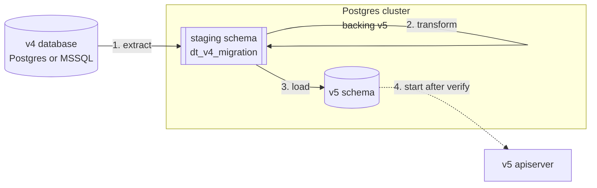

# v4 から v5 に移行する

このガイドでは、Dependency-Track v4(Postgres または Microsoft SQL Server)の本番データを、新しい Dependency-Track v5 インスタンス(Postgres のみ)に移す手順を説明します。

移行は、`v4-migrator` コマンドラインツールで実行する、1 回限りのオフライン作業です。このツールは v4 のデータベースから行を抽出し、v5 のデプロイを支える Postgres クラスター内で変換して、v5 のスキーマにロードします。移行中、v4 はオフラインにしておく必要があります。ツールは v4 のソースに書き込みません。

v5 のデプロイを v5 のリリース間で更新するだけであれば、このガイドは対象外です。代わりに[リリースごとのアップグレードガイド](../upgrading/index.md)を参照してください。

移行に踏み切る前に実際のワークロードで v5 を試すには、[v4 と v5 を並行して運用する](running-v4-and-v5-in-parallel.md)を参照してください。

本番の切り替えの前に、サンドボックスの v5 スタックに対してこの移行を最初から最後まで通して試すには、[v4 から v5 への移行をリハーサルする](../../tutorials/rehearsing-the-v4-migration.md)を参照してください。

!!! warning "v5 では設定プロパティと環境変数の名前が変わっています"
    v5 では多くの設定プロパティとその環境変数の名前が変更され、v4 の名前は受け付けられなくなりました。移行ツールが移すのはデータであり、デプロイの設定ではないため、v5 の API サーバーの設定は新しい名前で作り直す必要があります。現在のプロパティ名と環境変数名については、[設定リファレンス](../../reference/configuration/properties.md)を参照してください。

Kubernetes 環境で Dependency-Track を実行している場合は、[Helm チャート](https://github.com/DependencyTrack/helm-charts/blob/main/charts/dependency-track/UPGRADING.md)内の `UPGRADING.md` ガイドを参照してください。

## 移行のしくみ {#how-the-migration-works}

`v4-migrator` コマンドラインツールは、v5 のデプロイの Postgres の移行先に対して、3 つのオフラインフェーズ(**extract**、**transform**、**load**)を実行します。v4 のソースの行は、まず v5 のクラスター内にある専用の**ステージングスキーマ**(`dt_v4_migration`)に入り、移行ツールがそこで v5 の形に変換します。最終的な v5 のスキーマに書き込むのはロードフェーズだけです。v5 の apiserver は、ロードと検証が終わるまでオフラインのままにします。その後、ステージングスキーマを削除して apiserver を起動します。



## 始める前に {#before-you-start}

次の条件を満たしていることを確認します。

- **ソースのバージョン。** v4 インスタンスは **4.14.2 以降**である必要があります。移行ツールは、このリリースのスキーマとデータの形を前提としています。それより前のバージョンはサポートされておらず、失敗したり、壊れた出力を警告なしに生成したりする可能性があります。移行ツールを実行する前に、v4 を 4.14.2 以降にアップグレードします。
- **ソース。** v4 のデータベースが Postgres(v4 がサポートする任意のバージョン)または Microsoft SQL Server 2016 以降で動作していること。H2 はサポートされていません。始める前に v4 の API サーバーを停止します。ツールはソースに書き込みませんが、v4 から同時に書き込みが行われると、抽出結果に不整合が生じます。
- **移行先。** v5 インスタンス専用の Postgres 14 以降のクラスターが、データを受け入れられる状態であること。v5 のデータベーススキーマは、移行ツールの `bootstrap` ステップが適用します。移行先のクラスターを用意する方法については、[データベースを設定する](configuring-database.md)を参照してください。移行ツールを実行する前に、v5 の apiserver を移行先に対して起動しないでください。起動すると、移行ツールが v4 から投入する必要のあるテーブルに、apiserver の初期データ投入タスクがデータを入れてしまいます。移行ツールは、同梱しているスキーマバージョン以外のスキーマに対しては実行を拒否します。移行先にすでにユーザーデータがある場合も同様です。
- **データベースユーザー。** 移行ツールには、移行後に v5 の apiserver が使うものと同じデータベースユーザーを使います。*または*、移行ツールが作成するすべてのオブジェクトの所有権を apiserver のユーザーに付与します。apiserver はリリースごとに後続のスキーマのマイグレーションを適用するため、v5 のスキーマとそのテーブルに対する DDL 権限が必要です。ここで不一致があると、移行時ではなく、後で v5 をアップグレードしたときに起動時のマイグレーションの失敗として表面化します。
- **ディスク。** 移行先のクラスターには、最終的なデータセットのサイズのおよそ 2 倍の空きディスク容量が必要です。ステージングスキーマを削除するまで、ステージングテーブルには、移行するすべての行のソースの型のままのコピーが、最終的な v5 の行と並んで保持されます。
- **拡張機能。** 移行先で `pg_trgm` をインストールできる必要があります。拡張機能は v5 のスキーマの初期化でインストールされます。移行ツールの事前チェックでこれを確認します。
- **JDBC での到達性。** 移行ツールを実行するホストから、v4 のソースと v5 の移行先の両方に JDBC 接続できること。

!!! warning

    移行中は v4 のデータベースをオフラインにしておく必要があります。稼働中の v4 インスタンスに移行ツールを向けないでください。ツールはオフラインであることを前提としており、ソースに書き込みロックをかけません。

## 推奨される Postgres のチューニング {#recommended-postgres-tuning}

移行中は、次の設定を適用します。移行ツールはこれらを設定しません。実行前に移行先で設定し、必要に応じて移行後に元に戻します。

| 設定 | 推奨値 | 理由 |
|---|---|---|
| `max_wal_size` | 8 GB 以上 | ロードフェーズはすべての書き込みを WAL に記録します。デフォルトのサイズではチェックポイントが頻繁に発生します。 |
| `max_locks_per_transaction` | 256 | 設定しないと、メトリクスのパーティション操作でデフォルトの 64 を使い切る可能性があります。 |
| `maintenance_work_mem` | 1 GB 以上 | ロード中のインデックスの更新が速くなります。 |
| `checkpoint_timeout` | 30 分 | ロード時の WAL の急増を、過剰なチェックポイントを発生させずに吸収します。 |
| `checkpoint_completion_target` | 0.9 | 同上。 |

!!! warning

    v5 の apiserver のデフォルトのタイムゾーンは、移行期間中だけでなく、デプロイを運用する期間を通じて `UTC` である必要があります。[公式 Docker イメージ](https://github.com/DependencyTrack/hyades-apiserver/pkgs/container/hyades-apiserver)ではすでに `TZ=Etc/UTC` が設定されているため、このイメージを使う運用者は何もする必要はありません(また、`TZ` を上書きしてはいけません)。コンテナー以外のデプロイやカスタムイメージでは、`TZ` 環境変数を `Etc/UTC` に設定します。

    移行ツールは、UTC の日付の境界で日次のメトリクスパーティションを事前に作成します。apiserver はデフォルトのタイムゾーンを使ってこれらのパーティションを拡張するため、apiserver が UTC 以外だと、移行ツールとずれたパーティションの境界を計算し、範囲の重複によって `ATTACH PARTITION` が失敗します。

## 移行を実行する {#run-the-migration}

移行ツールは、`ghcr.io/dependencytrack/v4-migrator:<version>` で公開されているコンテナーイメージとして提供されています。レジストリとタグの規則については [Container images](../../reference/container-images.md) を参照してください。

以下の例では、簡潔にするために次のシェルエイリアスを使います。

```bash
alias v4-migrator='docker run --rm -it --network=host ghcr.io/dependencytrack/v4-migrator:<version>'
```

!!! note

    `--network=host` は Linux でのみ動作します。macOS と Windows の Docker Desktop では、このフラグは警告なしに無視され、コンテナーには独自のネットワーク名前空間が割り当てられます。ホスト上のデータベースに接続するには、JDBC URL の `localhost` / `127.0.0.1` を `host.docker.internal` に置き換えるか、ソースと移行先の両方に到達できるユーザー定義の Docker ネットワーク(`--network <name>`)にコンテナーを接続します。

!!! tip "パスワードの入力"

    以下の例では、`--source-pass` と `--target-pass` を引数なしで渡しています。この場合、移行ツールは対話的にパスワードの入力を求めるため、シークレットがシェルの履歴や `ps` の出力に残りません。インラインでパスワードを指定する場合は、代わりに `--source-pass <value>` / `--target-pass <value>` と記述します。

### 1. v5 のスキーマを適用する {#1-apply-the-v5-schema}

移行先のデータベースを初期化します。このステップでは v5 のスキーマのマイグレーションを適用します。何度実行しても安全です。ここで指定したユーザーが v5 のスキーマオブジェクトの所有者になるため、v5 の apiserver が接続に使うものと同じユーザーを使います(前のセクションの**データベースユーザー**の注意事項を参照してください)。

```bash
v4-migrator bootstrap \
  --target-url 'jdbc:postgresql://target-host:5432/dtrack' \
  --target-user dtrack \
  --target-pass
```

これで移行先には、v5 のスキーマと、初期データが投入された `PERMISSION` カタログ(v5 の既知の権限のセット)が作成されます。bootstrap はそれ以外の行を書き込みません。`LICENSE`、`TEAM`、`USER` などは、移行ツールの後続のフェーズが v4 のソースから投入します。

### 2. 移行先を検証する {#2-verify-the-target}

抽出に時間をかける前に、事前チェックを実行して問題を見つけます。

```bash
v4-migrator verify \
  --target-url 'jdbc:postgresql://target-host:5432/dtrack' \
  --target-user dtrack \
  --target-pass
```

`verify` は読み取りのみを行い、書き込みは一切行いません。初期化したばかりでステージングが存在しない移行先では、次の結果になります。

- Flyway head `202605111028` が `OK` と報告される。
- **v5 の `PERMISSION` テーブルを除いて**、行数の列がすべて 0 である。
- プローブのエントリーがない。
- 終了を示す行 `== verify complete ==` が表示される。

この段階ではまだデータを移していないため、`verify` には初期データの投入直後の状態が表示され、指摘事項はありません。

### 3. ドライラン {#3-dry-run}

実際に実行する前に、何が起きるかを確認します。

```bash
v4-migrator run \
  --target-url 'jdbc:postgresql://target-host:5432/dtrack' --target-user dtrack --target-pass \
  --source-url 'jdbc:postgresql://v4-host:5432/dtrack' --source-user dtrack --source-pass \
  --metrics-retention-days 90 \
  --dry-run
```

`--dry-run` を指定すると、事前チェックを実行して実行計画を出力します。どちらのデータベースにも何も書き込みません。

### 4. 抽出、変換、ロード {#4-extract-transform-load}

3 つのフェーズをまとめて実行します。

```bash
v4-migrator run \
  --target-url 'jdbc:postgresql://target-host:5432/dtrack' --target-user dtrack --target-pass \
  --source-url 'jdbc:postgresql://v4-host:5432/dtrack' --source-user dtrack --source-pass \
  --metrics-retention-days 90
```

`run` と `extract` には `--metrics-retention-days` を必ず指定します。v4 には保持期間の概念がなく、v5 で導入されました。[時系列メトリクスについて](../../concepts/time-series-metrics.md)を参照してください。移行ツールは、メトリクスの行を黙って削除したり引き継いだりするのではなく、明示的に選択することを求めます。v4 のメトリクスをすべて削除するには `0` を、直近 `N` 日分を残すには正の整数を、すべてを移行するには大きな数を指定します。移行ツールは保持する日ごとに日次のパーティションを 1 つずつ事前に作成するため、大きな値を指定するとロードフェーズが目に見えて長くなります。

ステップの間でステージングを確認したい場合は、フェーズを個別に実行することもできます。

```bash
v4-migrator extract   --target-url ... --source-url ... --metrics-retention-days 90
v4-migrator transform --target-url ...
v4-migrator load      --target-url ...
```

ソースが Microsoft SQL Server の場合は、ソースの URL を差し替えます。

```bash
--source-url 'jdbc:sqlserver://v4-host:1433;databaseName=dtrack'
```

v4 のデプロイで使っているものと同じ接続パラメーター(TLS、認証など)を付け加えます。

移行ツールは、JDBC URL からソースの種類を自動的に判別します。

### 5. サンプルモード {#5-sample-mode}

完全な実行に踏み切る前に自分たちのデータでパイプラインを試すには、テーブルごとに少数の行をサンプリングします。

```bash
v4-migrator run ... --sample 100
```

`--sample` は、テーブルごとの抽出件数の上限を設定します。後続のフェーズはサンプリングしたデータに対して実行され、有効な(ただし一部だけの)v5 のデータセットを生成します。

完全な実行の前に、ロードが失敗した後と同じ方法で移行先をリセットします。v5 のスキーマ(または移行先のデータベース全体)を削除して作り直し、`v4-migrator bootstrap` を再実行してから、`v4-migrator cleanup` でステージングスキーマを削除します。理由については[失敗したロードから復旧する](#recovering-from-a-failed-load)を参照してください。v5 のテーブルを手動で `TRUNCATE` しないでください。

### 6. 結果を検証する {#6-verify-the-result}

ロードの後、もう一度 `verify` を実行します。今回はテーブルごとにソース、ステージング、v5 の行数が報告され、すべてのプローブの結果(不正な形式の UUID など)も表示されます。

```text
[Schema]
  OK    Flyway head = 202605111028

[Row counts]
  Table                       Source      Staging           v5    Note
  LICENSE                       5234         5234         5234
  TEAM                            47           42           42    expected: dedup by NAME (-5)
  COMPONENT                  4823714      4823711      4823711    see [Probes] (-3)
  PROJECTS_TAGS                12480        12462        12462    reduction (-18), see migration guide
  ...

[Probes]
  COMPONENT                3 malformed UUID(s) dropped

[Constraints]
  18 CHECK constraint(s) hold across 6 loaded table(s)

== verify complete ==
```

`Note` 列には、ソースから v5 にかけて行数が減ったテーブルについての注記が表示されます。重複排除、フィルタリング、保持期間によって、移行中に行数が減ることはよくあります。これらの削減は移行ツールが意図的に行うものです。`Note`(および `[Probes]` セクション)にはどの理由が当てはまるかが示されるため、減少を説明のつかないまま放置せずに、それぞれの原因を確認できます。各注記は、次の 3 つのいずれかの状態です。

- `expected: <reason> (-N)`。既知の意図的な削減です。理由は、[情報が失われる変更とわかりにくい変更](#lossy-and-non-obvious-changes)のセクションにある変換に対応しています。
- `see [Probes] (-N)`。`[Probes]` セクションに減少の内訳(無効な UUID、スキップされたユーザー、大文字小文字の衝突)が示されます。
- `reduction (-N), see migration guide`。専用の注記がない意図的な削減です。内容を理解するには、[情報が失われる変更とわかりにくい変更](#lossy-and-non-obvious-changes)のセクションを参照してください。

!!! warning "権限の結合テーブルはデータ損失を示すものではない"

    `TEAMS_PERMISSIONS` と `USERS_PERMISSIONS` はどちらも、v4 から v5 への権限の再割り当ての一環として行が減ったり増えたりします([v4 の対応する権限から付与される v5 専用の権限](#v5-only-permissions-granted-from-v4-equivalents)を参照してください)。そのため、これらの行数の差には意味がありません。この 2 つのテーブルの `Note` は無視してください。

最後の `== verify complete ==` の行は、正常に終了したことを示します。この行がない場合は、`verify` が最後まで完了せずに停止したことを意味します。

### 7. ステージングを削除する {#7-drop-staging}

結果に問題がなければ、ステージングスキーマを削除します。

```bash
v4-migrator cleanup \
  --target-url ... --target-user ... --target-pass
```

または、あらかじめ `load` の実行時に `--drop-staging` を渡しておくと、成功時に削除されます。

```bash
v4-migrator load ... --drop-staging
```

## 情報が失われる変更とわかりにくい変更 {#lossy-and-non-obvious-changes}

以下の変換は自動的に適用されます。メトリクスの保持期間を除き、いずれも設定で変更できません。

### ユーザーの種類をまたいだユーザー名の衝突 {#username-collisions-across-user-types}

v4 では、管理対象ユーザー、LDAP ユーザー、OIDC ユーザーを 3 つの別々のテーブルに格納していました。v5 では 1 つのテーブルに格納します。同じユーザー名が複数の種類にまたがって存在する場合、移行ツールは管理対象ユーザーを先に挿入し、LDAP と OIDC のユーザーにはサフィックスを付けます。

- `alice`(管理対象)→ `alice`
- `alice`(LDAP)→ `alice-CONFLICT-LDAP`
- `alice`(OIDC)→ `alice-CONFLICT-OIDC`

サフィックスが付いたアカウントは、外部の ID と一致しなくなります。移行後に、名前が `-CONFLICT-LDAP` または `-CONFLICT-OIDC` で終わるすべてのユーザーを一覧表示します。それぞれについて、サフィックスのない管理対象ユーザーの単なる重複であるか(その場合は削除します)、元のユーザー名に戻す必要がある正当な外部 ID であるか(その場合は、サフィックスのない管理対象ユーザーを削除または名前変更してから、サフィックス付きのアカウントを外部 ID に一致する名前に変更します)を判断します。

### ユーザー名のないユーザーレコード {#user-records-without-a-username}

v4 では、`USERNAME IS NULL` の管理対象ユーザーと LDAP ユーザーの行が許容されていました。v5 では NULL でないユーザー名が必要です。移行ツールはこれらの行を通知なしにスキップします。これらの行は v4 でも使えなかった(ログインする手段がなかった)ため、削除しても問題ありません。

### v4 の対応する権限から付与される v5 専用の権限 {#v5-only-permissions-granted-from-v4-counterparts}

v5 では、v4 で暗黙的に含まれていた 2 つの能力を、それぞれ専用の権限に分離しています。移行ツールは、移行前の認可がこれまでどおり機能するように、それぞれについて v4 時代の対応する権限を持っていたすべての v4 のユーザーとチームに新しい v5 の権限を付与します。v5 の分離されたセマンティクスにしたい場合は、移行後に、該当するプリンシパルから新しい権限を取り消します。

- **`PORTFOLIO_ACCESS_CONTROL_BYPASS`。** v4 の `ACCESS_MANAGEMENT` 権限には、ポートフォリオのアクセス制御をバイパスする能力が暗黙的に含まれていました。移行ツールは、`ACCESS_MANAGEMENT` を持つすべての v4 のユーザーとチームに `PORTFOLIO_ACCESS_CONTROL_BYPASS` を付与します。
- **`SECRET_MANAGEMENT`。** v4 にはシークレット管理専用の権限がありませんでした。パッケージリポジトリの Basic 認証のパスワードと、アナライザー / 脆弱性データソースの API 認証情報は、`SYSTEM_CONFIGURATION` を持つすべてのユーザーが設定できました。v5 では、これらを `SECRET_MANAGEMENT` で保護された専用のシークレットマネージャーで管理します。移行ツールは、`SYSTEM_CONFIGURATION` を持つすべての v4 のユーザーとチームに `SECRET_MANAGEMENT` を付与します。

v5 で廃止された v4 の権限名(`VIEW_BADGES` など)は、移行時に削除されます。これらの名前を参照するユーザーやチームへの割り当ては、通知なしに削除されます。

### チーム、OIDC グループ、タグの重複排除 {#dedup-of-teams-oidc-groups-and-tags}

v4 では `TEAM.NAME`、`OIDCGROUP.NAME`、`TAG.NAME` の一意性を強制していませんでした。v5 では強制します。移行ツールは重複を `ID` が最も小さい行に集約し、すべての結合テーブルの参照を正規の ID に書き換えて、正規でない行を削除します。

### プロジェクトの重複排除 {#project-deduplication}

v5 では、プロジェクトごとに `(NAME, VERSION)` の一意性を強制します(バージョンが NULL の場合には別の部分インデックスを使います)。移行ツールは、`LAST_BOM_IMPORTED` が最も新しいものを残して重複を集約します。古い重複は削除されます。

### プロジェクトのアクティブ状態 {#project-activity-state}

v4 では `ACTIVE` という true/false のフラグを持っていました。v5 では `INACTIVE_SINCE`(任意のタイムスタンプ)を持ちます。v4 でアクティブだったプロジェクトは `INACTIVE_SINCE = NULL` になります。v4 で非アクティブだったプロジェクトは `INACTIVE_SINCE = '1970-01-01 00:00:00+00'`(Unix エポック)になります。これは「*v4 から非アクティブとして移行され、正確な非アクティブ化の日時は不明*」を意味する番兵値です。

### 脆弱性の EPSS の値 {#vulnerability-epss-values}

v4 では、EPSS のスコアとパーセンタイルを各脆弱性の行に直接格納していました。v5 では、上流のデータソースから投入される専用のテーブルに EPSS を格納します。移行ツールは v4 の EPSS の値をコピーしません。v5 は初回起動から数分以内に、実行時に EPSS の値を投入し直します。

### メトリクスの保持期間 {#metrics-retention}

v5 では、日次のメトリクスを保持期間内に限って保持します。v4 には対応する設定がなかったため、移行ツールは `extract` と `run` に `--metrics-retention-days` フラグの指定を求めます。`DEPENDENCYMETRICS` と `PROJECTMETRICS` のうち、基準日より古い行は削除されます。ポートフォリオのメトリクスは移行されません。v5 では、ポートフォリオのメトリクスを必要に応じて計算されるマテリアライズドビューとして導出します。

### 通知ルールの設定 {#notification-rule-configuration}

v5 では、`NOTIFICATIONRULE.PUBLISHER_CONFIG` の格納形式が自由形式のテキストから JSON に変わります。移行ツールは、各ルールの設定を v4 の `destination`(Jira の場合は `jiraTicketType` も)から再構築し、移行するすべてのルールに `ENABLED = FALSE` を設定します。v4 のテキストのペイロードにエンコードされていた、パブリッシャー固有のその他のフィールドは削除されます。

!!! warning

    移行したすべての通知ルールは、v5 ではオフの状態になります。各ルールの設定を確認してから、もう一度有効にしてください。

### パッケージリポジトリ、アナライザー、脆弱性データソースの認証情報 {#repository-analyzer-and-vulnerability-source-credentials}

v4 では、パッケージリポジトリの Basic 認証のパスワードを `REPOSITORY.PASSWORD` に格納し、アナライザー(OSS Index、Snyk、Trivy、VulnDB)と脆弱性データソース(NVD、GitHub Advisories、OSV)の API 認証情報を暗号化されたプロパティ値として格納していました。v5 では、これらをすべて一元化された[シークレットマネージャー](../user/managing-secrets.md)で管理しますが、移行ツールはシークレットマネージャーにデータを投入しません。

移行ツールは、すべての `REPOSITORY.PASSWORD` を NULL にし、該当するパッケージリポジトリをオフにします。アナライザーと脆弱性データソースの認証情報は、後述する暗号化されたプロパティの処理の一環として削除されます。

移行後に、v5 の管理パネルで **Repositories**、**Analyzers**、**Vulnerability Sources** の各ページを開き、シークレットマネージャーを通じて各認証情報を再入力します。該当するパッケージリポジトリをオンに戻します。各ミラーを再び有効にする手順の詳細については、[脆弱性データソースを設定する](configuring-vulnerability-sources.md)を参照してください。v5 のデプロイにシークレットの暗号鍵をまだ設定していない場合は、[シークレット管理を設定する](configuring-secret-management.md)を参照してください。

### 暗号化されたプロパティ値 {#encrypted-property-values}

v5 では、`ENCRYPTEDSTRING` プロパティ型が廃止されました。移行ツールは、暗号化されたすべてのプロパティ値を NULL にし、型を `STRING` に書き換えます。この方法で格納されていた認証情報(主にアナライザーと脆弱性データソースの API キー)の復旧手順については、前のセクションを参照してください。

### 型が不明なプロパティ値 {#property-values-of-unknown-type}

v5 では、プロパティ型を `BOOLEAN`、`INTEGER`、`NUMBER`、`STRING`、`TIMESTAMP`、`URL`、`UUID` の固定のセットに限定しています。移行ツールは、型がこのセットに含まれない v4 のプロパティを削除します(前のセクションで扱った `ENCRYPTEDSTRING` を除きます)。

### 分類子の値 {#classifier-values}

v5 では、プロジェクトとコンポーネントの `NONE` 分類子が廃止されました。移行ツールは、すべての `NONE` を `NULL` に書き換えます。v5 のセットに含まれないその他の v4 の分類子の値も、`NULL` に変換されます(この列は `NULL` を許容します)。

### パッケージメタデータの PURL によるフィルタリング {#purl-filtering-for-package-metadata}

v4 では、パッケージリポジトリのメタデータを名前と名前空間でインデックス化していました。v5 では、パッケージ URL(PURL)でインデックス化し、PURL に `@`、`?`、`&`、`#` を含めることを禁止する CHECK 制約を強制します。移行ツールは、導出した PURL にこれらの文字のいずれかを含むパッケージリポジトリのメタデータの行をスキップします。v5 は実行時に、同じ上流のソースからパッケージメタデータを投入し直します。

### 削除されたテーブル {#removed-tables}

次の v4 のテーブルには v5 に対応するテーブルがなく、移行されません。

- `EVENTSERVICELOG`、`INSTALLEDUPGRADES`、`SCHEMAVERSION`。v5 のスキーママイグレーションと永続実行の管理情報が、その役割を引き継ぎます。
- `COMPONENTANALYSISCACHE`。実行時のキャッシュです。v5 が必要に応じて投入し直します。

### 不正な形式の UUID {#malformed-uuids}

v5 では、UUID を `varchar(36)` ではなくネイティブの `uuid` として格納します。移行ツールは、UUID を正規の形式に照らして検証します。移行ツールは、不正な形式の UUID を持つ行を削除し、ステージングスキーマ内の `probe_invalid_uuids` テーブルに記録します。`verify` は、ソースのテーブルごとにその件数を報告します。ステージングのプローブはステージングスキーマを削除するまで残るため、影響を受けた行を監査できます。

### MSSQL の大文字小文字を区別しない一意性 {#mssql-case-folded-uniqueness}

Microsoft SQL Server のデフォルトの照合順序(`SQL_Latin1_General_CP1_CI_AS`)では、`Alice` と `alice` を同じ値として扱います。Postgres では別の値として扱います。移行ツールは、v5 で両方の行を保持します。大文字小文字を区別せずに一意だった v4 の列に v5 が一意性を強制する場合(たとえば、大文字小文字だけが異なる 2 つの `TEAM.NAME` の値)、それらの行は 2 つの別々のエントリーとして残ります。この点が気になる場合は、実行前にデータを調べてください。

## 実行時の動作の変更 {#runtime-behavior-changes}

前のセクションでは、移行ツールがデータに適用する変換を扱いました。このセクションでは、移行したデータに対して v5 が*動作する*方法の違いを扱います。いずれも設定で変更できません。v5 に切り替えた後はこれらの変化を想定し、観察された影響(メトリクスの減少、検出結果の欠落)を以下の項目と照らし合わせてください。

### 非アクティブな検出結果 {#inactive-findings}

v4 は検出結果を*追加する*だけでした。すべてのアナライザーが報告しなくなった後も、検出結果はコンポーネントに残り続けました。v5 では、そのような検出結果を自動的に非アクティブにし、デフォルトのビューでは非アクティブな検出結果を除外します。

v5 の最初の分析サイクルの後すぐに、アクティブな検出結果の件数が一度だけ減少し、それに応じて時系列メトリクスも段階的に下がることを想定してください。v5 は過去の行を削除せずに非アクティブな状態で保持しますが、それらはアクティブな合計には含まれなくなります。

## パフォーマンスとオブザーバビリティ {#performance-and-observability}

スループットは、ハードウェア、ソースの種類、データセットのサイズによって異なります。Postgres から Postgres への抽出(バイナリの `COPY`)ではおよそ 50 MB/秒、Microsoft SQL Server のソース(JDBC のバッチ挿入)ではおよそ 20 MB/秒を想定してください。

長時間の実行中に状況を把握できるように、移行ツールはテーブルごとに次のような進捗の行を出力します。

```text
INFO  Extracting LICENSE
INFO    -> 5234 rows in 142 ms
INFO  Transforming LICENSE
INFO    -> 5231 rows in 38 ms
INFO  Loading LICENSE into v5
INFO    -> LICENSE: 5231 rows in 27 ms (193740 rows/s)
```

さらにロードフェーズでは、1 つのテーブルの処理が続いている間、5 秒ごとにハートビートを出力するため、大きなテーブルでも状況を把握できます。

```text
INFO  Loading COMPONENT into v5
INFO    .. COMPONENT: still loading after 25s (expected 4823714 rows)
INFO    .. COMPONENT: still loading after 30s (expected 4823714 rows)
INFO    -> COMPONENT: 4823714 rows in 32104 ms (150253 rows/s)
```

expected の件数は上限です。重複排除や削除された行があるため、最終的な件数はこれより少なくなることがあります。

100 GB の v4 のデータセットは、ワークステーションクラスのディスクで数時間、専用のサーバーハードウェアではそれより短い時間で完了するはずです。

### フェーズの完了を示す行 {#phase-completion-lines}

各フェーズは成功すると、テーブルごとの行の後に、完了を明示する行を出力します。

```text
INFO  Extract phase completed: 64 table(s), 5821044 row(s) in 184302 ms
INFO  Transform phase completed: 64 table(s), 5820102 row(s) in 96118 ms
INFO  Load phase completed: 64 table(s), 5820097 row(s) in 211740 ms
```

抽出、変換、ロードを連続して実行する `run` コマンドは、最後に 1 行を出力します。

```text
INFO  Migration completed: extract + transform + load finished. Run 'verify' to review row counts and probes.
```

完了したフェーズは、完了を示す行を出力します。`run` の場合は、`Migration completed` の行が成功を示します。**テーブルごとの出力の後にこの行がない場合は、フェーズが完了していません。** 終了コードとその前のログの行を確認してください。

最後のテーブルのロードが終わると、移行ツールは最終処理を行いながら進捗の行を出力します。

```text
INFO  Finalizing load: re-enabling triggers and resetting identity sequences
INFO  Analyzing 64 loaded table(s)
INFO  Refreshing PORTFOLIOMETRICS_GLOBAL materialized view
INFO  Applying v5.7.0 cleanup deletes
```

最終処理が終わると、`Load phase completed` の行が続きます。

## 再開性 {#resumability}

各フェーズは、テーブルごとの状態をステージングスキーマ内の `migration_state` テーブルに保存します。

`extract` と `transform` は安全に再実行できます。`extract` を再実行すると、完了していないテーブルを空にして抽出し直します。`transform` を再実行すると、すべての `tgt_*` テーブルを削除して作り直します(変換はべき等です)。

`load` は自動的には再開できません。実行するたびに、すべての `INSERT INTO ... SELECT` を最初から実行し直します。v5 に行が 1 つでも入っていると、続けて `load` を実行しても制約違反で失敗し、移行先は不整合な状態になります。後述の**失敗したロードから復旧する**を参照してください。

`load` を開始する前に実行を中止する必要がある場合は、ステージングスキーマを削除(`v4-migrator cleanup`)して最初からやり直すか、ステージングスキーマを残しておいて、後で `extract` または `transform` から再開します。

## 失敗したロードから復旧する {#recovering-from-a-failed-load}

`load` の実行が途中で失敗すると、失敗する前に完了したすべてのテーブルの行が v5 に残ります。移行ツールはそれらをロールバックしないため、そのまま `load` を再試行しても失敗します。次のいずれかの方法を選びます。

**最初からやり直す。** 失敗の原因が不明な場合や、まっさらな移行先を使いたい場合に推奨します。

```bash
v4-migrator cleanup --target-url ... --target-user ... --target-pass
# Drop and re-create the v5 schema (or the entire target database) yourself, then:
v4-migrator bootstrap --target-url ... --target-user ... --target-pass
v4-migrator run       --target-url ... --source-url ... --metrics-retention-days N
```

**既存のステージングから再ロードする。** `extract` と `transform` の出力が信頼でき、ロードのステップだけが失敗した場合は、こちらのほうが速く済みます。ステージングスキーマは `bootstrap` を実行しても残るため、次のように実行します。

```bash
# Drop and re-create the v5 schema (or the entire target database) yourself.
v4-migrator bootstrap --target-url ... --target-user ... --target-pass
v4-migrator load      --target-url ... --target-user ... --target-pass
```

`bootstrap` はスキーマを適用した後に v5 の `PERMISSION` カタログに初期データを投入し直すため、`transform` を再実行しなくても、`load` の再実行で権限の外部キーを解決できます。

!!! warning

    v5 の個々のテーブルを手動で `TRUNCATE` してから `load` を再実行しないでください。ロードフェーズは、`PROJECT` と `PROJECT_ACCESS_USERS` のトリガーの無効化、ID シーケンスのリセット、日次のメトリクスパーティションの事前作成を、一連の流れとして行います。いずれもテーブル単位ではべき等ではありません。再試行する前に、必ず v5 を完全にリセットしてください。

## 移行したデータを本番の移行先に移す {#moving-the-migrated-data-to-its-production-target}

移行を専用のホストで実行した場合は、移行ツールの完了後に `pg_dump`/`pg_restore` で結果を移せます。

```bash
pg_dump --format=custom --no-owner --no-acl \
  --exclude-schema=dt_v4_migration \
  -h migration-host -U dtrack dtrack \
  > v5.dump

pg_restore --no-owner --no-acl -d dtrack -h prod-host -U dtrack < v5.dump
```

ステージングスキーマ(デフォルトでは `dt_v4_migration`)はダンプから除外します。ステージングスキーマはクラスター間で移植できず、v5 の実行時にも必要ありません。

## 移行後に行うこと {#what-to-do-after-the-migration}

- v5 の API サーバーを起動し、ロード後の調整タスク(メトリクス、ポリシー評価)を実行させます。基本となる実行時の構成については、[本番環境にデプロイする](deploying-to-production.md)を参照してください。以下の作業はすべて、API サーバーが動作している必要があります。
- 移行したすべての通知ルールの設定を確認してから、もう一度有効にします。[通知アラートを設定する](../user/configuring-notifications.md)を参照してください。
- パッケージリポジトリ、アナライザー、脆弱性データソースの認証情報を v5 のシークレットマネージャーを通じて再入力し、該当するパッケージリポジトリをオンに戻します。[シークレットを管理する](../user/managing-secrets.md)と[シークレット管理を設定する](configuring-secret-management.md)を参照してください。シークレットを管理するには、新しい [`SECRET_MANAGEMENT`](../../reference/permissions.md#secret-management) 権限が必要です(v4 で `SYSTEM_CONFIGURATION` を持っていたプリンシパルには、移行時に自動的に付与されます。[v4 の対応する権限から付与される v5 専用の権限](#v5-only-permissions-granted-from-v4-counterparts)を参照してください)。
- ユーザー名に `-CONFLICT-LDAP` または `-CONFLICT-OIDC` のサフィックスが付いたすべてのユーザーを整理します(単なる重複は削除し、正当な外部 ID は元のユーザー名に戻します)。
- 数時間待ってから、v5 が上流のデータソースから `EPSS` テーブルにデータを投入したことを確認します。

## 関連項目 {#see-also}

- [データベースを設定する](configuring-database.md): v5 を支える Postgres クラスターの用意とチューニング。
- [本番環境にデプロイする](deploying-to-production.md): v5 のサイジング、トポロジー、実行時の構成。
- [スケーリング](scaling.md): 負荷のかかった v5 のデプロイのチューニング。
- [稼働中のインスタンスをアップグレードする](upgrading-instances.md): 以降の v5 から v5 へのアップグレード。
- [v5 での変更点について](../../concepts/changes-in-v5.md): 何がなぜ変わったかの背景。
