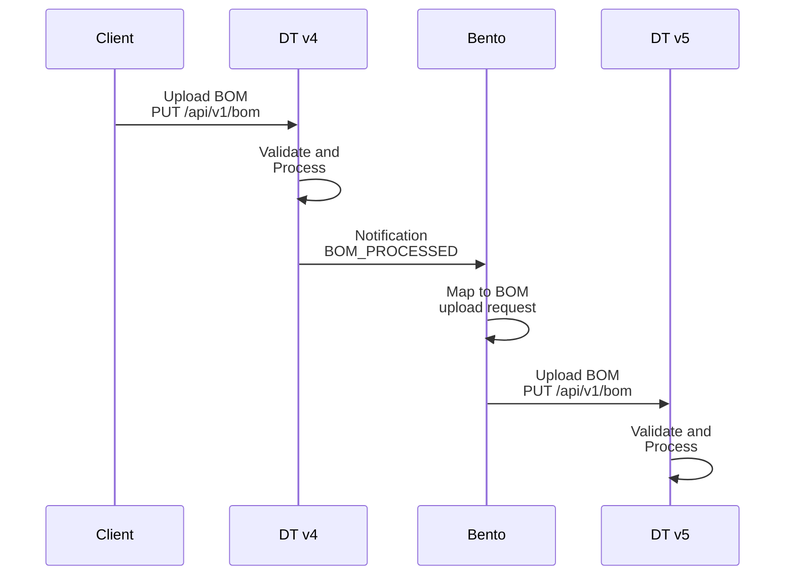

# v4 と v5 を並行して運用する

既存の v4 の本番デプロイがある場合、v5 のテスト用デプロイを並行して運用すると、*実際の*データで動作を比較し、新機能を試せるので便利です。これは、[v4 から v5 に移行する](migrating-from-v4.md)で説明している一度きりのデータ移行に踏み切る前の評価や検証に役立ちます。

この手法でミラーリングされるのは **BOM のアップロード**だけで、すべてのリクエストトラフィックではないことに注意してください。v4 は各 BOM をデータベースと同期した*後*に `BOM_PROCESSED` 通知を発行し、並行して稼働する v5 インスタンスがその通知を受け取って BOM を再アップロードします。BOM のアップロードによって発生しないもの(プロジェクトの手動編集、ポリシーの変更、検出結果のトリアージ、通知)は複製されません。

`BOM_PROCESSED` 通知のサブジェクトには、元の BOM(Base64 エンコード済み)と、対象プロジェクトの名前とバージョンが含まれます。これだけあれば、別の Dependency-Track インスタンスへの BOM アップロードリクエストを組み立てられます。

必要なのは、次のことができるアプリケーションだけです。

* Webhook を受信し、その JSON ペイロードを解析する
* 通知のサブジェクトを BOM アップロードリクエストに変換する
* BOM アップロードリクエストを別の Dependency-Track インスタンスに転送する

スクリプトでも実現できますが、[Bento] を使えば 1 つの設定ファイルだけで済みます。

!!! tip
    ここで説明する方法と同じ手順で、本番前環境やステージング環境を構築することもできます。

概念的には、この構成は次のように動作します。



## API キーを作成する {#creating-an-api-key}

Dependency-Track v5 のシステムに BOM をアップロードするには、`BOM_UPLOAD` 権限と `PROJECT_CREATION_UPLOAD` 権限を持つ API キーが必要です。Dependency-Track v5 のインスタンスにログインし、*Administration* -> *Access Management* -> *Teams* に移動して、新しいチームと API キーを作成します。


## Bento をデプロイする {#deploy-bento}

[Bento] はパイプラインという概念で動作し、パイプラインは [YAML で設定します](https://warpstreamlabs.github.io/bento/docs/configuration/about)。次のパイプラインで目的の結果が得られます。

```yaml linenums="1"
---
input:
  http_server:
    path: /notification/bom-processed
    allowed_verbs:
    - POST
    timeout: 5s
    sync_response:
      status: "202"

pipeline:
  processors:
  - mapping: |
      root.projectName = this.notification.subject.project.name
      root.projectVersion = this.notification.subject.project.version
      root.projectTags = this.notification.subject.project.tags.split(",").catch([]).map_each(tag -> {"name": tag})
      root.bom = this.notification.subject.bom.content
      root.autoCreate = true

output:
  http_client:
    url: "${DTV5_API_URL}/api/v1/bom"
    verb: PUT
    headers:
      Content-Type: application/json
      X-Api-Key: "${DTV5_API_KEY}"
    max_in_flight: 10
    # tls:
    #  skip_cert_verify: true
    #  ^-- Uncomment this if you're using self-signed certificates.
```

詳しくは、各パイプラインコンポーネントのドキュメントを参照してください。

* [`http_server` 入力](https://warpstreamlabs.github.io/bento/docs/components/inputs/http_server)
* [`mapping` プロセッサー](https://warpstreamlabs.github.io/bento/docs/components/processors/mapping)
* [`http_client` 出力](https://warpstreamlabs.github.io/bento/docs/components/outputs/http_client)

[Bento をコンテナーとして実行します](https://github.com/warpstreamlabs/bento?tab=readme-ov-file#run)。

```shell linenums="1"
docker run -d --name bento \
    -p "4195:4195" \
    -v "$(pwd)/config.yaml:/bento.yaml" \
    -e 'DTV5_API_URL=https://dtv5.example.com' \
    -e 'DTV5_API_KEY=odt_****************' \
    ghcr.io/warpstreamlabs/bento
```

## 通知を設定する {#configure-notification}

Dependency-Track v4 のインスタンスにログインし、*Administration* -> *Notifications* -> *Alerts* に移動して、次の設定で新しいアラートを作成します。

* Scope: *Portfolio*
* Notification level: *Informational*
* Publisher: *Outbound Webhook*


作成したら、*Groups* で `BOM_PROCESSED` を有効にし、*Destination* に Bento のエンドポイントの URL を設定します。


## テストする {#testing}

* Dependency-Track v4 のインスタンスで、プロジェクトに BOM をアップロードします。
* Dependency-Track v5 のインスタンスに移動し、アップロードが複製されるのを待ちます。

問題がなければ、これで完了です。

!!! tip
    BOM のアップロードが複製されない場合:

    1. Dependency-Track v4 のデプロイのログに、通知の発行中のエラーがないか確認します。
    2. Bento のログに、エラーや警告がないか確認します。
    3. Dependency-Track v5 のデプロイのログに、BOM の処理中のエラーがないか確認します。
    4. 作成した API キーに正しい権限があることを確認します。
    5. Dependency-Track v4 のデプロイから Bento にアクセスできることを確認します。
    6. Bento から Dependency-Track v5 のデプロイにアクセスできることを確認します。

[Bento]: https://github.com/warpstreamlabs/bento
