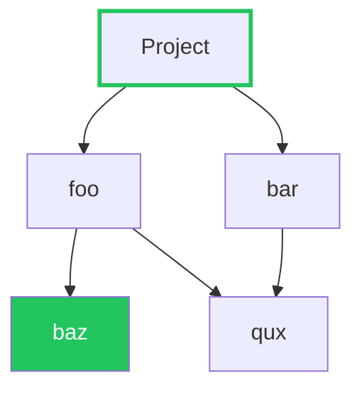
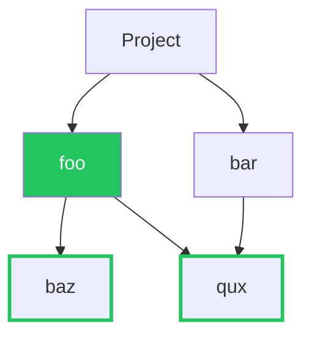
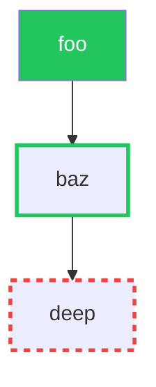
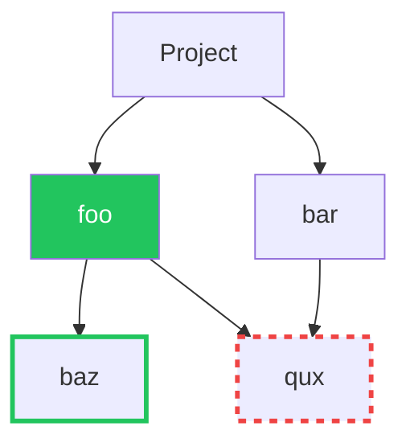

# 条件式

ポリシー条件は [CEL](../cel-expressions.md) を使用します。このページでは、ポリシー条件で利用できる入力、カスタム関数、式の例について説明します。

## 評価コンテキスト {#evaluation-contexts}

Dependency-Track には 2 種類のポリシーがあり、それぞれ独自の CEL 評価コンテキストを持ちます。

### コンポーネントポリシー {#component-policies}

[コンポーネントポリシー](component-policies.md)は個々のコンポーネントに適用されます。各条件は、プロジェクト内のすべてのコンポーネントに対して実行されます。

| 変数        | 型                                                  | 説明                                         |
|:------------|:----------------------------------------------------|:---------------------------------------------|
| `component` | [Component]                                         | 評価対象のコンポーネント                     |
| `project`   | [Project]                                           | コンポーネントが属するプロジェクト           |
| `vulns`     | list([Vulnerability])                               | コンポーネントに影響する脆弱性               |
| `now`       | [`google.protobuf.Timestamp`][protobuf-ts-docs]     | 評価開始時点の現在時刻                       |

### 脆弱性ポリシー {#vulnerability-policies}

[脆弱性ポリシー](vulnerability-policies.md)は単一の脆弱性に適用されます。各条件は、プロジェクト内のすべての脆弱性の検出結果に対して実行されます。

| 変数        | 型                                                  | 説明                                        |
|:------------|:----------------------------------------------------|:--------------------------------------------|
| `component` | [Component]                                         | 脆弱性が該当するコンポーネント              |
| `project`   | [Project]                                           | コンポーネントが属するプロジェクト          |
| `vuln`      | [Vulnerability]                                     | 評価対象の脆弱性                            |
| `now`       | [`google.protobuf.Timestamp`][protobuf-ts-docs]     | 評価開始時点の現在時刻                      |

2 つのコンテキストの違いは、脆弱性の公開方法だけです。コンポーネントポリシーは `vulns`(リスト)を反復処理し、脆弱性ポリシーは単一の `vuln` を受け取ります。以下で説明するカスタム関数はすべて、両方のコンテキストで利用できます。

!!! note
    [Component]、[Project]、[Vulnerability] の多くのフィールドはオプションです。アクセスする前に `has()` マクロを使って[オプションフィールドが存在するかどうかを確認](../cel-expressions.md#optional-field-checking)してください。

## 結果 {#result}

!!! note "5.3.0 以降で利用可能"

    それより前のバージョンでは、条件式は `bool` を返す必要があります。

条件式は `bool` または `string` のいずれかを返します。

* `true` は違反を記録し、`false` は記録しません。
* 空白でない文字列は違反を記録し、その文字列を違反メッセージとして使用します。Dependency-Track はメッセージの前後の空白を取り除き、1024 文字に切り詰めます。メッセージは、REST API では違反の `text` フィールドに、また `POLICY_VIOLATION` 通知と `NEW_POLICY_VIOLATIONS_SUMMARY` 通知に表示されます。
* 空白の文字列は違反を記録しません。

Dependency-Track は、式がそれ以外の型を返すコンポーネントポリシーの条件を拒否します。文字列を返すと、何かが一致したことだけでなく、*何が*一致したか(たとえば、どの脆弱性か、どのライセンスか)を条件で説明できます。例については[違反メッセージ](#violation-messages)を参照してください。

## 例 {#examples}

### コンポーネントの経過期間 {#component-age}

古いバージョンであることに加えて、コンポーネントの経過期間も潜在的なリスクを示す指標の 1 つです。コンポーネントが利用可能な最新バージョンであっても、20 年前のものである可能性があります。

次の式は、`now` 変数とタイムスタンプの演算を使って、2 年以上前の [Component] に一致します。

```js linenums="1"
has(component.published_at)
  && component.published_at < now - duration("17520h") // ~2 years
```

### コンポーネントの拒否リスト {#component-blacklist}

次の式は、[RE2] 構文の正規表現を使って、[Component] の [Package URL] に一致します。また、[`matches_range`](#matches_range) を使って、[Component] のバージョンが指定した [vers] の範囲に含まれるかどうかも確認します。

```js linenums="1"
component.purl.matches("^pkg:maven/com.acme/acme-lib\\b.*")
  && component.matches_range("vers:maven/>0|<1|!=0.2.4")
```

この式は次のものに一致します。

* `pkg:maven/com.acme/acme-lib@0.1.0`
* `pkg:maven/com.acme/acme-lib@0.9.9`

一方、次のものには一致しません。

* `pkg:maven/com.acme/acme-library@0.1.0`
* `pkg:maven/com.acme/acme-lib@0.2.4`

### 依存関係グラフの走査 {#dependency-graph-traversal}

次の式は、名前が `foo` の [Component] の(推移的な場合も含む)依存関係である [Component] に一致します。*ただし*、名前が `bar` の [Component] も [Project] に存在する場合*に限ります*。

```js linenums="1"
component.is_dependency_of(v1.Component{name: "foo"})
  && project.depends_on(v1.Component{name: "bar"})
```

コンポーネントが*直接*(つまり、推移的でない)依存関係かどうかを確認するには、次のようにします。

```js linenums="1"
component.is_direct_dependency_of(v1.Component{name: "foo"})
```

コンポーネントが別のコンポーネントを経由して*のみ*導入されているかどうか(つまり、依存関係グラフ内にそのコンポーネントに至る他の経路がないかどうか)を確認するには、次のようにします。

```js linenums="1"
component.is_exclusive_dependency_of(v1.Component{name: "foo"})
```

依存関係グラフの関数は、照合に次の [Component] フィールドをサポートします。

| フィールド    | `re:` プレフィックス | `vers:` プレフィックス |
|:--------------|:--------------------:|:----------------------:|
| `uuid`        |                      |                        |
| `group`       |          ✅           |                        |
| `name`        |          ✅           |                        |
| `version`     |          ✅           |           ✅            |
| `classifier`  |                      |                        |
| `cpe`         |          ✅           |                        |
| `purl`        |          ✅           |                        |
| `swid_tag_id` |          ✅           |                        |
| `is_internal` |                      |                        |

`re:` プレフィックスを付けると、フィールドの値に対して [RE2] の正規表現による照合を行います。

```js linenums="1"
project.depends_on(v1.Component{name: "re:^acme-.*"})
```

`vers:` プレフィックスを付けると、`version` フィールドに対して [vers] の範囲による照合を行います。

```js linenums="1"
project.depends_on(v1.Component{
  name: "acme-lib",
  version: "vers:maven/>1.0.0|<2.0.0"
})
```

!!! note
    [Component] などのオブジェクトをその場で構築する場合は、そのバージョンの名前空間(つまり `v1`)を使用してください。これにより型チェックが有効になり、後方互換性が確保されます。

### ライセンス式の許可リスト {#license-expression-allowlist}

次の式は、[SPDX ライセンス式][SPDX license expressions]が承認済みのセット以外のライセンスを必要とする、内部のものではない [Component] に一致します。ライセンスと例外の組み合わせは、1 つの複合エントリーとして記述します。

```js linenums="1"
!spdx_expr_allows(component.license_expression, [
  "MIT", "Apache-2.0", "BSD-3-Clause",
  "GPL-2.0-only WITH Classpath-exception-2.0"
])
```

コンポーネントにライセンス式がない場合は、`component.resolved_license.id` をフォールバックとして使えます。単一のライセンス ID も有効な SPDX 式であるため、同じようにバージョンを考慮した扱いを受けます。

```js linenums="1"
!spdx_expr_allows(
  has(component.license_expression)
    ? component.license_expression
    : component.resolved_license.id,
  ["MIT", "Apache-2.0"]
)
```

### ライセンスの拒否リスト {#license-blacklist}

次の式は、組織の内部のものでは**なく**、次のいずれかに該当する [Component] に一致します。

* 解決済みの [License] がまったくない
* 解決済みの [License] が `Permissive` ライセンスグループに含まれていない

```js linenums="1"
!component.is_internal && (
  !has(component.resolved_license)
    || !component.resolved_license.groups.exists(licenseGroup,
         licenseGroup.name == "Permissive")
)
```

### 脆弱性の拒否リスト {#vulnerability-blacklist}

次の式は、`3rd-party` のタグが付いた [Project] 内の [Component] のうち、指定した拒否対象の ID のいずれかに該当する [Vulnerability] を少なくとも 1 つ持つものに一致します。

```js linenums="1"
"3rd-party" in project.tags
  && vulns.exists(vuln, vuln.id in [
       "CVE-2017-5638",  // struts RCE
       "CVE-2021-44228", // log4shell
       "CVE-2022-22965", // spring4shell
     ])
```

### 外部公開プロジェクトにおける深刻度の高い脆弱性 {#vulnerabilities-with-high-severity-in-public-facing-projects}

次の式は、`public-facing` のタグが付いた [Project] 内の [Component] のうち、[CVSSv3] の攻撃元区分が `Network` である `HIGH` または `CRITICAL` の [Vulnerability] を少なくとも 1 つ持つものに一致します。

```js linenums="1"
"public-facing" in project.tags
  && vulns.exists(vuln,
    vuln.severity in ["HIGH", "CRITICAL"]
      && vuln.cvssv3_vector.matches(".*/AV:N/.*")
  )
```

### 悪用が確認されている脆弱性 {#known-exploited-vulnerabilities}

次の式は、[CISA KEV][cisa-kev] などの、悪用が確認されている脆弱性のカタログに掲載された [Vulnerability] を少なくとも 1 つ持つ [Component] に一致します。

```js linenums="1"
vulns.exists(vuln, vuln.is_kev)
```

まだカタログに掲載されていないものの、[EPSS] が今後 30 日以内に悪用される確率を 50% より高いと見積もっている脆弱性も対象にするには、次のようにします。

```js linenums="1"
vulns.exists(vuln, vuln.is_kev || vuln.epss_score > 0.5)
```

### 違反メッセージ {#violation-messages}

!!! note "5.3.0 以降で利用可能"

    それより前のバージョンでは、条件式は `bool` を返す必要があります。

次の式は、悪用が確認されている [Vulnerability] を持つ [Component] に一致し、その最初の脆弱性を違反メッセージで示します。`cel.bind` は一致した脆弱性を変数に割り当てるため、式の中でフィルターを繰り返す必要がありません。

```js linenums="1"
cel.bind(kev, vulns.filter(vuln, vuln.is_kev),
  kev.size() > 0
    ? "Component is affected by known exploited vulnerability " + kev[0].id
    : "")
```

何も一致しない場合に `""` を返すと、違反は記録されません。

### 脆弱性ポリシーで特定の CVE を抑制する {#suppressing-a-specific-cve-in-a-vulnerability-policy}

[脆弱性ポリシー](vulnerability-policies.md)では、サブジェクトは単一の脆弱性です。前述の `vulns.exists(...)` のパターンの代わりに、`vuln` のフィールドに直接アクセスします。

```js linenums="1"
vuln.id == "CVE-2022-41852"
  && component.name == "commons-jxpath"
  && component.is_dependency_of(v1.Component{
       group: "org.springframework.cloud",
       version: "vers:maven/>3.1|<3.3"
     })
```

### 上流のパッケージリポジトリとのハッシュの不一致 {#hash-mismatch-with-the-upstream-repository}

次の式は、宣言されたハッシュが、上流のパッケージリポジトリが同じアーティファクトについて報告するハッシュと一致しない [Component] に一致します。改ざんされたコンポーネントや、誤って固定されたコンポーネントを見つけるのに役立ちます。

```js linenums="1"
component.has_package_artifact_hash_mismatch()
```

`production` のタグが付いた [Project] に絞り込むには、次のようにします。

```js linenums="1"
"production" in project.tags
  && component.has_package_artifact_hash_mismatch()
```

照合の表と、`false` という結果が何を意味し、何を意味しないかについての注意事項は、[`has_package_artifact_hash_mismatch`](#has_package_artifact_hash_mismatch) を参照してください。

### バージョン距離 {#version-distance}

[`version_distance`](#version_distance) 関数を使うと、コンポーネントのバージョンが把握している最新バージョンからどれだけ遅れているかに基づいて照合できます。距離は、`epoch`、`major`、`minor`、`patch` フィールドを持つ [VersionDistance] オブジェクトで指定します。

次の式は、メジャーバージョンが 1 つより多く遅れているコンポーネントに一致します。

```js linenums="1"
component.version_distance(">=", v1.VersionDistance{major: 1})
```

## ライセンス式の扱い {#license-expression-handling}

`spdx_expr_*` 関数は [SPDX ライセンス式][SPDX license expressions]をチェックします。これらの関数は式の文字列(通常は `component.license_expression`)を対象に動作し、ライセンス式を持たないコンポーネントに対するフォールバックとして `component.resolved_license.id` でも動作します。

SPDX 仕様に従い、ライセンス ID の比較はすべて**大文字と小文字を区別しません**。

### バージョンの同等性 {#version-equivalence}

非推奨のライセンス ID は、対応する現行の ID に一致します。たとえば、`GPL-2.0` と `GPL-2.0-only` は同じライセンスに対応します。

### バージョンの範囲 {#version-ranges}

`+` 演算子と `-or-later` サフィックスは、「このバージョン、または同じライセンスファミリーのそれ以降の任意のバージョン」を意味します。たとえば、`GPL-3.0-only` は `GPL-2.0-or-later` を含む許可リストを満たし、`Apache-1.0+` は `Apache-2.0` を含む許可リストを満たします。

### 非推奨の `WITH` 複合 ID {#deprecated-with-compounds}

`GPL-2.0-with-classpath-exception` のような旧来の複合 ID は、現行の `WITH` 式の形式(`GPL-2.0-only WITH Classpath-exception-2.0`)に自動的に解決されます。

### `WITH` 複合 {#with-composites}

ライセンスと例外の組み合わせは、分割できない複合として扱われます。許可リストには、ライセンス ID と例外 ID を別々に記述するのではなく、複合全体(たとえば `"GPL-2.0-only WITH Classpath-exception-2.0"`)を 1 つのエントリーとして記述する必要があります。ライセンス部分はバージョンを考慮した照合を行います(たとえば、`GPL-2.0 WITH ...` は `GPL-2.0-only WITH ...` に一致します)が、例外部分は完全一致が必要です。

## 関数リファレンス {#function-reference}

型の定義については、[スキーマリファレンス](schema.md)を参照してください。

ポリシー条件では、[標準 CEL ライブラリ](../cel-expressions.md#standard-library)に加えて、Dependency-Track が登録する次のカスタム関数を利用できます。

### `depends_on` {#depends_on}

[Project] に、指定した条件に一致する [Component] が含まれているかどうかを確認します。プロジェクトに特定のコンポーネントが存在する場合にのみポリシーを適用したい場合に便利です。

| 名前        | 型          | 説明                                                                   |
|:------------|:------------|:-----------------------------------------------------------------------|
| *receiver*  | [Project]   | 確認対象のプロジェクト                                                 |
| `component` | [Component] | 照合する条件。`re:` プレフィックスと `vers:` プレフィックスをサポートします。 |

**戻り値:** 一致するコンポーネントがプロジェクトに存在する場合は `true`。

```js linenums="1"
project.depends_on(v1.Component{name: "baz"})
```



!!! tip
    `baz` が依存関係グラフ内に存在するため、`project` は一致します。

### `has_package_artifact_hash_mismatch` {#has_package_artifact_hash_mismatch}

[Component] の宣言されたハッシュが、上流のパッケージリポジトリが同じアーティファクトについて報告するハッシュと一致しないかどうかを確認します。

この関数は、MD5、SHA-1、SHA-256、SHA-512(パッケージリポジトリが通常報告するアルゴリズム)を比較します。比較はすべて大文字と小文字を区別しません。

| 名前       | 型          | 説明                     |
|:-----------|:------------|:-------------------------|
| *receiver* | [Component] | 確認対象のコンポーネント |

**戻り値:** 両方に共通するアルゴリズムのうち少なくとも 1 つで、両側の値が空でなく、かつ異なる場合は `true`。それ以外の場合はすべて `false` を返します。上流のメタデータが利用できない場合や、比較できる共通のアルゴリズムがない場合も `false` です。

```js linenums="1"
component.has_package_artifact_hash_mismatch()
```

| コンポーネントのハッシュ       | 上流のハッシュ                      | 結果    |
|:-------------------------------|:------------------------------------|:--------|
| `sha256: aaa…`                 | `sha256: aaa…`                      | `false` |
| `sha256: aaa…`(小文字)       | `sha256: AAA…`(大文字)            | `false` |
| `sha256: aaa…`                 | `sha256: bbb…`                      | `true`  |
| `sha256: aaa…`、`sha1: 012…`   | `sha256: aaa…`、`sha1: ff…`         | `true`  |
| `sha256: aaa…`                 | `sha1: 012…` のみ                   | `false` |
| `sha256: aaa…`                 | 報告なし                            | `false` |
| `sha3_512: ccc…` のみ          | `sha256: aaa…`                      | `false` |

!!! tip
    `false` という結果は、ハッシュが一致することを確認するもの**ではありません**。不一致の明確な証拠がないことを意味するだけです。上流のハッシュデータがないコンポーネントや、比較できる共通のアルゴリズムがないコンポーネントも `false` を返します。

!!! note
    Dependency-Track は上流のハッシュを非同期に解決します。BOM のアップロード後の最初のポリシー評価では、まだハッシュを利用できず、関数が `false` を返すことがあります。解決が完了すると、以降の評価でそのデータが使われます。

### `is_dependency_of` {#is_dependency_of}

[Component] が別の [Component] の(推移的な場合も含む)依存関係かどうかを確認します。

| 名前        | 型          | 説明                                                                             |
|:------------|:------------|:---------------------------------------------------------------------------------|
| *receiver*  | [Component] | 評価対象のコンポーネント                                                         |
| `component` | [Component] | 親と照合する条件。`re:` プレフィックスと `vers:` プレフィックスをサポートします。 |

**戻り値:** レシーバーが、一致するコンポーネントの依存関係(直接または推移的)である場合は `true`。

```js linenums="1"
component.is_dependency_of(v1.Component{name: "foo"})
```



!!! tip
    `baz` と `qux` はどちらも `foo` の依存関係であるため、一致します。`qux` は `bar` からも到達できますが、それでも一致します。

### `is_direct_dependency_of` {#is_direct_dependency_of}

[Component] が別の [Component] の*直接*(推移的でない)依存関係かどうかを確認します。

| 名前        | 型          | 説明                                                                             |
|:------------|:------------|:---------------------------------------------------------------------------------|
| *receiver*  | [Component] | 評価対象のコンポーネント                                                         |
| `component` | [Component] | 親と照合する条件。`re:` プレフィックスと `vers:` プレフィックスをサポートします。 |

**戻り値:** レシーバーが、一致するコンポーネントの直接の依存関係である場合は `true`。

```js linenums="1"
component.is_direct_dependency_of(v1.Component{name: "foo"})
```


!!! tip
    `baz` と `qux` はどちらも `foo` の直接の子であるため、一致します。

グラフがより深い場合、推移的な依存関係は一致**しません**。



!!! tip
    `baz` は `foo` の直接の子であるため、一致します。  
    `deep` は推移的な依存関係であるため、一致**しません**。

### `is_exclusive_dependency_of` {#is_exclusive_dependency_of}

[Component] が別の [Component] を経由して*のみ*導入されているかどうかを確認します。プロジェクトのルートからレシーバーに至るすべての経路が、一致するコンポーネントを通過する場合にのみ `true` を返します。

| 名前        | 型          | 説明                                                                             |
|:------------|:------------|:---------------------------------------------------------------------------------|
| *receiver*  | [Component] | 評価対象のコンポーネント                                                         |
| `component` | [Component] | 親と照合する条件。`re:` プレフィックスと `vers:` プレフィックスをサポートします。 |

**戻り値:** レシーバーが、一致するコンポーネントを経由してのみ導入されている場合は `true`。

```js linenums="1"
component.is_exclusive_dependency_of(v1.Component{name: "foo"})
```



!!! tip
    `baz` は `foo` を経由してのみ到達できるため、一致します。  
    `qux` は `bar` からも到達できるため、一致**しません**。

### `matches_range` {#matches_range}

[Component] または [Project] のバージョンが [vers] の範囲内にあるかどうかを確認します。

| 名前       | 型                       | 説明                                                       |
|:-----------|:-------------------------|:-----------------------------------------------------------|
| *receiver* | [Component] または [Project] | 確認対象のコンポーネントまたはプロジェクト             |
| `range`    | `string`                 | [vers] の範囲を表す文字列(たとえば `"vers:maven/>1.0.0\|<2.0.0"`) |

**戻り値:** バージョンが指定した範囲内にある場合は `true`。

```js linenums="1"
component.matches_range("vers:maven/>0|<1|!=0.2.4")
```

現在サポートされているバージョニングスキームは次のとおりです。

| バージョニングスキーム | エコシステム                     |
|:-----------------------|:---------------------------------|
| `deb`                  | Debian / Ubuntu                  |
| `generic`              | 汎用 / 任意                      |
| `golang`               | Go                               |
| `maven`                | Java / Maven                     |
| `npm`                  | JavaScript / NodeJS              |
| `rpm`                  | CentOS / Fedora / Red Hat / SUSE |

!!! note
    照合対象のコンポーネントのエコシステムが事前にわかっている場合は、`matches_range` で対応するバージョニングスキームを使用することをお勧めします。バージョニングスキームにはエコシステムごとに異なる細かな違いがあり、比較で誤りが起こりやすいため、正確性の向上につながります。

### `spdx_expr_allows` {#spdx_expr_allows}

[SPDX ライセンス式][SPDX license expressions]が、指定したライセンスのセットに限定した場合に成立するかどうかを確認します。`OR` 式では、少なくとも 1 つの分岐が充足可能である必要があります。`AND` 式では、すべての子が充足可能である必要があります。`WITH` 式は分割できない複合として扱われます(後述)。

| 名前         | 型             | 説明                                                         |
|:-------------|:---------------|:-------------------------------------------------------------|
| `expression` | `string`       | SPDX ライセンス式                                            |
| `ids`        | `list(string)` | 許可するライセンス。必要に応じて `WITH` 複合も含めます。     |

**戻り値:** 指定した ID で式が充足可能な場合は `true`。

```js linenums="1"
spdx_expr_allows(component.license_expression, ["MIT", "Apache-2.0"])
// "MIT"                  => true  (MIT is allowed)
// "MIT OR GPL-3.0-only"  => true  (MIT branch is satisfiable)
// "MIT AND Apache-2.0"   => true  (both are allowed)
// "MIT AND GPL-3.0-only" => false (GPL-3.0-only is not allowed)
// "GPL-3.0-only"         => false (not in the allowed set)
```

バージョン範囲による照合は自動的に適用されます。

```js linenums="1"
spdx_expr_allows(component.license_expression, ["GPL-2.0-or-later"])
// "GPL-2.0-only" => true  (2.0 is within 2.0-or-later range)
// "GPL-3.0-only" => true  (3.0 is within 2.0-or-later range)
// "GPL-1.0-only" => false (1.0 is below 2.0)
// "GPL-2.0"      => true  (deprecated ID, equivalent to GPL-2.0-only)
```

!!! tip
    `WITH` 式(ライセンスと例外の組み合わせ)は 1 つの単位として照合されます。許可するセットには、ライセンスと例外を別々に含めるのではなく、複合エントリー全体を含める必要があります。

    ```js linenums="1"
    spdx_expr_allows(component.license_expression, [
      "GPL-2.0-only WITH Classpath-exception-2.0"
    ])
    // "GPL-2.0-only WITH Classpath-exception-2.0" => true  (composite matches)
    // "GPL-2.0-only"                              => false (plain license, not in set)
    // "GPL-2.0-only WITH LLVM-exception"          => false (different composite)
    ```

### `spdx_expr_requires_any` {#spdx_expr_requires_any}

[SPDX ライセンス式][SPDX license expressions]を充足するあらゆる方法が、指定したライセンス ID の少なくとも 1 つを必要とするかどうかを確認します。`OR` 式では、ID の少なくとも 1 つがすべての分岐に現れる必要があります。`AND` 式では、ID の少なくとも 1 つが少なくとも 1 つの子に現れる必要があります。

| 名前         | 型              | 説明                       |
|:-------------|:----------------|:---------------------------|
| `expression` | `string`        | SPDX ライセンス式          |
| `ids`        | `list(string)`  | 確認対象のライセンス ID    |

**戻り値:** 充足するすべての方法が ID の少なくとも 1 つを必要とする場合は `true`。

```js linenums="1"
spdx_expr_requires_any(component.license_expression, ["GPL-2.0-only", "GPL-3.0-only"])
// "GPL-2.0-only AND MIT"         => true  (GPL-2.0-only always required)
// "GPL-2.0-only OR GPL-3.0-only" => true  (every branch requires one)
// "GPL-2.0 AND MIT"              => true  (GPL-2.0 is equivalent to GPL-2.0-only)
// "GPL-2.0-only OR MIT"          => false (MIT branch requires neither)
```

### `version_distance` {#version_distance}

[Component] の現在のバージョンと、把握している最新バージョンとの距離が、指定した [VersionDistance] に一致するかどうかを確認します。

| 名前       | 型                | 説明                                                |
|:-----------|:------------------|:----------------------------------------------------|
| *receiver* | [Component]       | 確認対象のコンポーネント                            |
| `operator` | `string`          | 数値の比較演算子: `<`、`<=`、`=`、`!=`、`>`、`>=` |
| `distance` | [VersionDistance] | 比較対象のバージョン距離                            |

**戻り値:** バージョン距離が比較条件を満たす場合は `true`。

```js linenums="1"
component.version_distance(">=", v1.VersionDistance{major: 1})
```

[CVSSv3]: https://www.first.org/cvss/v3.0/specification-document
[Component]: schema.md#component
[EPSS]: https://www.first.org/epss/
[License]: schema.md#license
[Package URL]: https://github.com/package-url/purl-spec/blob/master/PURL-SPECIFICATION.rst
[Project]: schema.md#project
[RE2]: https://github.com/google/re2/wiki/Syntax
[SPDX license expressions]: https://spdx.github.io/spdx-spec/v2.3/SPDX-license-expressions/
[VersionDistance]: schema.md#versiondistance
[Vulnerability]: schema.md#vulnerability
[cisa-kev]: https://www.cisa.gov/known-exploited-vulnerabilities-catalog
[protobuf-ts-docs]: https://protobuf.dev/reference/protobuf/google.protobuf/#timestamp
[vers]: https://github.com/package-url/vers-spec
